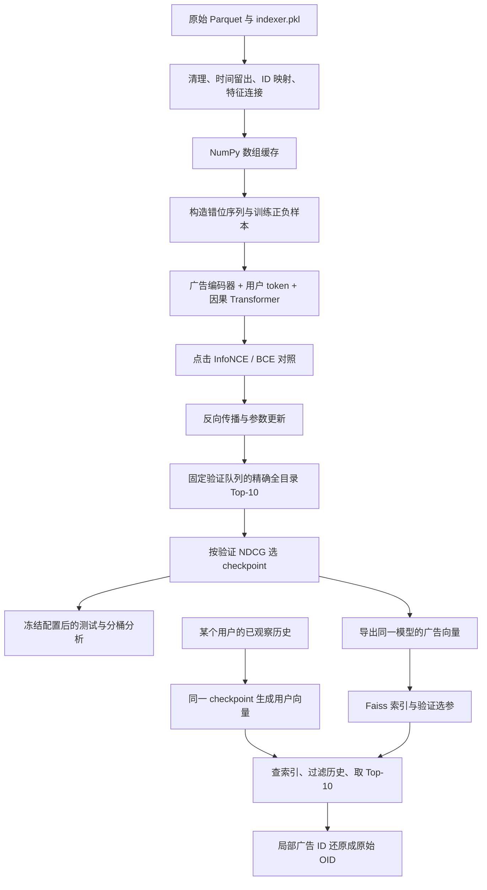

# 项目完整讲解：从 TencentGR-1M 原始数据到 Top-10 广告推荐

> 阅读对象：希望理解代码、亲自复现，并能在搜广推实习面试中讲清楚这个项目的同学。
>
> 讲解依据：当前工作区的实际代码、实际缓存和已保存实验结果。代码链接使用仓库相对路径与 GitHub 行号；以后修改代码时，以函数名为准。文中的“教学示例”使用虚构的 A/B/C 广告，标注为“实际样例”的内容才取自本地数据。
>
> 工作目录：`/home/jyk/project/baseline_2025`。

> 前面的主流程以当前保留的一层推荐模型为例；第 21、22 节记录后续冷启动与深度对照。验证集选中的实验方案不会自动覆盖现有推荐入口或索引。

> 当前路径按研究问题组织，数据与基线使用 `baseline`，目标函数与检索研究使用 `objective_study`。旧日期路径仅作为兼容链接，详见[目录结构](docs/directory_layout.md)。

## 阅读导航

1. [项目要解决什么问题](#s01)
2. [整体架构：训练、评估、推荐三条链](#s02)
3. [代码来源与目录分工](#s03)
4. [数据集有哪些表，实际长什么样](#s04)
5. [必须分清的 ID 和标签](#s05)
6. [原始数据怎样变成数组缓存](#s06)
7. [时间留出怎样防止目标提前出现](#s07)
8. [用完整例子构造训练、验证、测试样本](#s08)
9. [模型怎样编码广告和用户](#s09)
10. [Transformer 怎样建模历史兴趣](#s10)
11. [负采样、BCE、InfoNCE 和训练张量](#s11)
12. [训练循环、梯度和 checkpoint](#s12)
13. [为什么这样做消融与扩大复核](#s13)
14. [精确召回、HR 和 NDCG 怎样计算](#s14)
15. [训练好的模型怎样导出广告向量](#s15)
16. [Faiss、HNSW 和等价升维怎样工作](#s16)
17. [一个用户怎样得到最终 Top-10](#s17)
18. [实验结果和失败案例应该怎样读](#s18)
19. [如何运行、检查和完整复现](#s19)
20. [测试、边界、面试讲述和代码索引](#s20)
21. [冷启动与长尾：覆盖诊断、ID 遮蔽和候选融合](#s21)
22. [模型容量：一层、两层、四层的对照](#s22)

<a id="s01"></a>
## 1. 项目要解决什么问题

### 1.1 从一个推荐请求理解任务

假设我们已经观察到某个用户看过、点击过的一串广告，希望从一个大广告目录里，找出他接下来更可能点击的广告。

本项目的输入包括用户画像和历史广告，输出是十个广告 ID。数学上可以写成：

$$
q_u=f_\theta(\text{用户画像},\text{用户历史}),\qquad
v_i=g_\theta(\text{广告 ID},\text{广告属性},\text{广告内容向量})
$$

$$
s(u,i)=q_u^T v_i,\qquad
\text{推荐结果}=\operatorname{TopK}_{i\in\mathcal C}s(u,i).
$$

- `q_u` 是当前历史对应的用户兴趣向量。
- `v_i` 是候选广告向量。
- `C` 是固定候选目录。
- 内积越高，表示模型认为当前用户与广告越匹配。

这里的 query 是**检索查询向量**，不是用户输入的搜索关键词。

### 1.2 项目定位

它对应推荐、广告链路中的**序列召回**：在较大目录中找候选。候选之后可以再接精排、规则和业务策略，但本项目尚未实现那些模块。

当前模型输出的是连续向量，然后做检索。根目录虽然有 RQ-VAE 模块，但最终链路没有接入离散语义 ID、逐 token 广告 ID 生成或 beam search。不能把已经完成的工作描述为完整的语义 ID 生成式推荐系统。

TAAC2025 的数据和研究背景见[原论文](https://arxiv.org/abs/2604.04976)。本文重点解释当前仓库实际实现，实验指标来自本地代理任务，不是官方私有测试成绩。

### 1.3 当前完成的版本

| 项目 | 当前实际设置 |
|---|---|
| 数据来源 | TencentGR-1M 公开广告交互及特征 |
| 扩大实验抽样用户 | 300,000 |
| 满足留出条件的用户 | 280,985 |
| 训练前缀事件 | 19,361,659；包含曝光、点击和未知行为 |
| 固定候选广告 | 2,708,122 |
| 验证、测试用户 | 各 10,000；同一批用户的两个不同时刻 |
| 用户历史上限 | 100 个广告事件，另加一个用户 token |
| 向量维度 | 32 |
| Transformer | 1 层、1 个注意力头 |
| 最终训练目标 | 点击位置的 InfoNCE，64 个随机负样本 |
| 最终历史行为 Embedding | 未启用；该分支做过对照，但没有被验证集选中 |
| 内容特征 | 只启用 81 号预提取文本向量 |
| 检索 | 精确内积作为参照，等价升维后的 HNSW 用于近似检索 |

数据证据：[缓存 metadata](artifacts/objective_study/scale_data/metadata.json)。配置证据：[扩大实验配置](configs/objective_study.json)、[主模型实际配置](artifacts/objective_study/confirmation/selected_seed2026/config.json)。

<a id="s02"></a>
## 2. 整体架构：训练、评估、推荐三条链



**训练链**的任务是学习参数。它反复构造历史状态与下一广告，计算损失并更新权重。

**评估链**不更新参数。它拿历史生成一个用户向量，在完整候选目录上取前十，再与留出的点击比较。

**推荐链**复用已训练参数。广告向量可以提前计算并建索引，每次请求只需编码用户历史、查索引和还原 ID。

关键分工是：**Transformer 处理历史序列，广告编码器处理单个候选。** 不会为 270 万个候选分别运行一次 Transformer，也不会把所有候选与用户历史一起做交叉注意力。

<a id="s03"></a>
## 3. 代码来源与目录分工

### 3.1 上游与当前实现

上游是 [TencentAdvertisingAlgorithmCompetition/baseline_2025](https://github.com/TencentAdvertisingAlgorithmCompetition/baseline_2025)，当前本地 remote 是 [J-OneK/baseline_2025](https://github.com/J-OneK/baseline_2025)。仓库基础提交为 `c4481fb`；本文解释的新增项目代码还包含工作区改动，不能仅用这个旧提交号代表完整实现。

需要分清两组入口：

| 代码 | 作用 | 是否产生本项目最终报告 |
|---|---|---|
| 根目录 `main.py / dataset.py / model.py / infer.py / eval.py` | 旧基线链路，保留兼容修复 | 否 |
| `taac_retrieval/` | 新增的数组化数据、训练、评估与检索链路 | 是 |
| 根目录 `model.py` 中的注意力、前馈类 | 被新模型直接复用 | 是，作为子模块 |
| `model_rqvae.py` | 语义 ID 方向的扩展代码 | 未接入最终主流程 |

例如，新模型在 [taac_retrieval/model.py:14](taac_retrieval/model.py#L14) 导入了根目录的 `FlashMultiHeadAttention` 和 `PointWiseFeedForward`。它不是另起一套毫无关系的模型，也不是完整照搬旧训练脚本。

### 3.2 目录地图

```text
baseline_2025/
├── TencentGR-1M/                 原始数据，不随实验改写
├── taac_retrieval/
│   ├── prepare.py               数据清理、切分、数组缓存
│   ├── data.py                  Dataset、输入构造、负采样
│   ├── model.py                 用户/广告编码、因果 Transformer
│   ├── objectives.py            监督权重、BCE、InfoNCE
│   ├── train.py                 训练与验证选 checkpoint
│   ├── study.py                 消融排队、模型方案冻结
│   ├── cohorts.py               冻结新的评估用户队列
│   ├── metrics.py               精确检索、HR/NDCG、热门基线
│   ├── evaluate_checkpoint.py   最终独立评估与模型加载
│   ├── export.py                广告/用户向量导出
│   ├── ann.py                   索引 ID、过滤、等价升维适配器
│   ├── benchmark_ann.py         建图、选参、计时与召回比较
│   ├── recommend.py             用户历史到 Top-10 的完整演示
│   ├── audit.py                 全缓存不变量检查
│   └── week_report.py           统计、案例、图表和最终报告
├── configs/                     开发、扩大、索引配置
├── scripts/                     基线阶段与目标函数与检索研究的复现入口
├── tests/                       数据、损失、索引、选参回归检查
├── artifacts/                   缓存、checkpoint、索引、逐用户结果
└── reports/                     小体积、可阅读的实验报告
```

旧 `main.py` 的随机用户划分和验证 BCE 不等于新项目的时间留出推荐评估；旧 `eval.py` 主要负责导出预测。不要混用两套 checkpoint 或把旧脚本的 loss 当作这里的 HR/NDCG。

### 3.3 旧基线的入口分别在做什么

原始代码也值得理解，它提供了当前模型的起点：

```text
main.py
  → MyDataset：加载 Parquet 与特征字典，创建正负样本
  → BaselineModel：融合特征，Transformer 编码序列，输出正负内积
  → BCE 训练、随机用户验证、保存旧格式模型

eval.py
  → infer.py：恢复 BaselineModel 与 MyTestDataset
  → 编码官方候选广告，保存 embedding.fbin 与 id.u64bin
  → 编码用户历史，保存 query.fbin
  → 调用 faiss-based-ann/faiss_demo 外部二进制检索
  → retrieval_id 还原 OID，写 result.json
```

| 文件/函数 | 对照源码时怎么读 |
|---|---|
| [main.py:130](main.py#L130) 附近的主入口 | 初始化日志、数据目录、Dataset 与模型；随机按用户分 90%/10%；Adam 优化正负 BCE。这里的验证是 loss，不是完整候选推荐评估 |
| [MyDataset.__init__](dataset.py#L108) | 将序列和静态特征读入内存，加载 `indexer` 与内容向量，建立缺省值和特征分组 |
| [MyDataset.__getitem__](dataset.py#L263) | 插入用户 token、右移正样本、左填充、排除已见广告采负例，同时返回大量逐位置特征字典 |
| [BaselineModel.feat2tensor](model.py#L187) | 将字典形式的字段组装成数值张量，包含多值列表补齐 |
| [BaselineModel.feat2emb](model.py#L227) | ID、单值、多值、内容向量分别编码，再拼接投影，按 token 类型区分用户和广告 |
| [BaselineModel.log2feats](model.py#L314) | 位置向量、因果注意力、前馈层与归一化，得到各位置状态 |
| [BaselineModel.forward](model.py#L354) | 状态分别与下一广告、负广告算内积，为 BCE 提供 logits |
| [MyTestDataset.__getitem__](dataset.py#L499) 与 [predict](model.py#L395) | 创建完整可见历史，用最后状态作为用户检索向量 |
| [get_candidate_emb_parquet](infer.py#L103) | 处理官方候选表的特殊字段、冷启动值、OID/RID 与 `retrieval_id`，并导出候选向量 |
| [infer](infer.py#L225) | 载入旧格式 `model.pt`，导出向量，调用 C++ Faiss 可执行程序，还原结果 ID |
| [eval.py](eval.py) | 包装推理、记录耗时、写结果；末尾会清理结果目录中的中间文件，只保留 `result.json` |

新的 `taac_retrieval` 把“准备特征、构造样本、选择目标、评估全库、建索引”拆成独立模块，并把训练中的逐条字典处理换成数组索引。它复用基本序列建模思想，但样本协议、词表大小和参数名均已变化，旧 `model.pt` 不能直接作为新 `best.pt` 使用。

旧训练辅助函数里有保存 optimizer 的 `latest.pt`；新的 `train.py` 只保存推断/评估所需最佳权重。两套保存机制不同，不能看到旧文件支持恢复，就宣称新入口也已经实现完整断点续训。

### 3.4 `model_rqvae.py` 为什么没有出现在推荐主链中

[RQVAE](model_rqvae.py#L356) 是另一个研究方向的模块：先把输入向量编码成 latent，经过多级残差向量量化，每级选择一个码字，将多个整数拼成语义 ID，再解码重建原向量。

```text
输入向量 → RQEncoder → latent
                       ↓
              第 1 级码本选一个向量
                       ↓ 量化残差
              第 2 级码本继续拟合残差
                       ↓ ...
            [code_1, code_2, ...] + 累加量化向量
                                      ↓
                                  RQDecoder
                                      ↓
                             重建误差 + 量化损失
```

来源：[RQ.quantize](model_rqvae.py#L306)、[RQVAE.forward](model_rqvae.py#L404)。这说明仓库具备量化模块，不代表已经训练好广告 tokenizer，更不代表当前 Transformer 在生成这些 code。

要真正走离散语义 ID 路线，还需要广告编码与 tokenizer 的训练/导出、离散 ID 冲突处理、序列到 code 的生成训练、约束解码及 ID 还原等环节。当前已完成的路线是后文的连续向量检索。

<a id="s04"></a>
## 4. 数据集有哪些表，实际长什么样

### 4.1 文件布局

TencentGR-1M 提供约 100 万用户、约 478 万广告的公开表，以及多个内容向量目录。文件是 Snappy 压缩的 Parquet，能保留列表、结构体等嵌套类型。

| 路径 | 主要字段 | 原始规模 | 用途 |
|---|---|---:|---|
| `seq/` | `user_id`, `seq` | 1,001,845 个用户 | 行为历史 |
| `user_feat/` | `user_id`, 8 个用户特征字段 | 1,001,845 行 | 用户画像 |
| `item_feat/` | `item_id`, 13 个广告属性字段 | 4,783,154 行 | 广告属性 |
| `candidate/` | `item_id`, `retrieval_id`, 属性结构体 | 660,000 行 | 官方候选表；本地主要检查覆盖率 |
| `mm_emb/emb_81_32_parquet/` | `anonymous_cid`, `emb` | 4,742,961 行 | 本项目启用的 32 维文本向量 |
| `mm_emb/` 其余目录 | 不同维度内容向量 | 82–86 号 | 当前最终模型未启用 |
| `indexer.pkl` | `i`, `u`, `f` 等映射 | — | ID 与特征编码说明 |

字段说明来源：[本地数据卡](TencentGR-1M/README.md)。下面各表的实际样例分别读取各自第一行，**它们不是同一用户与同一广告的关联结果**。

### 4.2 `seq`：一行就是一个用户的嵌套序列

实际第一行的前三个事件：

```json
{
  "user_id": 953188,
  "seq": [
    {"item_id": 2905777, "action_type": 0, "timestamp": 1745919240},
    {"item_id": 728757, "action_type": 0, "timestamp": 1745919475},
    {"item_id": 3161041, "action_type": 0, "timestamp": 1746024819}
  ]
}
```

这里 `item_id` 是原数据 RID，`timestamp` 是时间戳。原始 `action_type=0` 表示曝光，`1` 表示点击。实际文件中还有空行为值，因此代码不能假设所有事件都只有 0/1。

用户画像不在这三个事件里；用户 token 是后续代码根据 `user_feat/` 创建的。

### 4.3 `item_feat`：广告的匿名离散属性

```json
{"item_id":26,"100":4,"101":5,"102":81603,"112":14,"114":3,
 "115":null,"116":8,"117":382,"118":692,"119":3077,
 "120":640,"121":2011258,"122":67985}
```

`100`、`101` 等是特征字段编号，值已经被编码。它们不是可以直接按数值大小比较的连续变量，也没有公开语义，因此不能擅自断言某字段一定是品类、年龄或性别。

模型为每个离散字段建立独立 Embedding 表。`null` 在准备阶段补成 0。

### 4.4 `user_feat`：单值与多值特征

```json
{"user_id":19,"103":36,"104":2,"105":7,"106":[6],
 "107":[15],"108":null,"109":2,"110":null}
```

单值字段为 `103/104/105/109`；多值字段为 `106/107/108/110`。多值可以理解为一组匿名类别。模型查表后求和，当前没有对这些列表再运行一个 Transformer。

### 4.5 `mm_emb`：提供的是向量，不是原始广告素材

实际样例：

```json
{"anonymous_cid":"20000000029",
 "emb":[0.15403946,-0.21125971,0.11637048,-0.20939584]}
```

这里只展示前四维，实际 81 号向量有 32 维。原文件元素为 double，本项目转换为 float32。

`anonymous_cid` 是字符串形式的原始广告 OID。81 号为预提取文本向量；推荐模型训练其投影层，不训练生成这些向量的文本编码器。虽然原数据还提供 82–86 号向量，最终实验只加载 81，不能称为已经完成文图融合。

### 4.6 `candidate`：另一种 ID 与特征格式

实际第一行节选：

```json
{"item_id":20000006363,"retrieval_id":0,
 "100":{"cold_start":0,"feature_value":"6"},
 "102":{"cold_start":0,"feature_value":"63599"},
 "115":{"cold_start":null,"feature_value":null}}
```

这张表的 `item_id` 是 OID，不是 `seq.item_id` 的 RID。属性也不是直接的整数列，而是包含 `cold_start` 和 `feature_value` 的结构体。

兼容旧推理时，`cold_start=0` 的有效值可以转为整数，未知/缺失值回退 0，见 [infer.py:96](infer.py#L96) 的 `parse_candidate_feature`。

新项目的本地候选池从所选公开序列构建，不直接等于这张官方表。两者的区别将在下一节和第 6 节说明。

<a id="s05"></a>
## 5. 必须分清的 ID 和标签

### 5.1 广告一共有几层 ID

同一广告在不同阶段使用不同编号，不能因为都叫 `item_id` 就直接互相查询。

| 名称 | 作用 | 当前映射 |
|---|---|---|
| 原始 OID | 还原广告身份、连接内容向量 | `catalog_oids[local_id]` |
| 原数据 RID | `seq`、`item_feat` 内部编号 | `indexer['i'][OID]`；缓存有 `catalog_rids` |
| 本项目目录 local ID | 为本次抽样目录紧凑编号 | `items.npy`、特征数组行号；0 留给填充 |
| 可学习广告 Embedding ID | 只有训练前缀出现过的广告分配独立行 | `item_id_lookup[local_id]` |
| Faiss 行号 | 索引内部从 0 编号 | 本项目为 `local_id - 1` |
| 官方 `retrieval_id` | 官方候选表的检索编号 | 新链路没有拿它当本地 Faiss 行号 |

真实例子：实际演示用户最后一条历史广告对应：

```text
OID                     20000009236
原数据 RID              4445322
本项目 local ID         2516812
可学习 Embedding ID     2217412
本项目 Faiss 行号       2516811
```

OID 超过了 32 位有符号整数上限，所以保持 int64。RID/local ID 的当前范围较小，缓存可以用 int32；送进部分模型输入时再转成 int64。

**local ID 为正，不代表它在训练中出现过。** 一个留出广告可以存在于公开目录、拥有正的 local ID，但若 `train_counts[local_id]==0`，它的可学习 ID 就映射为 0。它仍可使用属性和内容向量编码，并不等于把整条广告向量强行设为 0。

代码来源：[prepare.py:144](taac_retrieval/prepare.py#L144) 建局部目录，[prepare.py:161](taac_retrieval/prepare.py#L161) 建训练可见 ID 映射，[ann.py:29](taac_retrieval/ann.py#L29) 将检索结果加 1。

### 5.2 用户也有两种常见编号

`user_rids.npy[row]` 保存原数据用户 RID，模型收到的用户 ID 是 `row + 1`。这是因为本次只保留部分用户，原始用户 RID 不再连续。

实际演示中：用户 RID 为 12，位于缓存第 2 行，模型用户 ID 为 3。命令中的 `--index 0` 则是**冻结评估队列的第 0 个样本**，既不是用户 RID 0，也不是模型 ID 0。

代码来源：[data.py:60](taac_retrieval/data.py#L60) 的 `SequenceDataset.__getitem__`。

### 5.3 三套“0/1/2”不能混在一起

| 字段 | 数值含义 |
|---|---|
| 原始 `action_type` | 0=曝光，1=点击，空值=未知 |
| 缓存/输入 `actions` | 0=填充或用户位置，1=曝光，2=点击，3=未知 |
| 输入 `kinds` | 0=填充，1=广告 token，2=用户 token |
| BCE 的训练标签 | 1=真实下一广告，0=随机负样本 |
| InfoNCE 的分类标签 | 0=“拼接后的第 0 列是正样本” |

因此，看到 InfoNCE 代码中 `torch.zeros(...)`，不能解释成“所有目标都是曝光”；看到 BCE 正样本标签 1，也不能解释成“所有正样本都是点击”。

<a id="s06"></a>
## 6. 原始数据怎样变成数组缓存

入口：[prepare.py:81](taac_retrieval/prepare.py#L81) 的 `prepare`。

### 6.1 先固定抽样用户

代码从用户表里以固定种子无放回抽样，不是直接取 Parquet 前 30 万行。随后用 Arrow scanner 批量扫描序列表，只把抽中的用户转换成 Python 对象。

核心节选：

<!-- source-snippet: taac_retrieval/prepare.py:L95-L108 -->
```python
    rng = np.random.default_rng(args.seed)
    users_table = ds.dataset(root / 'user_feat', format='parquet')
    all_users = users_table.to_table(columns=['user_id'])['user_id'].to_numpy()
    sampled = np.sort(rng.choice(all_users, min(args.max_users, len(all_users)), replace=False))
    selected = np.zeros(int(all_users.max()) + 1, dtype=bool)
    selected[sampled] = True
    del all_users
    user_ids, records = [], []
    audit = Counter()
    sequences = ds.dataset(root / 'seq', format='parquet')
    log(f'Sampling {len(sampled)} users uniformly, scanning chronological sequences')
    for batch in sequences.scanner(columns=['user_id', 'seq'], batch_size=4096).to_batches():
        uids = batch.column('user_id').to_numpy()
        batch = batch.filter(pa.array(selected[uids]))
```

这有两个目的：减少数据转换开销；避免“直接取文件头部”与文件排序相结合带来的取样偏差。

抽样 300,000 人后，排除不满足本地留出条件的 19,015 人，剩下 280,985 人。排除不是模型效果筛选，而是因为无法为这些用户构造所要求的两个目标和足够早期历史。

### 6.2 清理与编码事件

每条序列执行：

1. 丢弃事件为空、广告 ID 缺失/非正、时间戳缺失的记录。
2. 按时间稳定排序；同时间保留原相对顺序。
3. 保留最近最多 100 个广告事件。
4. 原始曝光、点击、其他/未知行为编码为 1、2、3。
5. 构造训练截止点和验证/测试目标，规则见第 7 节。

未知行为不会被静默当成曝光。它可以作为已经观察到的上下文，但不会提供训练监督标签。

### 6.3 目录与计数

代码取这些保留用户序列中出现过的全部不同广告，建立固定 local ID 目录。`train_counts` 则只统计各用户训练截止点之前的事件。

<!-- source-snippet: taac_retrieval/prepare.py:L144-L163 -->
```python
    catalog_rids = np.unique(items)
    if catalog_rids[0] != 0:
        catalog_rids = np.r_[np.int32(0), catalog_rids]
    # Local IDs are compact, independent of original integer/string OID types.
    rid_to_local = np.zeros(int(catalog_rids.max()) + 1, dtype=np.int32)
    rid_to_local[catalog_rids] = np.arange(len(catalog_rids), dtype=np.int32)
    items = rid_to_local[items]
    train_counts = np.zeros(len(catalog_rids), dtype=np.int64)
    for i, cut in enumerate(vectors['train_cut']):
        np.add.at(train_counts, items[i, :cut], 1)
    train_counts[0] = 0
    save_array(out, 'items', items)
    save_array(out, 'actions', actions)
    save_array(out, 'timestamps', times)
    save_array(out, 'user_rids', user_ids)
    save_array(out, 'catalog_rids', catalog_rids)
    save_array(out, 'train_counts', train_counts)
    id_lookup = np.zeros(len(catalog_rids), dtype=np.int32)
    id_lookup[train_counts > 0] = np.arange(1, np.count_nonzero(train_counts) + 1, dtype=np.int32)
    save_array(out, 'item_id_lookup', id_lookup)
```

注意两者来源不同：

- **目录**允许包含公开序列中的留出广告，属于静态目录可见的假设。
- **热门计数、负样本池、可学习 ID 词表**只由训练前缀决定。

构造目录时没有根据目标名单逐个补候选，也没有根据模型分数改变候选池；但目录确实来自包含留出事件的公开序列，不能称为一个完全不知道未来广告身份的线上目录回放。

扩大实验中，2,708,122 个目录广告里有 2,385,886 个在训练前缀出现过。其他广告的可学习 ID 回退到 0。

### 6.4 广告属性词表只在训练可见广告上拟合

原 `item_feat` 的属性值已有全局编码，但本项目再做一层局部紧凑映射。例如一个字段的训练可见取值为 `[0, 7, 19]`，会映射为 `[0, 1, 2]`；其他候选上的未见取值回退到 0。

这里 `[0,7,19]` 是教学例子，不是实际某字段的完整取值。

原样代码：

<!-- source-snippet: taac_retrieval/prepare.py:L192-L202 -->
```python
    for j, field in enumerate(ITEM_FIELDS):
        # Fit each categorical vocabulary only on training-visible items.
        vocabulary = np.unique(np.r_[np.int32(0), item_sparse[train_counts > 0, j]])
        pos = np.searchsorted(vocabulary, item_sparse[:, j])
        bounded = np.minimum(pos, len(vocabulary) - 1)
        known = (pos < len(vocabulary)) & (vocabulary[bounded] == item_sparse[:, j])
        field_oov[field] = float((~known[1:]).mean())
        item_sparse[:, j] = np.where(known, pos, 0)
        feature_sizes[field] = len(vocabulary)
        save_array(out, f'item_vocabulary_{field}', vocabulary)
    save_array(out, 'item_sparse', item_sparse)
```

`item_vocabulary_*.npy` 保存反向解释这种编码所需的取值数组，`metadata.feature_sizes` 记录各表大小。

用户特征使用给定的匿名字段编码空间，加载的是保留用户的静态画像。当前没有用户画像的历史快照，不能据此声称画像也经过了严格的时点可用性回放。

### 6.5 内容向量连接为什么重要

原始序列用 RID，内容用字符串 OID。因此需要：

```text
local ID → 原 RID 对应的 OID → 内容表字符串 OID → 内容向量
```

旧代码中，整数 OID 直接查询字符串键字典会无法命中。新准备流程先统一整数 OID，再通过排序与 `searchsorted` 批量连接。

<!-- source-snippet: taac_retrieval/prepare.py:L226-L249 -->
```python
    # Join integer OIDs after Arrow casts the string content keys to int64.
    mm = np.zeros((len(catalog_rids), 32), dtype=np.float32)
    mm_present = np.zeros(len(catalog_rids), dtype=bool)
    oid_order = np.argsort(oids)
    sorted_oids = oids[oid_order]
    source = ds.dataset(root / 'mm_emb/emb_81_32_parquet', format='parquet')
    for batch in source.scanner(columns=['anonymous_cid', 'emb'], batch_size=32768).to_batches():
        batch_oids = pc.cast(batch.column('anonymous_cid'), pa.int64()).to_numpy()
        pos = np.searchsorted(sorted_oids, batch_oids)
        bounded = np.minimum(pos, len(sorted_oids) - 1)
        keep = ((pos < len(sorted_oids)) & (sorted_oids[bounded] == batch_oids)
                & batch.column('emb').is_valid().to_numpy(zero_copy_only=False))
        if not keep.any():
            continue
        emb = batch.filter(pa.array(keep)).column('emb')
        lengths = pc.list_value_length(emb).to_numpy()
        if not np.all(lengths == 32):
            raise ValueError('Embedding 81 contains a vector with an unexpected dimension.')
        values = pc.cast(pc.list_flatten(emb), pa.float32()).to_numpy(zero_copy_only=False).reshape(-1, 32)
        usable = np.isfinite(values).all(axis=1)
        audit['unusable_mm81_vectors'] += int((~usable).sum())
        local = oid_order[pos[keep]]
        mm[local[usable]] = values[usable]
        mm_present[local[usable]] = True
```

只有维度正确、数值有限的有效向量被写入缓存。缺失内容补零，并另存 `mm_present`，所以后面能分析“有无内容”分桶。

扩大目录的有效内容覆盖率约 **95.20%**。补零表示内容缺失，不表示该广告应该被推荐或不应该被推荐。

### 6.6 为什么不直接把所有数据放进字典

旧实现会把 Parquet 大量转换成嵌套字典，并在 forward 内循环把特征组装成张量。新链路将列式数据准备成数组，训练时按整数下标查表。

当前扩大缓存的主要样式：

| 文件 | shape | dtype | 含义 |
|---|---|---|---|
| `items.npy` | `[280985,100]` | int32 | 每个用户的完整保留事件，广告为 local ID，尾部补零 |
| `actions.npy` | `[280985,100]` | uint8 | 与事件对齐的行为编码 |
| `timestamps.npy` | `[280985,100]` | int64 | 时间戳 |
| `lengths.npy` | `[280985]` | int32 | 有效事件长度 |
| `train_cut/val_cut/test_cut.npy` | `[280985]` | int32 | 上下文的右开截止位置 |
| `val_pos/test_pos.npy` | `[280985]` | int32 | 目标所在事件位置 |
| `catalog_oids.npy` | `[2708123]` | int64 | local ID 还原 OID，含第 0 行 |
| `item_id_lookup.npy` | `[2708123]` | int32 | local ID 到训练可见 Embedding ID |
| `item_sparse.npy` | `[2708123,13]` | int32 | 广告属性编码 |
| `item_mm81.npy` | `[2708123,32]` | float32 | 文本向量 |
| `user_sparse.npy` | `[280986,4]` | int32 | 用户单值属性，含第 0 行 |
| `user_array_106.npy` | `[280986,8]` | int32 | 第 106 字段的多值列表，右侧补零 |

**缓存尾部补零**与**模型输入左侧补零**是不同阶段的安排，后面会分别展示。

[data.py:11](taac_retrieval/data.py#L11) 用 `np.load(..., mmap_mode='c')` 读取缓存。它是文件映射、写时复制模式，不是每次把所有事件复制一份。模型则将需要查表的静态特征注册为 buffer，移到 GPU 后可直接索引。

### 6.7 为什么不直接使用官方 66 万候选

官方候选对应官方未来预测任务，本地目标是从公开历史中截出的另一次点击，两者不是同一套答案。

在扩大实验里，官方候选覆盖本地验证目标约 73.35%、测试目标约 81.01%。若不检查覆盖率，就会把许多“根本不在候选池里”的目标算成模型错误。

所以本地实验固定使用公开抽样目录，所有模型共享该目录，目标覆盖率为 100%。这个 100% 是**目录覆盖率**，不是模型召回率。

### 6.8 缓存怎样避免误复用

[prepare.py:66](taac_retrieval/prepare.py#L66) 对相关文件的路径、大小、修改时间等生成签名；[prepare.py:87](taac_retrieval/prepare.py#L87) 比较准备配置，发生变化就拒绝复用；完成标记 `metadata.json` 最后写入。

这个 source signature 是文件清单与元信息签名，不是对全部 Parquet 内容逐字节求哈希。它能检测常见输入变化，但不应描述为原始数据内容的完整密码学校验。

<a id="s07"></a>
## 7. 时间留出怎样防止目标提前出现

入口：[prepare.py:27](taac_retrieval/prepare.py#L27)，`clean_and_split`。

### 7.1 为什么不是简单随机拆分事件

如果把同一用户的事件随机分到训练和测试，较晚的行为可能进入训练，而较早的点击却成了测试目标。模型会接触预测时不应知道的信息。

这里采用**用户内部的时间留出**：每个用户都保留早期前缀用于训练，再保留较晚的验证点击和测试点击。它不是把用户随机分成互不相交的训练用户与测试用户，因此也不是严格的新用户评估。

### 7.2 哪些点击能当目标

点击必须同时满足：原始行为值为 1；该广告此前没有在此用户的保留序列中出现；目标前面至少有 5 个严格更早的有效事件。

选择最后一个符合条件的点击作为测试，再从更早时间的合格点击里选最后一个作为验证。时间相同的两个点击不会被当成一前一后的验证、测试目标。

核心选择代码：

<!-- source-snippet: taac_retrieval/prepare.py:L41-L62 -->
```python
    seen, eligible = set(), []
    times = np.array([int(e['timestamp']) for e in clean], dtype=np.int64)
    for pos, event in enumerate(clean):
        item = int(event['item_id'])
        cut = int(np.searchsorted(times, times[pos], side='left'))
        if event.get('action_type') == 1 and item not in seen and cut >= min_history:
            eligible.append((pos, cut))
        seen.add(item)
    if len(eligible) < 2:
        return None
    test_pos, test_cut = eligible[-1]
    earlier = [(p, c) for p, c in eligible[:-1] if times[p] < times[test_pos]]
    if not earlier:
        return None
    val_pos, val_cut = earlier[-1]
    # Targets and all later events are absent from the training prefix.
    return {
        'items': [int(e['item_id']) for e in clean],
        'actions': [1 if e.get('action_type') == 0 else
                    2 if e.get('action_type') == 1 else 3 for e in clean],
        'times': times, 'train_cut': val_cut, 'val_cut': val_cut,
        'test_cut': test_cut, 'val_pos': val_pos, 'test_pos': test_pos,
```

### 7.3 为什么限制“首次出现广告的点击”

考虑：

```text
看见广告 X → 发生其他行为 → 点击广告 X
```

如果直接把最后的点击作为目标，历史里已经有目标 X。项目当前缺少可靠的曝光—点击关联 ID，难以精确判断哪一次曝光必须从历史移走。

本地协议采用保守办法：不把之前出现过的广告点击作为留出目标。它降低了目标身份提前出现在输入里的风险，但也**改变了任务定义**：本项目评估的是“保留历史内首次出现广告的点击”，不是所有重复点击或真实线上完整分布。

“首次出现”只针对最多 100 条公开保留事件，不能解释成该用户一生中第一次看见此广告。

### 7.4 截止点与目标位置的区别

- `val_pos/test_pos`：目标事件的下标，0 开始。
- `val_cut/test_cut`：上下文右开区间的终点，历史为 `items[:cut]`。
- `train_cut = val_cut`：训练只使用验证目标时间之前的事件。

`np.searchsorted(times, target_time, side='left')` 使同时间的其他事件也不进入历史。如果目标时间没有并列，`cut` 常常等于 `pos`；存在并列时，`cut` 可以更小。

训练前缀不含验证目标及其后的事件。测试时验证点击已经在更早时刻发生，所以验证点击可以进入测试历史；这不会更新模型权重，也不等于拿测试答案训练。

### 7.5 新评估队列怎样冻结

第一次 100k 抽样实验已经查看过 2,000 名用户的测试结果。后续扩大实验通过 [cohorts.py:13](taac_retrieval/cohorts.py#L13) 排除这些用户，再用固定种子 3107 抽取 10,000 名用户。

<!-- source-snippet: taac_retrieval/cohorts.py:L14-L26 -->
```python
    data, previous = PreparedData(cache), PreparedData(previous_cache)
    excluded = previous.user_rids[previous.eval_indices]
    eligible = np.flatnonzero(~np.isin(data.user_rids, excluded))
    if len(eligible) < count:
        raise ValueError('Not enough fresh evaluation users.')
    selected = np.sort(np.random.default_rng(seed).choice(eligible, count, replace=False)).astype(np.int64)
    output = Path(output)
    output.parent.mkdir(parents=True, exist_ok=True)
    if output.exists():
        np.testing.assert_array_equal(np.load(output), selected)
    else:
        np.save(output, selected)
    assert not np.isin(data.user_rids[selected], excluded).any()
```

冻结结果保存在 [confirm_eval_indices.json](artifacts/objective_study/confirm_eval_indices.json)，与早期测试用户重叠为 0。这批用户仍会贡献各自的训练前缀；“新的评估队列”不是“整个用户完全没参与过训练”。

准备缓存也自带 `eval_indices.npy`，但扩大复核实际用的是独立冻结的 `confirm_eval_indices.npy`。训练时通过 `--eval-indices` 覆盖默认队列，checkpoint 里也保存了这批下标。

<a id="s08"></a>
## 8. 用完整例子构造训练、验证、测试样本

本节用虚构广告 A–H，所有时间严格递增，并且广告此前都未出现。它用于解释数组对齐，不是从原始数据复制的一条用户记录。

### 8.1 一条原始序列

| 事件下标 | 广告 | 原始行为 | 缓存行为编码 |
|---:|---|---|---:|
| 0 | A | 曝光 | 1 |
| 1 | B | 点击 | 2 |
| 2 | C | 曝光 | 1 |
| 3 | D | 点击 | 2 |
| 4 | E | 曝光 | 1 |
| 5 | F | 点击 | 2 |
| 6 | G | 曝光 | 1 |
| 7 | H | 点击 | 2 |

按当前 `min_history=5` 规则，F、H 可以作为较晚的两个合格目标：

```text
训练前缀：A B C D E      train_cut=5
验证历史：A B C D E      val_cut=5，目标 F，val_pos=5
测试历史：A B C D E F G  test_cut=7，目标 H，test_pos=7
```

F 不在训练前缀中，H 也不在训练前缀和测试历史中。

### 8.2 训练不是“每个用户只取一个正样本”

代码将训练前缀错开一位：

```text
输入 token：User A B C D
下一广告：   A    B C D E
```

对应的预测任务为：

```text
User           → A
User,A         → B
User,A,B       → C
User,A,B,C     → D
User,A,B,C,D   → E
```

根目录的基线思想是预测真实下一事件，因此 A、C、E 这样的曝光也可以提供正样本。最终点击 InfoNCE 则只在下一广告为 B、D 的位置算损失。

曝光 A、C 等仍然可以出现在历史中，帮助编码状态；“只监督点击”并不等于删除历史里的曝光。

样本构造原样节选：

<!-- source-snippet: taac_retrieval/data.py:L60-L77 -->
```python
    def __getitem__(self, index):
        row = int(self.indices[index])
        data = self.data
        cut = int(getattr(data, f'{self.split}_cut')[row])
        prefix = data.items[row, :cut]
        acts = data.actions[row, :cut]
        if self.split == 'train':
            seq, kinds, actions = make_input(prefix[:-1], acts[:-1], data.max_history)
            pos = np.zeros(data.max_history + 1, dtype=np.int64)
            pos_actions = np.zeros_like(pos)
            pos[-cut:] = prefix
            pos_actions[-cut:] = acts
            return dict(user=row + 1, row=row, items=seq, kinds=kinds, actions=actions,
                        positive=pos, target_actions=pos_actions,
                        seen=np.pad(prefix, (0, data.max_history - len(prefix))).astype(np.int64))
        seq, kinds, actions = make_input(prefix, acts, data.max_history)
        target = int(data.items[row, getattr(data, f'{self.split}_pos')[row]])
        return dict(user=row + 1, row=row, items=seq, kinds=kinds, actions=actions, target=target)
```

### 8.3 训练标签为什么能对齐到用户 token

第一个有效输入位置是用户画像 token，它的正样本是训练前缀第一个广告。之后每个输入广告对应下一个广告。

用户 token 自己没有广告 ID，`items` 在该位置填 0，但 `kinds=2`。模型依靠 `kinds` 识别它，所以不会把它当成普通 padding。

为了直观看清补齐，暂将 `max_history` 设成教学用的 8，输入长度为 9：

```text
位置：          0 1 2 3 4    5 6 7 8
items：         0 0 0 0 0    A B C D
kinds：         0 0 0 0 User I I I I
实际 kinds：    0 0 0 0 2    1 1 1 1
actions：       0 0 0 0 0    1 2 1 2
positive：      0 0 0 0 A    B C D E
target_actions：0 0 0 0 1    2 1 2 1
```

最终点击训练掩码只保留 `target_actions==2` 的位置，即这里的第 5、7 位。它们分别用 A、C 结束的历史预测 B、D。

### 8.4 模型输入为什么左填充

[data.py:35](taac_retrieval/data.py#L35) 的 `make_input` 保证最后一位总是最后一个有效历史 token。

<!-- source-snippet: taac_retrieval/data.py:L35-L47 -->
```python
def make_input(items, actions, max_history):
    """Left-pad history, retaining an explicit user token and the last event."""
    items, actions = np.asarray(items)[-max_history:], np.asarray(actions)[-max_history:]
    length = max_history + 1
    start = length - len(items) - 1
    seq = np.zeros(length, dtype=np.int64)
    kinds = np.zeros(length, dtype=np.int64)
    acts = np.zeros(length, dtype=np.int64)
    kinds[start] = 2
    seq[start + 1:] = items
    kinds[start + 1:] = 1
    acts[start + 1:] = actions
    return seq, kinds, acts
```

因此，`model.predict` 可以统一取 `states[:, -1]`，不用再逐行查最后有效长度。如果改成右填充，却仍取最后一位，会取到 padding，推荐结果就可能出错。

本地实际 `max_history=100`，所以新模型输入长 **101**：最多 100 个广告，加 1 个用户 token。不要将旧 `MyDataset` 的 `maxlen+1` 逻辑机械套过来。

### 8.5 验证/测试输入会保留最后一个已观察事件

验证输入是 `User,A,B,C,D,E`，拿最后状态预测 F；测试输入是 `User,A,B,C,D,E,F,G`，预测 H。

训练为了错位需要 `prefix[:-1]`；验证/测试则需要完整 `prefix`。旧测试构造曾无条件丢掉最后一个事件，这也是修复点之一。

### 8.6 一个 batch 长什么样

设 `B=128`，`L=101`，广告/用户维度 `d=32`，点击监督位置数为 `M`，负样本数 `K=64`：

| 张量 | shape | 含义 |
|---|---|---|
| `items/kinds/actions` | `[B,L]` | 输入广告、token 类型、历史行为 |
| `user` | `[B]` | 模型用户 ID，等于缓存行号加 1 |
| `positive/target_actions` | `[B,L]` | 下一广告及下一事件行为 |
| `seen` | `[B,100]` | 训练前缀全部广告，供负采样排除 |
| 全部历史状态 | `[B,L,32]` | 每个位置一个向量 |
| 点击位置状态 | `[M,32]` | 仅选择本 batch 可监督的点击位置 |
| 负样本 ID | `[M,64]` | 每个点击位置 64 个随机广告 |
| 负样本向量 | `[M,64,32]` | 与对应状态计算内积 |
| InfoNCE logits | `[M,65]` | 第 0 列正样本，其后 64 列负样本 |

`M` 随 batch 中点击数量变化，不等于用户数，也不等于固定 128。最后一个 batch 也可能不足 128 个用户。

<a id="s09"></a>
## 9. 模型怎样编码广告和用户

主类：[taac_retrieval/model.py:18](taac_retrieval/model.py#L18)，`SequenceRetriever`。

### 9.1 广告编码器：15 组向量拼接后投影

每个广告的输入分为三部分：一组 ID Embedding、13 个属性 Embedding、一组投影后的文本向量。

```text
local ID → item_id_lookup → ID Embedding：32 维
13 个广告属性分别查 Embedding：           13 × 32 维
预提取文本向量 → Linear(32,32)：          32 维
                                           ↓
                            拼接为 15 × 32 = 480 维
                                           ↓
                               Linear(480,32) + ReLU
                                           ↓
                                   广告向量 v_i：32 维
```

原样代码：

<!-- source-snippet: taac_retrieval/model.py:L77-L88 -->
```python
    def encode_items(self, ids):
        lookup = self.item_id_lookup[ids]
        if self.training and self.item_id_dropout > 0:
            if self._item_id_keep is None:
                raise RuntimeError('Refresh the item ID mask once before each training batch.')
            lookup = lookup * self._item_id_keep[lookup]
        parts = [self.item_emb(lookup)]
        sparse = self.item_sparse[ids]
        parts.extend(self.sparse_emb[field](sparse[..., j]) for j, field in enumerate(self.item_fields))
        parts.append(self.mm_projection(self.item_mm81[ids]))
        result = torch.relu(self.item_dnn(torch.cat(parts, dim=-1)))
        return result * (ids != 0).unsqueeze(-1)
```

`item_id_lookup` 让训练未见广告共享 OOV 行 0；属性与文本仍按广告自身取值参与编码。最后乘 `(ids != 0)` 是屏蔽**目录 padding ID**，不是屏蔽所有冷启动广告。

### 9.2 内容向量与推荐模型参数的区别

`item_mm81` 是静态 float32 buffer，不参与反向传播。可训练的是 `mm_projection` 和后续网络。

因此训练不会修改原始内容向量，也没有加载 BERT 去处理文本字符串。原数据甚至没有公开原始广告文案让本项目重新编码。

代码中 [register_buffer(..., persistent=False)](taac_retrieval/model.py#L31) 的含义：这些数组会随模型 `.to(device)` 移到 GPU，但不作为可训练参数，也不写入 `state_dict`。所以单独拿 `best.pt` 并不能完成推断，还需要匹配的特征缓存。

### 9.3 用户 token：9 组向量拼成 288 维

用户编码器包含：用户 ID 向量 1 组、单值画像 4 组、多值画像 4 组。每组输出 32 维：

$$
u=\operatorname{ReLU}(W_u[\text{ID};\text{单值画像};\text{多值画像}]+b_u).
$$

当前拼接宽度为 `9×32=288`，再投影为 32 维。

<!-- source-snippet: taac_retrieval/model.py:L90-L96 -->
```python
    def encode_users(self, ids):
        parts = [self.user_emb(ids)]
        sparse = self.user_sparse[ids]
        parts.extend(self.sparse_emb[field](sparse[..., j]) for j, field in enumerate(self.user_fields))
        parts.extend(self.sparse_emb[field](getattr(self, f'user_array_{field}')[ids]).sum(-2)
                     for field in self.array_fields)
        return torch.relu(self.user_dnn(torch.cat(parts, dim=-1)))
```

多值列表先查 Embedding，再沿列表轴求和；它不是均值池化，当前也没有单独的列表注意力。补齐的类别 0 使用 padding 行，不提供有效类别向量。

### 9.4 用户 token 和广告 token 如何放进同一条序列

`encode_history` 根据 `kinds` 选择：广告位置取广告向量，用户位置取用户向量，padding 位置取零。

<!-- source-snippet: taac_retrieval/model.py:L98-L106 -->
```python
    def encode_history(self, items, kinds, actions, users):
        item_mask, user_mask, valid = kinds == 1, kinds == 2, kinds != 0
        hidden = self.encode_items(items) * item_mask.unsqueeze(-1)
        hidden = hidden + self.encode_users(users).unsqueeze(1) * user_mask.unsqueeze(-1)
        if self.use_actions:
            hidden = hidden + self.action_emb(actions) * item_mask.unsqueeze(-1)
        positions = valid.long().cumsum(1) * valid
        hidden = self.dropout(hidden * math.sqrt(self.hidden) + self.position_emb(positions))
        hidden = hidden * valid.unsqueeze(-1)
```

用户画像不是直接加到每个广告位置，而是先形成一个用户 token；后面的广告 token 可以通过注意力读取它。

### 9.5 最终为什么没启用历史行为向量

`use_actions=True` 时会为每个已经观察到的广告事件加上一条行为 Embedding。这个分支只读取历史行为，不会读取尚未发生的目标行为。

但验证集最终选择的是不加历史行为 Embedding 的 InfoNCE-64。此时，传入的历史 `actions` 不直接改变编码结果；行为信息主要通过**训练时选择哪些下一事件作为监督目标**发挥作用。

两个版本都分配 `action_emb`，是为了使其他参数的随机初始化顺序一致。checkpoint 里存在这张表，不代表最终前向真的使用了它。

另一个容易误读的地方：最终文件 [selected_seed2026/config.json](artifacts/objective_study/confirmation/selected_seed2026/config.json) 中 `variant="baseline"` 仅表示没有启用历史行为分支；它的 `objective="click_infonce"`、`num_negatives=64` 才决定最终训练目标。目录名 `selected` 表示验证选定的方案。

### 9.6 为什么 hidden=32，却有约 1.30 亿参数

实际参数总数为 **129,569,344**。大部分在 ID/属性 Embedding 表中：

| 表 | 大致参数量 |
|---|---:|
| 训练可见广告 ID，2,385,887 行 × 32 | 76,348,384 |
| 广告属性 121，1,237,082 行 × 32 | 39,586,624 |
| 用户 ID，280,986 行 × 32 | 8,991,552 |

相比之下，广告融合层只有 `480→32`，Transformer 的隐藏维度也只有 32。这是“大量离散实体的向量表 + 小型序列网络”，不是一个 1.3 亿参数的大语言模型。

### 9.7 广告编码器为什么必须共享

历史广告、正样本、负样本和候选库广告都通过同一个 `encode_items`。这样，它们的向量空间由同一组参数定义。

如果训练正样本用一种广告编码器，建索引用另一套权重，就算维度都是 32，内积分数也可能失去意义。后面的 checkpoint 身份检查用于防止这种混用。

<a id="s10"></a>
## 10. Transformer 怎样建模历史兴趣

### 10.1 加位置，区分顺序

广告集合相同，浏览顺序不同，用户当前兴趣可能不同。模型先将 token 向量乘 `sqrt(32)`，再加可学习位置 Embedding，随后做 dropout。

位置来自：

```python
positions = valid.long().cumsum(1) * valid
```

它按有效 token 累计计数，用户 token 是第 1 个有效位置，后面依次递增；左侧 padding 位置为 0。位置表共有 102 行，足以容纳 0 与最多 101 个有效位置。

**时间戳当前只用于排序和切分。** 训练输入里没有时间间隔、小时或会话特征；位置编码不能区分相邻两次行为相差一分钟还是一天。

### 10.2 因果自注意力

对一条输入 `User,A,B,C`，可见性是：

```text
             User A B C
User           1  0 0 0
A              1  1 0 0
B              1  1 1 0
C              1  1 1 1
```

第 t 个位置只能读取不晚于自己的 token，避免用后面的事件预测前面的下一广告。

原注意力模块来源：[根目录 model.py:11](model.py#L11)。它计算：

$$
Q=XW_Q,\quad K=XW_K,\quad V=XW_V,
$$

$$
\operatorname{Attention}(X)=
\operatorname{softmax}\left(\frac{QK^T}{\sqrt{d_{head}}}+\text{mask}\right)V.
$$

这里 `Q/K/V` 是注意力内部的矩阵，不要与最终检索查询向量 `q_u` 混淆。单头设置下，`d_head=32`。

核心实现使用 PyTorch 的 `scaled_dot_product_attention`，见 [model.py:40](model.py#L40)。类名虽然叫 `FlashMultiHeadAttention`，实际采用何种内核由 PyTorch、硬件和输入条件决定，不能只凭类名断言运行了某种 FlashAttention 内核。

### 10.3 padding 为什么也需要专门处理

如果一个 padding 查询的全部 key 都被遮掉，某些注意力实现可能在全为负无穷的 softmax 上产生 NaN。

新模型让 padding 查询仅看自己的对角位置，随后清零 padding 输出；有效查询仍然只看因果范围内的有效 token：

<!-- source-snippet: taac_retrieval/model.py:L107-L117 -->
```python
        length = items.shape[1]
        causal = torch.ones(length, length, dtype=torch.bool, device=items.device).tril()
        allowed = causal.unsqueeze(0) & valid.unsqueeze(1)
        # Padded queries attend to themselves only, avoiding fully masked softmax rows.
        allowed = allowed | ((~valid).unsqueeze(-1) & torch.eye(
            length, dtype=torch.bool, device=items.device).unsqueeze(0))
        for attention, ffn, norm_a, norm_f in zip(self.attention, self.ffn, self.norm_attn, self.norm_ffn):
            residual, _ = attention(hidden, hidden, hidden, attn_mask=allowed)
            hidden = norm_a(hidden + residual)
            hidden = norm_f(hidden + ffn(hidden)) * valid.unsqueeze(-1)
        return self.final_norm(hidden) * valid.unsqueeze(-1)
```

这不是放开未来信息，因为增加的对角通路仅属于 padding 查询，而且其输出不会被当成有效历史。

### 10.4 一层 Transformer 的结构

当前采用注意力残差 + LayerNorm，再做逐位置前馈残差 + LayerNorm，最后还有一次 LayerNorm。

复用的 [PointWiseFeedForward](model.py#L66) 使用两个 `kernel_size=1` 的 Conv1d，可理解为每个位置共享的 `32→32→32` 变换，中间有 ReLU 和 dropout；它没有使用常见的大倍数中间维度扩张。

### 10.5 从状态序列取一个兴趣向量

训练返回 `[B,L,32]` 的整条状态序列，以便不同位置同时监督。推断时，只取最后一个有效历史位置的状态：

<!-- source-snippet: taac_retrieval/model.py:L124-L125 -->
```python
    def predict(self, batch):
        return self.encode_history(batch['items'], batch['kinds'], batch['actions'], batch['user'])[:, -1]
```

在前面的教学例子中，验证查询是 E 位置的状态，测试查询是 G 位置的状态。一次请求只产生一个 32 维查询向量，然后从索引里找十个广告；不是自回归运行十次 Transformer 来生成十个 ID。

<a id="s11"></a>
## 11. 负采样、BCE、InfoNCE 和训练张量

### 11.1 正样本来自哪里

正样本是时间错位后真实出现的下一广告。基线监督已知的曝光与点击下一事件；最终方案只监督下一事件为点击的位置。

决定“在哪些位置训练”的代码是 [objectives.py:7](taac_retrieval/objectives.py#L7)：

<!-- source-snippet: taac_retrieval/objectives.py:L7-L18 -->
```python
def supervision_weights(actions, objective, exposure_weight=0.1):
    if objective not in ['all_bce', 'weighted_bce', 'click_bce', 'click_infonce', 'all_infonce']:
        raise ValueError(objective)
    if exposure_weight < 0:
        raise ValueError('Exposure weight must be nonnegative.')
    weights = (actions == 2).float()
    if objective in ['all_bce', 'all_infonce']:
        weights = weights + (actions == 1).float()
    elif objective == 'weighted_bce':
        weights = weights + (actions == 1).float() * exposure_weight
    # Padding and unknown actions never provide supervised labels.
    return weights
```

| objective | 曝光下一事件权重 | 点击下一事件权重 | 未知/填充 |
|---|---:|---:|---:|
| `all_bce` | 1 | 1 | 0 |
| `weighted_bce` | 0.1 | 1 | 0 |
| `click_bce` | 0 | 1 | 0 |
| `click_infonce` | 0 | 1 | 0 |
| `all_infonce`，补充消融 | 1 | 1 | 0 |

这是监督选择，和是否给历史 token 加行为 Embedding 是两个不同开关。

新增的 `all_infonce` 与点击版共用同一个 InfoNCE 实现，每个监督位置仍有 64 个负样本；它只增加曝光下一事件的监督。详见第 13.4 节。

### 11.2 随机负样本从哪里来

[train.py:81](taac_retrieval/train.py#L81) 构造：

```python
negative_pool = torch.tensor(np.flatnonzero(data.train_counts), dtype=torch.long, device=args.device)
```

它包含训练前缀出现过的广告，不含 padding，也不从未来验证/测试答案临时挑负例。采样按广告 ID 均匀进行，不按交互频次采样。

负样本排除同一用户**整个训练前缀**里的广告：

<!-- source-snippet: taac_retrieval/data.py:L80-L92 -->
```python
def sample_negatives(pool, seen, shape, generator):
    """Reject training-prefix items only; never consult held-out targets."""
    if pool.numel() <= seen.shape[1] and any(
            torch.isin(pool, history).all().item() for history in seen):
        raise ValueError('Negative pool is fully covered by a user history.')
    negative = pool[torch.randint(len(pool), shape, device=pool.device, generator=generator)]
    for _ in range(100):
        conflict = (negative.unsqueeze(-1) == seen.unsqueeze(1)).any(-1)
        if not conflict.any():
            return negative
        negative[conflict] = pool[torch.randint(len(pool), (int(conflict.sum()),),
                                              device=pool.device, generator=generator)]
    raise RuntimeError('Negative rejection sampling did not converge.')
```

这里会排除当前训练正样本，因为它也在训练前缀中。排除集合包含该用户训练前缀中相对当前预测位置更晚的事件，但不包含验证、测试时段的答案；这是训练期的已观察序列排除策略，不是每个位置完全独立的线上采样回放。

采样是有放回的，所以 64 个负样本项不保证是 64 个不同广告。它也不是困难负样本挖掘。未观察的广告仍可能是用户潜在喜欢的广告，因此无法彻底消除假负例。

### 11.3 BCE 基线在优化什么

对一个位置，记真实下一广告得分为 `s+`，随机广告得分为 `s-`。基本损失为：

$$
\ell_{BCE}=-\log\sigma(s^+)-\log\sigma(-s^-).
$$

它鼓励真实下一广告得分升高，随机广告得分降低。使用 `BCEWithLogits` 相关函数时直接输入内积 logits，函数内部处理数值稳定性，不需要提前做 sigmoid。

多个负样本与目标权重对应：

$$
\mathcal L_{BCE}=\frac{\sum_t w_t\left[
-\log\sigma(s_t^+)-\frac1K\sum_{j=1}^{K}\log\sigma(-s_{t,j}^-)
\right]}{\sum_t w_t}.
$$

原样代码：

<!-- source-snippet: taac_retrieval/objectives.py:L21-L30 -->
```python
def weighted_bce(positive, negative, weights):
    pos = F.binary_cross_entropy_with_logits(positive, torch.ones_like(positive), reduction='none')
    neg = F.binary_cross_entropy_with_logits(negative, torch.zeros_like(negative), reduction='none')
    if negative.ndim == positive.ndim + 1:
        neg = neg.mean(-1)
    if neg.shape != pos.shape or weights.shape != pos.shape:
        raise ValueError('Scores and supervision weights have incompatible shapes.')
    if not (weights.sum() > 0):
        raise ValueError('No supervised positions.')
    return ((pos + neg) * weights).sum() / weights.sum()
```

负项取**均值**而不是求和，避免把负样本数从 1 改成 64 时，简单把这一项的量级放大 64 倍。

### 11.4 InfoNCE 在优化什么

对每个点击目标，将一个正样本与 64 个随机负样本放在同一个分类问题里：

$$
\ell_{NCE}=-\log
\frac{\exp(s^+/\tau)}
{\exp(s^+/\tau)+\sum_{j=1}^{64}\exp(s_j^-/\tau)}.
$$

本项目温度 `τ=1`。正样本固定放在第 0 列，因此交叉熵类别标签全为 0：

<!-- source-snippet: taac_retrieval/objectives.py:L33-L37 -->
```python
def sampled_info_nce(positive, negative, temperature=1.0):
    if temperature <= 0 or negative.ndim != 2 or positive.ndim != 1:
        raise ValueError('Expected [positions], [positions, negatives] scores and positive temperature.')
    logits = torch.cat([positive.unsqueeze(-1), negative], dim=-1) / temperature
    return F.cross_entropy(logits, torch.zeros(len(positive), dtype=torch.long, device=positive.device))
```

它约束正样本相对于同组负样本的分数。如果对一组 logits 做 softmax，得到 `p+` 和 `pj`，那么：

$$
\frac{\partial\ell}{\partial s^+}=\frac{p^+-1}{\tau},\qquad
\frac{\partial\ell}{\partial s_j^-}=\frac{p_j^-}{\tau}.
$$

梯度下降会推高正样本、压低负样本，尤其会关注当前得分较高的负样本。

### 11.5 最终 InfoNCE 分支怎样实现

先算历史状态，再只选点击监督位置，避免为所有曝光位置都编码 64 个负样本：

<!-- source-snippet: taac_retrieval/train.py:L119-L129 -->
```python
                else:
                    states = model.encode_history(batch['items'], batch['kinds'], batch['actions'], batch['user'])[mask]
                    positive = batch['positive'][mask]
                    row_indices = torch.where(mask)[0]
                    negative = sample_negatives(negative_pool, batch['seen'][row_indices],
                                                (count, args.num_negatives), negative_generator)
                    positive_logits = (states * model.encode_items(positive)).sum(-1)
                    negative_logits = torch.einsum('md,mkd->mk', states, model.encode_items(negative))
                    loss = (sampled_info_nce(positive_logits, negative_logits, args.temperature)
                            if args.objective in ['click_infonce', 'all_infonce'] else
                            weighted_bce(positive_logits, negative_logits, weights[mask]))
```

各步 shape：

```text
encode_history(...)       [B,L,32]
用 mask 选择 states        [M,32]
positive                  [M]
encode_items(positive)    [M,32]
negative                  [M,64]
encode_items(negative)    [M,64,32]
正样本内积                 [M]
负样本内积                 [M,64]
拼接后分类 logits          [M,65]
```

`torch.where(mask)[0]` 找出每个监督位置属于哪个用户，负采样才能使用该用户的训练历史进行排除。不能把所有用户的历史混在同一个排除集合中。

### 11.6 为什么低 loss 不等于好推荐

BCE 和 InfoNCE 的形式、负样本数、监督位置不同，损失数值没有相同标尺。不能因为 BCE 是 0.2、InfoNCE 是 0.5，就判断 BCE 更好。

模型选择看同一候选目录、同一验证队列下的 NDCG/HR，而不是跨目标比较 loss。

另外，InfoNCE 只对采样的 65 个广告做归一化，不是对整个 270 万目录做精确 softmax；当前也没有采样分布校正。它的概率或原始内积都不是校准后的线上 CTR。

<a id="s12"></a>
## 12. 训练循环、梯度和 checkpoint

主入口：[train.py:46](taac_retrieval/train.py#L46)。它完成以下顺序：

```text
读取参数与缓存 → 固定随机性 → 构造模型与优化器
→ 遍历 batch → 构造监督 mask / 负样本 → 前向与 loss
→ 反向传播 → 梯度裁剪 → Adam 更新
→ 每轮验证 → 按验证指标保存 best.pt
→ 训练结束；开发与扩大训练阶段跳过测试
```

### 12.1 实际超参数

| 参数 | 数值 |
|---|---:|
| epoch | 5 |
| batch size | 128 |
| Adam 学习率 | 0.001 |
| Adam betas | `(0.9,0.98)` |
| dropout | 0.2 |
| 梯度裁剪最大范数 | 5.0 |
| 维度 / block / head | 32 / 1 / 1 |
| 开发种子 | 2026、2027 |
| 扩大复核种子 | 2026、2027、2028 |

来源：[配置文件](configs/objective_study.json)和 [train.py:66](taac_retrieval/train.py#L66)。每个模型实验独立占用一张 GPU；多个 GPU 用来并行不同实验，不是把模型做成了 DDP 分布式训练。

### 12.2 一次参数更新

<!-- source-snippet: taac_retrieval/train.py:L130-L140 -->
```python
                if not torch.isfinite(loss):
                    raise FloatingPointError(f'Non-finite loss at epoch={epoch}, step={step}')
                loss.backward()
                grad_norm = torch.nn.utils.clip_grad_norm_(model.parameters(), 5.0, error_if_nonfinite=True)
                optimizer.step()
                loss_sum += float(loss.detach()) * count
                positions += count
                global_step += 1
                if step % 100 == 0:
                    emit(dict(event='train', epoch=epoch, step=step, global_step=global_step,
                              loss=float(loss.detach()), grad_norm=float(grad_norm)))
```

梯度沿历史编码器、广告融合层、各 Embedding 表传播；静态内容 buffer 不更新。非有限 loss 或梯度会触发错误，避免悄悄把无效模型当作结果保存。

### 12.3 为什么固定 seed 还要比初值 SHA

[seed_everything](taac_retrieval/train.py#L25) 设置 Python、NumPy、Torch 随机种子及确定性相关选项。训练打乱顺序和负采样各自使用显式随机生成器。

[initialization_hash](taac_retrieval/train.py#L37) 对共享参数计算 SHA，核对同一种子下的两个模型从同一组权重出发。历史行为表被排除在这个共享参数摘要之外。

同一实验阶段、同一数据和词表下可以比较初值；100k 与 300k 阶段的 Embedding 表大小不同，不能要求它们仅凭相同 seed 就具有相同参数。

### 12.4 最佳模型怎样选择

每轮对固定验证队列评估完整目录，比较 `(NDCG@10, HR@10)`：先看 NDCG，相同再看 HR；完全相同时保留更早的最佳 checkpoint。

<!-- source-snippet: taac_retrieval/train.py:L144-L158 -->
```python
            validation, per_user = evaluate(model, data, 'val', args.device,
                                            args.eval_batch_size, args.candidate_chunk)
            np.savez_compressed(output / f'validation_epoch{epoch}.npz', **per_user)
            row = dict(event='epoch', epoch=epoch, train_loss=loss_sum / max(positions, 1),
                       supervised_positions=positions, training_seconds=training_seconds, validation=validation)
            history.append(row)
            emit(row)
            score = validation['NDCG@10'], validation['HR@10']
            if score > best:
                best = score
                torch.save(dict(model=model.state_dict(), epoch=epoch, config=vars(args),
                                cache_signature=data.metadata['preparation_config'], validation=validation,
                                evaluation_indices=torch.as_tensor(np.asarray(data.eval_indices).copy())),
                           output / 'best.pt')
            (output / 'history.json').write_text(json.dumps(history, indent=2) + '\n')
```

`best.pt` 保存模型权重、epoch、训练参数、缓存签名、验证指标和冻结评估下标。静态特征 buffer 不在里面，加载时必须有配套缓存。

新训练入口没有保存完整 optimizer/RNG 状态来实现精确断点续训。`best.pt` 首先用于推断和评估，不能直接把它当作“支持从任意 batch 无损恢复训练”的证明。

### 12.5 为什么训练结果里 `test` 是 null

开发与扩大训练使用 `--skip-test`，所以 `result.json` 的 `test`、`popularity_test` 为 null 是预期行为。

模型方案、epoch 都固定后，再由 [evaluate_checkpoint.py:31](taac_retrieval/evaluate_checkpoint.py#L31) 独立跑最终评估。这样不会每一轮都看测试分数挑最好看的 checkpoint。

### 12.6 一次运行保存哪些文件

| 文件 | 看什么 |
|---|---|
| `config.json` | 实际超参数、设备、缓存、共同初值 SHA |
| `events.jsonl` | 训练 step、loss、梯度范数、耗时 |
| `history.json` | 每轮训练摘要与验证指标 |
| `validation_epoch*.npz` | 每轮逐用户验证预测 |
| `best.pt` | 仅按验证指标选出的权重 |
| `result.json` | 本次运行总结，可能尚未评估测试 |

已有完整 `result.json` 时，直接训练入口拒绝覆盖。做新实验应使用新输出目录；修改模型源码后也应开新目录，不能假设调度脚本会仅凭相同参数自动识别所有源码变化。

<a id="s13"></a>
## 13. 为什么这样做消融与扩大复核

### 13.1 先提问题，再定义实验

开发阶段依次回答三个问题：曝光是否应该和点击一样被当作正反馈？收益来自负样本增加，还是来自对比损失？历史动作 Embedding 是否有帮助？

在 100k 抽样、实际保留 93,586 用户的开发缓存上，设置如下实验。每个配置使用两个种子、相同模型尺寸和 5 个 epoch。

| 名称 | 监督位置 | 损失 | 负样本数 | 输入含动作 Embedding |
|---|---|---|---:|---|
| baseline | 曝光、点击 | BCE，二者等权 | 1 | 否 |
| weighted_bce | 曝光、点击 | BCE，曝光权重 0.1 | 1 | 否 |
| click_bce | 点击 | BCE | 1 | 否 |
| click_bce64 | 点击 | BCE | 64 | 否 |
| click_infonce64 | 点击 | InfoNCE | 64 | 否 |
| click_infonce64_actions | 点击 | InfoNCE | 64 | 是 |

来源：[study.py:14](taac_retrieval/study.py#L14)。新增五组乘以两个种子，共 10 次开发训练；baseline 的两次训练复用基线阶段的产物。

`click_bce64` 很关键：如果只比较“BCE + 1 负例”和“InfoNCE + 64 负例”，无法判断负样本预算的贡献。它补上同样 64 个负例下的损失对照。

这组实验控制了 epoch、batch、模型维度等，但没有做到 FLOPs、训练时长完全相等：点击监督的有效位置数更少，负例数又不同。面试中应说“相同 epoch 和模型配置下比较”，不要说成“严格等算力”。

### 13.2 只看开发验证指标选择方案

[lock_selection](taac_retrieval/study.py#L79) 只读取各训练目录的 `history.json`，先取各自最佳验证 epoch，再按种子平均 NDCG@10 排名；HR@10 是第二排序条件。

| 开发方案 | 平均验证 NDCG@10 | 平均验证 HR@10 |
|---|---:|---:|
| click_infonce64 | 0.011616 | 2.175% |
| click_infonce64_actions | 0.009726 | 2.225% |
| baseline | 0.008415 | 1.675% |
| weighted_bce | 0.008266 | 1.800% |
| click_bce64 | 0.005126 | 0.950% |
| click_bce | 0.004434 | 0.925% |

来源：[model_selection.json](reports/objective_study/model_selection.json)。带动作的模型 HR 稍高，但预先约定的主指标 NDCG 更低，所以最终选中不加历史动作 Embedding 的 `click_infonce64`。

选择结果和各验证历史的 SHA 保存在锁定文件中。后续配置如果改变，脚本会拒绝静默替换这次研究的选择结果。

### 13.3 扩大数据并换一批测试用户

确认阶段抽样 300,000 个原始用户，按清洗与留出规则实际保留 280,985 个用户，得到 2,708,122 个候选广告。

由 [freeze_cohort](taac_retrieval/cohorts.py#L13) 先排除基线阶段已经测试过的 2,000 名用户，再固定抽取 10,000 个评估用户，保存为 `confirm_eval_indices.npy`。后续所有模型使用同一批用户、同一候选目录和同一标签。

这里“新评估队列”只表示用户没有参加早期测试；这些用户的训练前缀仍然用于训练。因此它不是完全新用户的冷启动测试。广告冷启动则用另一口径：该广告在训练前缀出现次数是否为 0。

扩大后的 baseline 与选中方案分别跑 2026、2027、2028 三个种子，共 6 次确认训练。各自仅用验证集选 epoch，完成后才独立执行一次测试。

全过程由 [study.py:121](taac_retrieval/study.py#L121) 与 [run_objective_study.py](scripts/run_objective_study.py) 编排。这里没有使用三种子模型集成，三次训练用于衡量结果稳定性；导出索引使用预先指定的单个种子 2026。

### 13.4 补充对照：固定 InfoNCE-64，只改变监督范围

原始实验中“全部事件 BCE-1”与“点击 InfoNCE-64”同时改变了监督范围、损失和负例数，不能单独证明“点击监督优于全部事件监督”。因此又补充了下列更直接的比较：

| 配置 | 曝光下一事件 | 点击下一事件 | 损失 | 每位置负例 |
|---|---|---|---|---:|
| `click_infonce` | 不监督 | 监督 | InfoNCE | 64 |
| `all_infonce` | 等权监督 | 监督 | InfoNCE | 64 |

两者都保留曝光作为可见历史，未知行为与 padding 都不提供监督。曝光在全部事件版是“真实下一广告”的正样本，不是被当成负样本。

补充实验直接沿用扩大阶段的缓存、10,000 人冻结队列和三个种子，复用已有点击版，新增三次全部事件版训练。网络、共享初值、优化器、batch size 128、5 轮与负采样策略一致，仅监督掩码不同；全部事件版的监督位置、负例总数和计算量更多。

它是在看过原测试结果后提出的补充消融，主比较使用各模型最佳验证 NDCG；附带的测试比较不是一批新的独立确认结果，也不会覆盖原先冻结的模型或 Faiss 选择。

入口：[run_infonce_supervision.py](scripts/run_infonce_supervision.py)；配置：[infonce_supervision.json](configs/infonce_supervision.json)；完整结果与成本：[补充实验报告](reports/infonce_supervision/README.md)。

实际三种子均值如下，全部事件与仅点击均使用各自最佳验证 checkpoint：

| 方案 | 验证 HR@10 | 验证 NDCG@10 | 补充测试 HR@10 | 补充测试 NDCG@10 |
|---|---:|---:|---:|---:|
| 仅点击 InfoNCE-64 | 2.9733% | 0.015775 | 2.9733% | 0.015391 |
| 全部事件 InfoNCE-64 | 2.9233% | 0.015133 | 2.9767% | 0.015703 |

全部事件相对仅点击的验证 NDCG 差值为 -0.000642，用户与种子配对 95% 区间为 [-0.003304, 0.001934]；补充测试差值为 +0.000312，区间为 [-0.001782, 0.002384]。方向不同且都跨 0，因此当前不能认定某种监督稳定更好，也不能把原项目的提升直接归因于“只监督点击”。原主模型与索引不因此改写。

全部事件每轮监督 19,199,815 个已知事件，点击版为 2,050,483 个，约相差 9.36 倍；新实验的三个最佳 epoch 分别为 2、1、3，后续验证曲线有回落。监督量更多没有转化为稳定的验证优势。

<a id="s14"></a>
## 14. 精确召回、HR 和 NDCG 怎样计算

### 14.1 评估时真的搜索整个本地目录

每个 checkpoint 都重新编码所有候选广告，得到 `V ∈ R^(2708123×32)`，包含不参与检索的第 0 行。对每批用户求出 `Q ∈ R^(B×32)`，再计算内积。

如果一次构造 256 × 2,708,122 的分数矩阵，单是 float32 分数就约占 2.58 GiB。代码把候选按 32,768 行分块，逐块计算并合并 Top-10：

<!-- source-snippet: taac_retrieval/metrics.py:L40-L60 -->
```python
def exact_topk(queries, item_vectors, seen, k=10, chunk_size=32768):
    """Streaming exact inner-product top-k; row 0 is padding and never returned."""
    if len(item_vectors) <= k:
        raise ValueError('The catalog must contain at least k nonpadding items.')
    batch_size = len(queries)
    scores = torch.full((batch_size, k), -torch.inf, device=queries.device)
    ids = torch.zeros((batch_size, k), dtype=torch.long, device=queries.device)
    for start in range(1, len(item_vectors), chunk_size):
        end = min(start + chunk_size, len(item_vectors))
        block = queries @ item_vectors[start:end].T
        blocked_rows, blocked_cols = torch.where((seen >= start) & (seen < end))
        block[blocked_rows, seen[blocked_rows, blocked_cols] - start] = -torch.inf
        take = min(k, end - start)
        block_scores, block_ids = block.topk(take, dim=1)
        joined_scores = torch.cat([scores, block_scores], dim=1)
        joined_ids = torch.cat([ids, block_ids + start], dim=1)
        scores, order = joined_scores.topk(k, dim=1)
        ids = joined_ids.gather(1, order)
    if not torch.isfinite(scores).all():
        raise ValueError('Not enough eligible finite-scoring candidates after history filtering.')
    return ids
```

为什么分块后仍然精确？一个广告如果连所在分块的前 10 都进不了，就至少有同块 10 个广告比它高，不可能进入全局前 10。保留每块 Top-10 并与已有结果合并，足以得到整个目录的 Top-10，分数相同的边界情况受底层 TopK 的平分处理影响。

### 14.2 屏蔽历史广告

`seen` 取当前评估样本可见的历史。每个候选分块里，历史广告的得分设为 `-inf`；padding 0 从一开始就不进入搜索。

验证时使用验证目标之前的历史，测试时使用测试目标之前的历史。测试历史可以包含已经发生的验证点击，因为它在测试时点已经成为可见信息。

[evaluate](taac_retrieval/metrics.py#L64) 还有断言检查：目标广告不能已经出现在本次历史里。否则“过滤所有历史广告”会把答案也删除，指标就失去含义。

### 14.3 两个推荐指标

当前每名用户只有一个留出相关广告。设它在推荐列表的位置为从 1 开始的 `rank_u`：

$$
\mathrm{HR@10}=\frac1N\sum_u\mathbf 1[rank_u\le10]
$$

$$
\mathrm{NDCG@10}=\frac1N\sum_u
\frac{\mathbf 1[rank_u\le10]}{\log_2(rank_u+1)}.
$$

只有一个相关广告时，理想 DCG 等于 1，因此不需要再显式除一个不同的 IDCG。

<!-- source-snippet: taac_retrieval/metrics.py:L10-L18 -->
```python
def recommendation_metrics(predictions, targets):
    predictions, targets = np.asarray(predictions), np.asarray(targets)
    if predictions.ndim != 2 or len(predictions) != len(targets):
        raise ValueError('Expected [users, k] predictions and [users] targets.')
    matched = predictions == targets[:, None]
    hits = matched.any(axis=1).astype(np.float64)
    discounts = 1 / np.log2(np.arange(predictions.shape[1]) + 2)
    ndcg = (matched * discounts).sum(axis=1)
    return hits, ndcg
```

教学示例：三名用户的目标分别排第 1、第 3 和未进前 10，则 HR 是 `2/3`，NDCG 是 `(1 + 1/log2(4) + 0)/3 = 0.5`。HR 只关心是否命中；NDCG 还奖励更靠前的命中。

这里单目标下 HR@10 和按该单目标定义的 Recall@10 数值相同，但下面检索索引的 ANNRecall@10 是另一件事。

### 14.4 候选覆盖与热门基线

本地候选目录由缓存固定，所有本地留出目标都在里面，因此报告的 `candidate_coverage=1.0` 表示本地代理任务的目标覆盖完整，不表示官方 660k 候选覆盖率或模型能命中全部用户。

[evaluate_popularity](taac_retrieval/metrics.py#L90) 只使用训练前缀出现次数给广告排序，再过滤每名用户的历史。它回答：如果完全不做个性化，直接推热门能达到什么水平？

热门统计没有使用验证、测试点击，且其候选目录、历史过滤和评估用户与模型一致。

<a id="s15"></a>
## 15. 训练好的模型怎样导出广告向量

### 15.1 为什么要预计算广告向量

同一个冻结模型下，广告向量只依赖广告 ID、属性和内容，与本次用户请求无关。可以离线计算一次，在线只编码用户并搜索索引，避免每次请求重算 270 万个广告。

来源：[export.py:18](taac_retrieval/export.py#L18)。

<!-- source-snippet: taac_retrieval/export.py:L32-L48 -->
```python
    model, data, checkpoint = load_model(args.checkpoint, args.cache, args.device)
    vectors = np.lib.format.open_memmap(output / 'item_vectors.npy', mode='w+', dtype=np.float32,
                                        shape=(data.num_items + 1, model.hidden))
    for start in range(0, len(vectors), 8192):
        end = min(start + 8192, len(vectors))
        vectors[start:end] = model.encode_items(torch.arange(start, end, device=args.device)).cpu().numpy()
    vectors.flush()
    for split in ['val', 'test']:
        queries, seen, targets, rows = [], [], [], []
        loader = DataLoader(SequenceDataset(data, split), batch_size=256, shuffle=False)
        for batch in loader:
            queries.append(model.predict(to_device(batch, args.device)).cpu().numpy())
            seen.append(batch['items'].numpy())
            targets.append(batch['target'].numpy())
            rows.append(batch['row'].numpy())
        np.savez_compressed(output / f'{split}_queries.npz', queries=np.concatenate(queries),
                            seen=np.concatenate(seen), targets=np.concatenate(targets), rows=np.concatenate(rows))
```

`open_memmap` 直接写 `.npy` 文件，避免额外在普通 Python 容器里堆积整个向量表。`torch.inference_mode()` 与 `model.eval()` 则关闭梯度和训练时 Dropout。

### 15.2 导出文件的约定

| 文件 | 内容 |
|---|---|
| `item_vectors.npy` | float32，形状 `[2708123, 32]`，第 0 行保留 |
| `val_queries.npz` | 验证用户向量、已见历史、目标及缓存行号 |
| `test_queries.npz` | 测试对应内容，模型选择阶段不读取其标签 |
| `metadata.json` | checkpoint SHA、缓存签名、队列 SHA、维度、度量和 ID 偏移 |

`queries` 是模型产生的兴趣向量，`targets` 是评估用答案。向量导出本身不会用测试答案更新模型；ANN 参数选择只读取验证查询，锁定索引配置后才读取测试查询评估。

### 15.3 模型、特征、索引必须是一套

广告向量来自哪个 checkpoint，在线用户向量就必须来自同一 checkpoint。即使维度都是 32，不同模型的坐标系也不能混用。

[load_model](taac_retrieval/evaluate_checkpoint.py#L16) 检查缓存签名并恢复冻结队列；导出保存 checkpoint 文件的完整 SHA256；[recommend](taac_retrieval/recommend.py#L23) 又检查导出和索引记录的 checkpoint SHA、广告总数和逻辑维度。

缓存签名、文件 SHA 和队列 SHA 解决的是不同问题：前者标识数据准备配置及源文件元信息，第二个标识具体权重文件，第三个标识评估用户集合。前者没有对全部原始大文件逐字节做哈希，不能把它表述成原始数据的完整内容校验。

<a id="s16"></a>
## 16. Faiss、HNSW 和等价升维怎样工作

### 16.1 为什么已经有 GPU 精确检索，还要做 ANN

全库矩阵内积容易验证正确性，但 CPU 每次扫描 270 万个向量的代价较大。ANN，即近似最近邻搜索，用额外的索引结构换取更快检索，代价是可能漏掉少量精确 Top-10。

本项目同时保留两个 Faiss 索引：

| 索引 | 用途 | 物理维度 | 是否扫描全部向量 |
|---|---|---:|---|
| `IndexFlatIP` | 原始内积精确参照 | 32 | 是 |
| HNSW，L2 升维版本 | 最终近似检索 | 33 | 否 |

HNSW 在多个层级建立邻居图：高层快速找到接近查询的区域，低层细搜候选。这里 `M=32` 控制图的连接预算，`efConstruction=100` 控制构建搜索预算，`efSearch` 控制查询搜索预算。预算更大通常提高召回，也增加时间和资源；不是任何数据上都能套用一个固定最佳值。

构建来源：[build_index](taac_retrieval/benchmark_ann.py#L23)。第 0 行 padding 不添加到 Faiss，所以 `Faiss 行号 + 1 = 本地广告 ID`。

### 16.2 第一版原始内积 HNSW 没有达标

预先要求验证 ANNRecall@10 至少 98%。最初直接对 32 维广告向量建立内积 HNSW，验证结果在 `efSearch=128` 时约 78.73%，到 1024 也只有约 84.84%，没有达到门槛。

失败记录保存在 [ann_initial_failure.json](reports/objective_study/ann_initial_failure.json)。这次失败没有被改写成成功；模型配置、98% 门槛均保留，通过验证数据诊断后才更换索引几何。

### 16.3 为什么不能直接归一化成余弦

原模型训练和精确检索使用原始内积 `q·v`。广告向量长度也会影响得分。把所有向量归一化，会把排序变成余弦相似度，改变模型本来的检索目标。

教学例子：`q=[1,0]`，`v1=[1,0]`、`v2=[2,0]`。内积更偏好 `v2`，余弦却打平，原始欧氏距离则更偏好 `v1`。三者不是天然等价的。

### 16.4 保留内积排序的非对称升维

选择覆盖所有广告范数的半径：

$$
R^2\ge \max_i \|v_i\|^2.
$$

将广告和查询分别变换为：

$$
v'_i=[v_i,\sqrt{R^2-\|v_i\|^2}],\qquad q'=[q,0].
$$

于是：

$$
\|q'-v'_i\|^2=\|q\|^2+R^2-2q^Tv_i.
$$

对一个固定查询，前两项是常数。因此**最小化升维后的 L2 距离，与最大化原内积的排序严格等价**，忽略浮点误差。变换本身保留排序，HNSW 搜索仍然是近似的，不能把二者混为一谈。

对应实际代码：

<!-- source-snippet: taac_retrieval/ann.py:L6-L12 -->
```python
def lift_database(vectors, radius_squared):
    """Asymmetric MIPS-to-L2 lift; unlike normalization, it preserves IP order."""
    norms = np.square(vectors.astype(np.float64)).sum(1)
    if (norms > radius_squared + 1e-6).any():
        raise ValueError('Lift radius is smaller than a database vector norm.')
    extra = np.sqrt(np.maximum(radius_squared - norms, 0)).astype(np.float32)
    return np.ascontiguousarray(np.column_stack([vectors, extra]), dtype=np.float32)
```

<!-- source-snippet: taac_retrieval/ann.py:L15-L26 -->
```python
class InnerProductFromL2:
    """Query (q,0) against (v,sqrt(R²-||v||²)); convert distances back to IP."""
    def __init__(self, index, radius_squared):
        self.index, self.radius_squared = index, radius_squared
        self.ntotal, self.d = index.ntotal, index.d - 1

    def search(self, queries, k):
        lifted = np.ascontiguousarray(np.column_stack([queries, np.zeros(len(queries), dtype=np.float32)]), dtype=np.float32)
        distances, ids = self.index.search(lifted, k)
        qnorm = np.square(queries.astype(np.float64)).sum(1)
        scores = ((qnorm[:, None] + self.radius_squared - distances) / 2).astype(np.float32)
        return scores, ids
```

最后一个式子反过来还能把平方距离恢复成原始内积分数：`score = (||q||² + R² - distance²) / 2`。Faiss 的 L2 返回值已经是平方距离，代码不再平方一次。

本次 `R²≈11.18722243`；模型输出仍然是 32 维，只有索引内部变成 33 维。`InnerProductFromL2` 包装器向外暴露逻辑维度 32，内部完成查询补 0 和分数恢复。

这个几何修正是当前数据和索引配置上的有效结果，不能推出“原始内积 HNSW 在所有任务上都不行”。新增向量如果范数超过既有半径，当前变换也不能直接接收，需要重新确定半径并处理索引；项目没有实现在线增量维护。

### 16.5 用验证集选搜索预算

升维后仍按原门槛选择配置。最初到 1024 约为 97.09%，随后只用验证集扩展预算到 2048、4096，修正记录见 [ann_amendment.json](reports/objective_study/ann_amendment.json) 和 [ann_geometry.json](configs/ann_geometry.json)。

| efSearch | 验证 ANNRecall@10 | 验证单查询 p95 |
|---:|---:|---:|
| 128 | 87.207% | 0.311 ms |
| 256 | 92.109% | 0.511 ms |
| 512 | 95.195% | 0.880 ms |
| 1024 | 97.090% | 1.695 ms |
| **2048** | **98.203%** | **3.740 ms** |
| 4096 | 99.043% | 9.295 ms |

[select_configuration](taac_retrieval/ann.py#L62) 先筛掉召回不足 98% 的行，再选 p95 最低的那行，因此最终选择 2048。这不是用最终测试集反复试出一个好看的参数。

### 16.6 过滤历史，为什么先多取一些

如果搜索直接只取 10 个，其中可能有用户已经见过的广告，过滤后就不足 10 个。

[search_filtered](taac_retrieval/ann.py#L51) 先取 `10 + 本批最大历史非零数量` 个，至多约 110 个，再排除历史与重复 ID，保留前 10。历史可能有重复，用历史长度作为多取预算是保守做法。

<!-- source-snippet: taac_retrieval/ann.py:L51-L55 -->
```python
def search_filtered(index, queries, seen, k=10):
    queries = np.ascontiguousarray(queries, dtype=np.float32)
    fetch = min(int(index.ntotal), k + int(np.count_nonzero(seen, axis=1).max()))
    scores, ids = index.search(queries, fetch)
    return filter_results(ids, scores, seen, k)
```

`filter_results` 内部先把 Faiss 行号转换成本地 ID，再过滤，最后在推荐出口转换成原始 OID。错一位就会把相似度分数和另一条广告对上，因此 ID 映射测试与精确参照核对非常重要。

### 16.7 ANNRecall 与推荐 HR 必须分开读

$$
\mathrm{ANNRecall@10}=\frac1N\sum_u
\frac{|A_u^{10}\cap E_u^{10}|}{10},
$$

其中 `A` 是近似索引结果，`E` 是同模型、同历史过滤规则下的精确 Top-10。它衡量索引多大程度还原模型排序，不使用用户实际点击作为“相关集合”。

| 指标 | 参照对象 | 回答的问题 |
|---|---|---|
| 推荐 HR@10 | 留出的真实点击 | 推荐是否找到了答案广告 |
| 推荐 NDCG@10 | 留出点击的排名 | 找到了之后排得是否靠前 |
| ANNRecall@10 | 精确内积 Top-10 | 近似检索损失了多少模型结果 |

“ANNRecall 98.81%”绝不表示“98.81% 的用户被推荐命中”。也不能把两项百分比直接相乘，推出实际推荐 HR。

### 16.8 测试速度与资源的真实口径

来源：[benchmark.json](artifacts/objective_study/ann/benchmark.json)。固定后的模型和索引，在 512 个测试查询上：

| 指标 | Flat 精确索引 | 升维 HNSW |
|---|---:|---:|
| ANNRecall@10 | 100% 参照 | 98.8086% |
| 单线程 CPU 单查询 p95 | 40.196 ms | 4.144 ms |
| 8 线程批量查询 QPS | 188.8 | 2521.2 |
| 序列化索引大小 | 330.6 MiB | 1043.8 MiB |

p95 提升约 9.70 倍，以更多索引空间换取查询速度。HNSW 本次构建约 36.28 秒，使用 16 个构建线程。

计时由 [latency](taac_retrieval/benchmark_ann.py#L49) 实现：先预热 32 个查询，再将 512 个查询打乱重复三轮，共 1536 个单查询样本。包含 CPU 索引搜索、升维/分数恢复和 Python 历史过滤，不包含用户编码、网络、启动和模型/索引加载。QPS 使用另一个 8 线程批量工作负载，不能取 `1000/p95` 去验证它。

序列化大小是磁盘文件大小，不是峰值常驻内存。多线程 HNSW 构建也不承诺逐位复现相同图结构。

代码还独立验证了内积分数和 ID；该测试子集上的 Faiss Flat 与 Torch 精确检索 ID 重合率为 100%。512 个索引测试查询的推荐分数，不能替代 10,000 用户、三种子完整模型测试分数。

<a id="s17"></a>
## 17. 一个用户怎样得到最终 Top-10

### 17.1 请求入口与完整调用路径

入口是 [recommend.py:20](taac_retrieval/recommend.py#L20)，核心流程可以按下面顺序跟读：

```text
recommend(args)
  ├─ load_model(checkpoint, cache, device)
  │    ├─ 读取 checkpoint，核对缓存签名
  │    ├─ PreparedData(cache)，恢复该模型的冻结评估下标
  │    └─ SequenceRetriever(...)，加载参数，eval()
  ├─ 核对 checkpoint / 导出文件 / 索引之间的模型身份
  ├─ faiss.read_index(hnsw.faiss)
  │    └─ 如为 mips_l2，套 InnerProductFromL2
  ├─ SequenceDataset(data, split)[index]
  ├─ model.predict(batch)
  │    └─ encode_history(batch)[:, -1] → q，形状 [1, 32]
  ├─ search_filtered(index, q, seen)
  │    ├─ q 补一维 0 → HNSW → 距离恢复原内积分数
  │    └─ Faiss 行号 + 1 → 本地 ID → 屏蔽历史 → Top-10
  └─ catalog_oids[本地 ID] → JSON 中的广告 OID
```

实际的编码、搜索与输出代码：

<!-- source-snippet: taac_retrieval/recommend.py:L40-L62 -->
```python
    sample = SequenceDataset(data, args.split)[args.index]
    batch = to_device({key: torch.as_tensor(value).unsqueeze(0) for key, value in sample.items()}, args.device)
    # Warm up once; report request components separately from process startup.
    model.predict(batch)
    if args.device.startswith('cuda'):
        torch.cuda.synchronize(args.device)
    started = time.perf_counter()
    query = model.predict(batch).cpu().numpy().astype(np.float32, copy=False)
    encoded = time.perf_counter()
    found, scores = search_filtered(index, query, sample['items'][None])
    finished = time.perf_counter()
    result = dict(user_rid=int(data.user_rids[sample['row']]),
                  recommendations=[dict(item_oid=int(data.catalog_oids[item]), score=float(score))
                                   for item, score in zip(found[0], scores[0])],
                  timings_ms=dict(encoder_and_transfer=(encoded - started) * 1000,
                                  index_and_history_filter=(finished - encoded) * 1000,
                                  warm_request_total=(finished - started) * 1000),
                  timing_note='One warmed local request; startup/model/index loading excluded; not a p95 measurement.',
                  offline_target_oid=int(data.catalog_oids[sample['target']]))
    print(json.dumps(result, ensure_ascii=False, indent=2))
    return result


```

### 17.2 用真实用户把 ID 和时点对上

已经保存的推荐样例取冻结测试队列的第 0 个位置，即 CLI 的 `--index 0`。它对应缓存行 2、用户 RID 12，模型用户 ID 是 `row+1=3`。

此用户清洗后的序列长度为 97，训练截断位置为 92；验证目标位于位置 92，测试目标位于位置 96，位置均从 0 计数。

| 内容 | 实际值 |
|---|---|
| 原始用户 RID | 12 |
| 缓存行号 / 模型用户 ID | 2 / 3 |
| 验证目标广告 OID | 20001315527 |
| 测试目标广告 OID | 20002205421 |
| 测试历史最后一个广告 OID | 20000009236 |
| 这个历史广告的全局 RID | 4445322 |
| 这个历史广告的本地目录 ID | 2516812 |
| 这个历史广告的可训练 ID Embedding 索引 | 2217412 |

这些值说明：`--index 0` 既不是原始用户 RID 0，也不是缓存行 0。参数是评估 Dataset 中的位置，经过冻结下标映射后才找到真正用户。

测试时只输入位置 96 之前的上下文；测试目标留在样本的 `target` 字段中供评估，`model.predict` 没有用它来算 query。位置 92 到 95 的新事件可以出现在测试历史中，因为已经发生在测试目标之前。

### 17.3 实际返回的结果

来源：[recommend_example.json](reports/objective_study/recommend_example.json)。

| 排名 | 广告 OID | 原内积分数，四舍五入 |
|---:|---:|---:|
| 1 | 20001009388 | 10.630966 |
| 2 | 20000184097 | 10.536530 |
| 3 | 20005469879 | 10.256950 |
| 4 | 20005770786 | 9.817810 |
| 5 | 20005657636 | 9.045952 |
| 6 | 20004289211 | 8.947014 |
| 7 | 20000769622 | 8.884216 |
| 8 | 20004791999 | 8.866608 |
| 9 | 20002959740 | 8.805855 |
| 10 | 20001854733 | 8.798668 |

这名用户的真实测试目标 `20002205421` 没有进入 Top-10，因此这是一次真实的未命中样例。它证明整条工程链能执行，不证明每次请求都推荐正确。

该次预热请求记录用户编码及传输约 2.44 ms，索引与过滤约 5.60 ms，共约 8.04 ms。它是一次测量，不是 p95，也不包含加载模型、加载约 1 GiB 索引和进程启动。

### 17.4 当前 CLI 的能力边界

它是“从已准备好的离线队列取一个用户历史，调用已持久化模型与索引返回推荐”的可运行演示。`offline_target_oid` 只是帮助核对离线答案，实际业务响应不应把它作为输入信息。

当前入口没有接收任意新用户的 JSON 历史，也没有 HTTP 服务、实时特征库、广告上下线与预算规则。模型还包含已保留用户的 ID Embedding；接入新用户时，需要明确定义 OOV 用户 ID、画像和历史的映射，并检验效果。不能把现有离线 `--index` 参数当成完整线上用户接口。

<a id="s18"></a>
## 18. 实验结果和失败案例应该怎样读

### 18.1 完整测试结果

下面结果来自 [metrics.json](reports/objective_study/metrics.json)；每个数使用同一批 10,000 名测试用户和 2,708,122 个本地候选广告，通过全库精确内积得到。这里尚未加入 ANN 近似误差。

| 方案 | 种子 | 验证选中的 epoch | 测试 HR@10 | 测试 NDCG@10 |
|---|---:|---:|---:|---:|
| baseline | 2026 | 3 | 1.900% | 0.009279 |
| baseline | 2027 | 5 | 2.170% | 0.011120 |
| baseline | 2028 | 4 | 2.270% | 0.011185 |
| click_infonce64 | 2026 | 4 | 2.840% | 0.014665 |
| click_infonce64 | 2027 | 5 | 2.980% | 0.014908 |
| click_infonce64 | 2028 | 4 | 3.100% | 0.016602 |
| **baseline 均值** | — | — | **2.113%** | **0.010528** |
| **click_infonce64 均值** | — | — | **2.973%** | **0.015391** |
| 训练热门基线 | — | — | 0.760% | 0.004230 |

HR 相对提升约 40.69%，NDCG 相对提升约 46.19%。HR 的绝对提升是 **0.86 个百分点**，不能写成“提高 40.69 个百分点”。

这说明当前方案在预先固定的本地测试协议下优于 baseline，也优于无个性化热门推荐。它没有给出官方榜单位置、线上 CTR/CVR 或业务收益。

### 18.2 稳定性怎样评估

[week_report.py:17](taac_retrieval/week_report.py#L17) 对用户与训练种子做配对重采样：同一个被抽到的用户，baseline 和改进方案一起进入统计，避免比较两批难度不同的用户。

用户与种子联合 bootstrap 的差值区间如下：

| 指标 | 改进减 baseline 的均值 | 95% bootstrap 区间 |
|---|---:|---:|
| HR@10 | 0.008600 | [0.005566, 0.011667] |
| NDCG@10 | 0.004863 | [0.002961, 0.006804] |

三个种子上改进方向一致，且当前重采样区间均在 0 以上，支持本地结果有稳定收益。只有三个训练种子，不能由此宣称对所有初始化、所有时间段和所有业务流量都显著有效。

### 18.3 总体变好，不代表每一组都变好

按“目标广告在训练前缀出现次数”分组，下面 HR 是三种子均值：

| 目标广告分组 | 测试用户数 | baseline HR@10 | 改进 HR@10 |
|---|---:|---:|---:|
| 冷广告，0 次 | 785 | 0% | 0.0425% |
| 长尾，1–5 次 | 1413 | 0% | 0% |
| 中频，6–50 次 | 2984 | 0.2234% | 0.1787% |
| 高频，大于 50 次 | 4818 | 4.2480% | 6.0537% |

收益主要来自高频广告。中频组略退步，长尾组没有命中；冷广告的微小非零来自三次训练合计只有一次命中。当前不能说“多模态显著解决了广告冷启动”。

有文本向量与无文本向量的用户分组，也只是相关性描述。它们的目标广告频率等分布可能不同，不是移除文本特征的受控消融。要回答文本本身带来多少收益，需新增匹配初值、数据、目标和预算的“去掉 81 特征”实验。

### 18.4 失败案例怎样帮助下一步

[failure_cases.json](reports/objective_study/failure_cases.json) 保存了改进后命中、改进后退步、冷广告未命中和双方暖广告未命中的样例；[week_report.py](taac_retrieval/week_report.py) 从逐用户预测中按确定规则提取。

查看每例时可以问：

1. 目标是否在目录里，ID 链是否正确？这是数据问题。
2. 目标出现次数、内容是否缺失？这是学习难度与特征问题。
3. 精确检索是否命中、ANN 是否复现它？这是模型与索引的区别。
4. 对比两模型的排名和头部广告重复程度。它们可能暴露热门偏置。

匿名字段和 OID 不含可读广告文本，不能凭一个数字 ID 编造“用户喜欢体育，所以推荐了运动鞋”的语义故事。

### 18.5 下一步值得做的个人改进

如果想把项目进一步变成你能独立解释的工作，建议先复现一个小而可检验的改动：

| 要解决的现象 | 可做实验 | 必须一起报告 |
|---|---|---|
| 高频收益强、长尾弱 | 改负采样分布、热门校正或引入更难负例 | 全体、冷/尾/中/头分组，以及训练成本 |
| 文本作用尚未隔离 | 移除文本、只用文本/属性的控制实验 | 同种子配对比较，不能只比较分组 |
| 用户历史没有时间间隔 | 加时间间隔分桶特征 | 严格只用当前可见历史 |
| 依赖用户 ID | 移除用户 ID、模拟新用户 | 真正未参与训练的用户协议 |
| 离线 CLI 距服务还有距离 | 任意历史输入映射、常驻模型与索引的服务 | 加载耗时、端到端分位数与并发条件 |

这些是后续工作，不是当前代码已经完成的功能。继续开发时应新开实验目录、重新冻结比较协议，避免在已有测试集上挑出一个更好分数后又把它当成首次独立验证。

<a id="s19"></a>
## 19. 如何运行、检查和完整复现

下面默认在 `/home/jyk/project/baseline_2025` 执行。当前数据、环境、模型和索引均已存在；先看结果与跑单用户演示即可，不需要为阅读本文重跑训练。

### 19.1 环境

当前环境记录在 [environment.json](reports/objective_study/environment.json)：Python 3.10.22、PyTorch 2.14.1+cu130、NumPy 2.2.6、PyArrow 25.0.1、Faiss 1.15.1。实际使用 2080 Ti 11GB GPU；索引延迟在 Xeon Gold 6254 CPU 上测量。

`.project_venv` 复用 `taac` 的 PyTorch 等包，单独补充索引和绘图依赖。只有环境不存在时才需要执行：

```bash
cd /home/jyk/project/baseline_2025
/home/jyk/miniconda3/envs/taac/bin/python -m venv --system-site-packages .project_venv
.project_venv/bin/python -m pip install -r requirements-project-extra.txt
```

新项目额外依赖见 [requirements-project-extra.txt](requirements-project-extra.txt)。旧根目录 `requirements.txt` 对应原始 baseline，不要仅凭旧清单判断当前实验环境。

### 19.2 最快跑一次实际推荐

```bash
.project_venv/bin/python -m taac_retrieval.recommend \
  --checkpoint artifacts/objective_study/confirmation/selected_seed2026/best.pt \
  --cache artifacts/objective_study/scale_data \
  --export-dir artifacts/objective_study/export \
  --index-dir artifacts/objective_study/ann \
  --device cuda:0 --split test --index 0
```

把 `--index 0` 换成 `1`、`2` 等可查看冻结队列的其他用户，范围是 `0…9999`。每次 CLI 都重新加载模型与索引，所以终端等待时间会长于输出里的预热请求时间。

如果想运行同用户的全目录 Torch 精确检索，而不是 Faiss 演示：

```bash
.project_venv/bin/python -m taac_retrieval.predict \
  --checkpoint artifacts/objective_study/confirmation/selected_seed2026/best.pt \
  --cache artifacts/objective_study/scale_data \
  --device cuda:0 --split test --index 0
```

来源：[predict.py:16](taac_retrieval/predict.py#L16)。它不需要 ANN 目录，但会为本次进程编码整个广告库。

### 19.3 只检查真实样本，不启动训练

以下代码只读取缓存，展示数据从“评估队列位置”到“原始用户/目标 OID”的映射：

```bash
.project_venv/bin/python - <<'PY'
import numpy as np
from taac_retrieval.data import PreparedData, SequenceDataset

data = PreparedData('artifacts/objective_study/scale_data')
data.set_eval_indices(np.load('artifacts/objective_study/confirm_eval_indices.npy'))
sample = SequenceDataset(data, 'test')[0]
row = sample['row']
print('user RID / cache row / model user ID:',
      int(data.user_rids[row]), row, sample['user'])
print('length / train_cut / val_pos / test_pos:',
      *[int(getattr(data, name)[row])
        for name in ['lengths', 'train_cut', 'val_pos', 'test_pos']])
print('target local ID / OID:', sample['target'],
      int(data.catalog_oids[sample['target']]))
print('last history OID:', int(data.catalog_oids[sample['items'][-1]]))
print('items / kinds / actions shapes:',
      sample['items'].shape, sample['kinds'].shape, sample['actions'].shape)
PY
```

也可以只读原始 Parquet 的第一批，避免把整张大表加载进内存：

```bash
.project_venv/bin/python - <<'PY'
import pyarrow.dataset as ds

table = ds.dataset('TencentGR-1M/seq', format='parquet')
batch = next(table.scanner(columns=['user_id', 'seq'], batch_size=1).to_batches())
row = batch.to_pylist()[0]
print({'user_id': row['user_id'], 'first_three_events': row['seq'][:3]})
PY
```

读取 Arrow batch、再转少量 Python 行，比直接 `to_table().to_pylist()` 整个 100 万用户表更适合初学检查。

### 19.4 跑一个用于理解训练的短实验

如果需要观察 loss 和梯度，可使用独立新目录：

```bash
.project_venv/bin/python -m taac_retrieval.train \
  --cache artifacts/baseline/data \
  --output artifacts/tutorial_smoke \
  --variant baseline --objective click_infonce --num-negatives 64 \
  --seed 2026 --epochs 1 --batch-size 32 --max-steps 2 \
  --workers 0 --device cuda:0 --skip-test
```

`--max-steps 2` 只做两个训练 step，但 epoch 末仍会完整验证，因此并非两次前向后立刻退出。它只用于理解流程，不能把短训指标与完整实验比较。

`--variant baseline` 表示不加历史动作 Embedding，**不会自动选中 InfoNCE**；必须显式指定 `--objective click_infonce --num-negatives 64`。若省略，默认仍是 `all_bce` 和 1 个负样本。

本文没有为编写文档执行这条训练命令。

### 19.5 从头复现已完成的完整实验

先在一个未使用过的目录完成第一阶段，以获得开发缓存与两个匹配 baseline：

```bash
.project_venv/bin/python scripts/run_baseline.py \
  --root artifacts/tutorial_baseline \
  --data-dir TencentGR-1M \
  --config configs/baseline.json \
  --gpus 0,1
```

然后执行开发消融、扩大复核、索引和最终报告：

```bash
.project_venv/bin/python scripts/run_objective_study.py \
  --root artifacts/tutorial_objective_study \
  --baseline-root artifacts/tutorial_baseline \
  --report-dir reports/tutorial_objective_study \
  --config configs/objective_study.json \
  --gpus 0,1
```

只有一张 GPU 时可以用 `--gpus 0`，脚本会依次排队；多个 GPU 用于不同实验。上述是完整训练与全库评估，会产生新的大缓存、权重和索引，不是查看现成结果所必需。

第二个脚本会按验证门槛检查原始内积 HNSW，若未达标，保存失败证据并使用登记的升维修正。多线程建图和系统负载会影响索引及耗时，因此不承诺新跑的每个数值逐位相同。

`--stage finish` 只适用于 6 次确认训练已完成的目录，用于继续最终评估、导出、索引与报告；它不会补齐缺失的模型训练。

### 19.6 结果在哪、遇到错误先看什么

| 现象 | 首先查看 |
|---|---|
| 想看整体实验结论 | [最终实验报告](reports/objective_study/README.md) |
| 想看为什么选 InfoNCE | [model_selection.json](reports/objective_study/model_selection.json) |
| 想核对训练过程 | `artifacts/objective_study/confirmation/*/history.json`、`events.jsonl` |
| 想看逐用户命中 | `artifacts/objective_study/evaluation/*.npz` |
| 数据切分/ID 怀疑有误 | [scale_data_audit.json](reports/objective_study/scale_data_audit.json) 与 `audit.py` |
| 推断模型与索引不匹配 | 导出 `metadata.json` 与索引 `export_identity.json` |
| ANN 门槛未达标 | `validation_sweep.json` 与 [失败记录](reports/objective_study/ann_initial_failure.json) |
| 某次训练退出 | 该运行目录旁的 `*.log` |
| 改源码后想重试 | 使用全新输出目录，保存新配置与源码版本 |

原始数据、缓存、checkpoint 和索引都不适合放进普通 Git 提交。可公开的代码和小体积报告应与大型本地实验产物分开管理；本次文档没有修改原始数据或重新启动训练。

<a id="s20"></a>
## 20. 测试、边界、面试讲述和代码索引

### 20.1 现有检查证明什么

已保存的流水线记录为 30 个测试通过，见 [verification.json](reports/objective_study/verification.json)。全缓存审计还检查了 35 项不变量，见 [scale_data_audit.json](reports/objective_study/scale_data_audit.json)。这是原实验流水线的记录，本文没有把它冒充为文档编写时重新训练得出的结果。

| 测试文件 | 主要覆盖 |
|---|---|
| [test_retrieval.py](tests/test_retrieval.py) | 时间留出、重复广告、同时间事件、未知行为、样本移位、负采样、分块 TopK、ID/内容连接、因果 mask 与有限梯度 |
| [test_objectives.py](tests/test_objectives.py) | 监督权重、负样本均值、未知位置零梯度、InfoNCE 值与梯度方向、冻结队列 |
| [test_study.py](tests/test_study.py) | 验证选方案、锁定后拒绝变更、种子不确定性 |
| [test_ann.py](tests/test_ann.py) | Faiss ID 偏移、历史过滤、排序度量、升维等价、索引保存加载、验证选参与测试输出 |

需要验证代码环境时，可以执行：

```bash
.project_venv/bin/python -m unittest discover -s tests -v
```

这些测试使用小样例验证关键行为；全缓存审计验证实际数据。两者都不能替代未来线上评估，也不能把统计收益“证明”成因果业务增长。

### 20.2 当前实现的明确边界

| 边界 | 对项目解释的影响 |
|---|---|
| 只使用 81 文本向量 | 未完成文图融合和原始文本编码器微调 |
| 连续向量序列召回 | 未完成离散语义 ID 生成、beam search |
| 每用户时间留出 | 未实现所有用户共享的全局时间切分 |
| 候选与静态特征来自公开快照 | 存在静态目录可见假设，无法验证各特征的历史发布时点 |
| 目标只选此前未出现的广告点击 | 有选择偏差，不涵盖重复点击推荐 |
| 只有 30 万抽样规模复核 | 未训练全量 100 万用户，未跑 TencentGR-10M |
| 冷启动、长尾弱 | 多模态效果和泛化仍需专门实验 |
| CLI 读取已准备用户 | 尚无任意历史 API、特征服务、索引实时更新 |
| HNSW 约 1 GiB 持久化体积 | 尚无压缩索引、多机分片、生产容量评估 |
| 本地离线指标 | 尚无线上 A/B、CTR/CVR、收益或官方排名 |

其中全局时间问题尤其容易忽略：用户甲较晚的训练事件，可能发生在用户乙较早的测试目标之后。本项目只保证“每个用户自己的训练与上下文早于相应目标”，不能自动推出跨用户的历史回放也严格成立。

### 20.3 一段能逐句对应到代码的项目介绍

> 我基于 TencentGR-1M 和开源序列推荐基线完成了一个广告序列召回项目。先把 Parquet 中的序列、匿名属性和预提取文本向量通过多层 ID 映射接成数组缓存，按每用户时间留出构建点击预测任务。模型融合广告 ID、13 个离散属性和文本向量，用因果 Transformer 编码用户历史，以内积召回广告。我对曝光权重、点击监督、负样本数和 InfoNCE 做了控制实验，只用开发验证集选定点击 InfoNCE-64。在 280,985 名用户、约 270 万候选的新评估队列上，三个种子的平均 NDCG@10 从 0.01053 提升到 0.01539。随后导出同一模型向量，针对原始内积 HNSW 召回不足的问题，使用保留内积排序的 MIPS→L2 升维，测试 ANNRecall@10 达到 98.81%，单线程 CPU 索引与过滤 p95 约 4.14 ms。当前收益主要在高频广告，冷启动与长尾仍有明显空间。

这段话包含任务、数据、方法、对照、结果、工程问题和限制。只有在你能自己解释、运行和修改相关代码时，才适合把它作为自己完成的项目经历；需要明确开源来源与个人新增工作。

### 20.4 面试追问与答案定位

| 追问 | 应能解释的要点 | 回看 |
|---|---|---|
| 这是推荐的哪个环节？ | 用户历史生成兴趣向量，大目录召回，后面可以接排序 | 第 1–2 节 |
| 为什么不是直接预测 CTR？ | 分数是检索内积，标签含采样负例，未做概率校准 | 第 11 节 |
| 为什么不用官方 66 万候选？ | 本地留出目标不是官方私有答案，目录覆盖不一致 | 第 6 节 |
| 怎么保证没有把目标输入模型？ | 首次出现约束、严格时间截断、训练前缀、输入断言 | 第 7–8、14 节 |
| 用户 token 与广告 token 会不会 ID 冲突？ | kinds 分开标识，用户 ID 不放进广告查询表 | 第 5、8–9 节 |
| 曝光是不是负样本？ | 原 baseline 将曝光也当下一事件正目标；最终只监督点击，负样本另采 | 第 11 节 |
| 增加负样本是否一定变好？ | BCE-64 对照未胜出，不能把收益全归因于 K | 第 13 节 |
| 多模态带来了多少提升？ | 当前未单独隔离文本增益，不能拿分桶替代消融 | 第 18 节 |
| 为什么不用余弦 HNSW？ | 归一化改变原内积排序，采用非对称升维保序 | 第 16 节 |
| 98.81% 是用户命中率吗？ | 是 ANN 对精确 Top-10 的集合还原率 | 第 16 节 |
| 4.14 ms 是端到端延迟吗？ | 单线程 CPU 索引与过滤 p95，未包含编码、网络和加载 | 第 16–17 节 |
| 下一个最想改哪里？ | 先选可验证的冷/尾问题或文本消融，固定协议报告代价 | 第 18 节 |

### 20.5 推荐的代码阅读顺序

第一次阅读：先看第 8 节的完整样本，再按 `data.py → model.py → objectives.py → train.py` 跟踪一个 batch；不要先从旧 baseline 的全部兼容逻辑开始。

第二次阅读：按 `prepare.py → metrics.py → study.py → evaluate_checkpoint.py`，解释数据隔离、候选口径与实验选择。

第三次阅读：按 `export.py → ann.py → benchmark_ann.py → recommend.py`，解释训练结果怎样变成可以调用的检索程序。

| 任务 | 代码入口 |
|---|---|
| 清洗与时间留出 | [clean_and_split](taac_retrieval/prepare.py#L27) |
| 抽样、静态表连接、缓存 | [prepare](taac_retrieval/prepare.py#L81) |
| 加载缓存 | [PreparedData](taac_retrieval/data.py#L15) |
| 左填充与用户 token | [make_input](taac_retrieval/data.py#L35) |
| 训练/评估样本 | [SequenceDataset](taac_retrieval/data.py#L50) |
| 随机负样本拒绝历史 | [sample_negatives](taac_retrieval/data.py#L80) |
| 广告、用户与历史编码 | [SequenceRetriever](taac_retrieval/model.py#L18) |
| 复用的注意力与 FFN | [FlashMultiHeadAttention](model.py#L11)、[PointWiseFeedForward](model.py#L66) |
| 监督权重与损失 | [objectives.py](taac_retrieval/objectives.py) |
| 训练与保存最佳模型 | [train](taac_retrieval/train.py#L46) |
| 新队列冻结 | [freeze_cohort](taac_retrieval/cohorts.py#L13) |
| 实验调度与验证锁定 | [study.py](taac_retrieval/study.py) |
| 分块精确 TopK | [exact_topk](taac_retrieval/metrics.py#L40) |
| checkpoint 恢复与最终测试 | [evaluate_checkpoint.py](taac_retrieval/evaluate_checkpoint.py) |
| 广告与查询导出 | [export](taac_retrieval/export.py#L18) |
| 几何、过滤与索引召回指标 | [ann.py](taac_retrieval/ann.py) |
| 索引构建和性能评估 | [benchmark_ann.py](taac_retrieval/benchmark_ann.py) |
| 从用户历史到广告 OID | [recommend](taac_retrieval/recommend.py#L20) |
| 全缓存审计 | [audit](taac_retrieval/audit.py#L13) |
| 最终统计、图表与案例 | [week_report.py](taac_retrieval/week_report.py) |
| 两阶段复现 | [run_baseline.py](scripts/run_baseline.py)、[run_objective_study.py](scripts/run_objective_study.py) |

### 20.6 资料来源与使用顺序

1. [原论文：Tencent Advertising Algorithm Challenge 2025: All-Modality Generative Recommendation](https://arxiv.org/abs/2604.04976)：理解比赛背景、数据和官方任务；当前项目对训练与离线评估做了自己的选择。
2. [官方 baseline](https://github.com/TencentAdvertisingAlgorithmCompetition/baseline_2025)：对照开源架构与最初的数据训练入口。
3. [官方数据发布页](https://huggingface.co/datasets/TAAC2025/TencentGR-1M) 与[本地数据卡](TencentGR-1M/README.md)：核对字段、内容向量和原始表结构。
4. 本文中的本地源码链接：解释当前运行的真实实现，优先于仅凭论文推测代码行为。
5. [完整实验报告](reports/objective_study/README.md)、[结构化指标](reports/objective_study/metrics.json)、[面试材料](reports/objective_study/INTERVIEW.md)：核对数值及能对外使用的项目表述。

本文中的结果表以保存的 JSON 为准，源码节选取自当前工作区；后续修改代码时需要同步更新行号和节选。它是一份理解、复现与继续开发现有项目的手册。


<a id="s21"></a>
## 21. 冷启动与长尾：覆盖诊断、ID 遮蔽和候选融合

### 21.1 先确认目标是否进入候选池

此前的分桶表只有 Top-10 指标，无法判断目标是“已经在较大候选集但排得靠后”，还是“召回根本没找到”。新增 [coverage.py](taac_retrieval/coverage.py) 固定原有三个点击 InfoNCE 模型，在相同验证队列、相同 270 万目录与历史过滤条件下做精确 Top-500，并统计较小前缀。

| 验证目标分组 | 用户数 | Recall@10 | Recall@100 | Recall@500 |
|---|---:|---:|---:|---:|
| 冷启动，训练事件数 0 | 659 | 0.1012% | 1.4669% | 8.3966% |
| 长尾，1–5 | 1326 | 0% | 0.0503% | 0.7290% |
| 中频，6–50 | 2966 | 0.1911% | 2.2140% | 6.8555% |
| 头部，大于 50 | 5049 | 5.7635% | 22.1562% | 40.3578% |
| 全体 | 10000 | 2.9733% | 11.9467% | 23.0600% |

这些是**验证集三种子均值**；本节不是此前 785 名冷广告目标用户的测试分桶。每人只有一个目标，所以这里 Recall@K 与 HR@K 相同。完整数值及来源见[覆盖诊断报告](reports/cold_start/diagnostics.md)。

长尾超过 99% 的目标没有进入 Top-500。只在当前候选上接精排，无法恢复这些缺失目标；冷启动也仍存在明显的候选覆盖问题。因此本轮先尝试召回改进。

### 21.2 少事件与少点击是两种不同的数据稀疏

[只读特征审计脚本](scripts/audit_cold_start_features.py) 从训练前缀重算所有事件与点击次数，没有读取测试答案。

- 全目录按 1–5 次事件划为长尾的广告中，约 **82.00% 没有训练点击**。
- 验证长尾目标用户中，约 **72.47% 的目标广告没有训练点击**。这与前一项的分母不同。
- 冷广告有有效文本向量的比例约 96.74%，因此不能简单把失败归因于“没有文本”。
- 匿名字段 121 的取值种类很多，可能成为另一条记忆实体身份的路径；只遮广告 ID 仍然只是部分模拟冷启动，不是所有属性都变为未知。

点击 InfoNCE 的负样本池包含全部训练可见广告，而正监督只来自点击。一个没有任何训练点击的长尾广告，仍可能被采成负样本。ID 遮蔽检验的是内容泛化，不能自动补足缺失的点击正反馈。

审计结果保存在 [frequency_audit.json](artifacts/cold_start/frequency_audit.json)，原缓存不被修改。

### 21.3 广告 ID 遮蔽如何实现

新增 `--item-id-dropout`，固定 0.3、0.7 两个概率，各训练三个种子。其余使用原点击 InfoNCE-64、相同共享初值、相同训练用户、每批用户数与五轮预算。

```text
每个 optimizer batch 开始
  → 给每个训练可见广告抽一个 keep / mask 决定
  → 同一广告在历史、正样本和负样本中共用这个决定
  → mask 时仅把 item_id_lookup 的结果替换为 0
  → local ID、属性、文本、监督标签和历史过滤均不变
```

来源：[refresh_item_id_mask](taac_retrieval/model.py#L64) 与 [encode_items](taac_retrieval/model.py#L77)。当前设计没有做普通 dropout 的反向概率放大；被遮广告的 ID 部分直接使用既有 OOV 行 0。

遮蔽使用独立随机生成器 `seed+31`，不会额外消耗数据打乱、负采样或普通 Transformer dropout 的随机流。概率为 0 时不抽新随机数；模型没有增加可训练参数，所以能逐个核对与原模型的共同初值 SHA。

推断时 `model.eval()` 关闭随机遮蔽，有 ID 的广告正常查表，真正训练未见的广告自然回退到 0。原 checkpoint 不含该配置时按 0 加载，因此旧模型继续可用。

最佳 epoch 仍按总体验证 NDCG 选择，不为每个频次分组单独挑 checkpoint。之后才比较三种子冷/尾 Recall@500，并约束总体 NDCG 至少保留对照的 95%、两个稀有桶均不能下降；没有达标的配置就保留原模型。

### 21.4 文本通道与固定预算候选融合

[content_recall.py](taac_retrieval/content_recall.py) 提供独立的文本召回基线：仅平均当前已观察点击的原始 81 向量，再归一化；没有可用点击时回退到已观察曝光。候选文本也归一化，通过余弦精确检索。

这个通道明确使用文本空间的余弦；它没有把原学习模型的内积悄悄改成余弦，也没有把两种不可直接比较的分数相加。

[candidate_fusion.py](taac_retrieval/candidate_fusion.py) 比较固定 500 个候选、额外通道配额为 0/50/100/250 的方案。原有 Top-10 顺序保留，重复项和无效项跳过；不足时用原模型候选补齐。

初版直接分配配额时，冷启动候选被挤掉，未通过验证约束，因此选择了配额 0。失败记录保持原样。随后另外登记了[保护稀有候选的跟进计划](artifacts/cold_start/fusion_protected_plan.json)：保留原 Top-10 和所有已召回冷/尾广告，只替换末端非稀有广告，以新的稀有文本候选补充。它属于看到验证失败后提出的探索性修正，不能包装成独立确认实验。

两路各取 500 再做并集，可能得到接近 1000 个候选。并集覆盖只能作为额外预算下的诊断，不能冒充同预算 Recall@500，更不能冒充最终 Top-10 提升。

### 21.5 结果、复现与是否接排序

本轮各模型、内容通道、原始配额与保护配额的实际结果和选择，统一保存在[冷启动与长尾报告](reports/cold_start/README.md)。所有选择均使用已经反复使用过的验证队列，本轮没有打开新测试标签，也没有替换既有 Faiss 索引。

完成的三种子 ID 遮蔽对照如下：

| 广告 ID 遮蔽率 | 整体 NDCG@10 | 冷启动 Recall@500 | 长尾 Recall@500 |
|---|---:|---:|---:|
| 0%，原点击 InfoNCE 模型 | 0.015775 | 8.3966% | 0.7290% |
| 30% | 0.015616 | 5.8675% | 0.6033% |
| 70% | 0.015772 | 5.9181% | 1.2318% |

70% 遮蔽提高了长尾平均覆盖，但损伤冷启动；其长尾差值的用户与种子联合配对区间仍跨 0。因此不能把它表述为已经稳定解决长尾，更不能作为冷/尾同时改善直接替换原模型。按事前约定的两个桶均不得下降规则，本轮独立模型仍保留原点击版。

基于这个取舍，又单独登记了[遮蔽模型互补候选计划](artifacts/cold_start/masked_fusion_plan.json)：使用对应种子的 70% 遮蔽模型作为额外通道，仍保护原 Top-10 与所有原有冷/尾候选，只替换末端非稀有项。固定比较 0/10/25/50 的配额，验证选择了 25：

| 固定 500 个候选的覆盖 | 原模型 | 保护式双通道融合 |
|---|---:|---:|
| 全体 Recall@500 | 23.0600% | 22.4167% |
| 冷启动 Recall@500 | 8.3966% | 9.2564% |
| 长尾 Recall@500 | 0.7290% | 0.9301% |

总体覆盖保留 97.21%，通过预先沿用的 95% 约束，但中频与头部覆盖有损失。这是明确的候选覆盖取舍，**不是总体指标全面上升，也不是 Top-10 提升**。它是在观察验证结果后提出的探索性候选构造原型，尚未导出第二套 Faiss 服务索引或做独立测试确认。实现与所有配额结果见 [masked_candidate_fusion.py](taac_retrieval/masked_candidate_fusion.py) 和[专项报告](reports/cold_start/fusion_masked.md)。

```bash
.project_venv/bin/python scripts/run_cold_start_pipeline.py \
  --root artifacts/cold_start_reproduction \
  --report-dir reports/cold_start_reproduction --gpus 0,2,3,4,5,6
```

该入口复现 ID 遮蔽训练与覆盖评估。文本、融合和审计的命令分别见对应报告；训练完成后可用 `--stage finish` 继续诊断与汇总。原始诊断文件按 checkpoint、队列和缓存签名校验，新实验需要新输出目录。

是否做排序，应区分两个目标：现有候选中包含的目标仍可通过排序争取更好的 Top-10；没有被召回的目标，需要先改善候选覆盖。报告会同时呈现这些空间，不把尝试过一个模型等同于已经解决冷启动或长尾。


<a id="s22"></a>
## 22. 模型容量：一层、两层、四层的对照

### 22.1 为什么补深度实验

当前主体一直是隐藏维度 32、单头注意力的 SASRec 风格网络。此前主要研究训练目标、监督范围、ID 遮蔽和检索工程，没有验证一层是否足够。

实际一层模型总参数为 129,569,344，其中 Embedding 为 129,537,120，全部非 Embedding 只有 32,224。一层注意力、FFN 和两次 LayerNorm 只有 6,464 个参数。因此，巨大的实体向量表并不能证明序列网络容量充足。

一层因果注意力已经能访问此前全部历史；新增层增加多阶段交互能力。是否因此提升推荐，需要固定其它设置后比较，而不是仅凭层数下结论。

### 22.2 本轮只改变层数

| 设置 | 一层对照 | 两层 | 四层 |
|---|---:|---:|---:|
| hidden / heads | 32 / 1 | 32 / 1 | 32 / 1 |
| 每层 FFN | 32→32→32 | 32→32→32 | 32→32→32 |
| 总参数 | 129,569,344 | 129,575,808 | 129,588,736 |
| Embedding 参数 | 129,537,120 | 129,537,120 | 129,537,120 |
| 非 Embedding 参数 | 32,224 | 38,688 | 51,616 |
| 训练目标 | 点击 InfoNCE-64 | 相同 | 相同 |
| 种子 / epoch / batch | 3 / 5 / 128 | 相同 | 相同 |

数据与冻结队列、学习率、历史长度、负采样策略、Dropout 概率、ID 遮蔽率 0 均保持一致。原一层实验复用完整训练产物，两层、四层新增六次训练。FFN 扩张和隐藏维度 64 尚未在本轮完成。

### 22.3 为什么不能只固定 seed

增加层数会改变构造模型时随机数的消耗，相同 seed 不保证所有共享参数相同。[initialization.py](taac_retrieval/initialization.py) 采用以下步骤：

1. 在 CPU 上重建旧一层模型的初始权重，并核对其 SHA 与历史 `config.json` 完全相同。
2. 用独立的 CPU seed+101 构造四层模板，把其中所有一层共有参数覆盖为已核对的原始初值，包含 Embedding、投影、第一层、LayerNorm 与动作表。
3. 两层模型加载模板前两层，四层加载完整模板，其他公共权重完全相同；两者第二层也具有相同初值。
4. 恢复一层构造后的 CPU RNG 状态，保存初始化文件和逐参数摘要；没有载入训练过的权重。

生成过程不触碰 CUDA RNG。训练仍使用独立的打乱和负采样生成器。层数改变会自然改变后续普通 dropout 随机数的消耗，因此不宣称全程 dropout 掩码或模型初始函数相同。

训练入口新增 `--initial-weights`，先校验缓存、架构和张量形状，再加载当前深度所需子集，并在实际训练配置中记录公共初值 SHA 和逐参数 SHA。推断仍按 checkpoint 的 `blocks` 恢复结构，不依赖初始权重文件。

### 22.4 如何比较结果

每个模型都按总体验证 NDCG@10、再按 HR@10 选择 epoch，平分保留较早 epoch。深度方案按三个种子的平均最佳验证 NDCG、再按 HR、再按更少层选择。

同时报告冷启动、长尾、中频和头部的 Recall@10/100/500，以及配对用户和种子的区间、训练耗时、峰值显存。更深网络增加计算，因此相同五轮不等于相同算力；固定五轮的结果也不是对每个结构做充分调参后的性能上限。

本轮沿用反复使用的验证队列，属于架构开发实验，没有新测试确认，也不会自动替换已持久化的主模型与 Faiss 索引。完整结果见[深度对照报告](reports/depth_study/README.md)，方法说明见[深度实验说明](docs/depth_study.md)。

完成的三种子平均结果如下：

| 层数 | 最佳验证 NDCG@10 | 验证 HR@10 | 冷启动 Recall@500 | 长尾 Recall@500 |
|---|---:|---:|---:|---:|
| 1 | 0.015775 | 2.9733% | 8.3966% | 0.7290% |
| 2 | 0.016316 | 3.1067% | 9.3576% | 0.6787% |
| 4 | 0.016498 | 3.1467% | 9.1553% | 0.6787% |

按约定的均值规则选择四层，其 NDCG 均值比一层约高 4.58%，但差值的用户与种子配对 95% 区间为 [-0.000866, 0.002225]，跨过 0，尚不能认定稳定优于一层。长尾没有同步改善，Top-10 的平均收益主要来自头部广告。

四层三个最佳 epoch 分别为 4、3、4；固定使用第 5 轮时，其平均 NDCG 约 0.015141，低于一层的约 0.015244。因而应解释为“当前训练协议下，按验证选择较早 checkpoint 的四层方案均值较高”，而不是“层数越多越好”。四层平均训练部分耗时约增加 9.6%，这是共享机器上的描述性结果。FFN 宽度与 hidden 维度还需要分别对照。

```bash
.project_venv/bin/python scripts/run_depth_study.py \
  --root artifacts/depth_study_reproduction \
  --report-dir reports/depth_study_reproduction --gpus 0,2,3,4,5,6
```

`--stage prepare` 只准备并锁定初值与计划，`--stage train` 训练，`--stage finish` 在训练完整后继续覆盖评估与报告。新实验应使用新输出目录。
