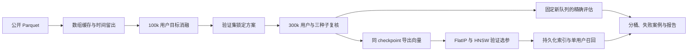

# 腾讯广告序列召回：训练目标对齐、对比学习与 Faiss 检索

这是基于 TAAC2025 / TencentGR-1M 的本地推荐召回项目。复用开源基线的注意力与前馈模块，补齐数据适配、时间留出、目标消融、扩大复核、持久化检索及结果分析。

想从头理解数据、样本、模型与推荐代码，阅读 [项目完整讲解](PROJECT_FULL_WALKTHROUGH.md)。

模型深度对照已完成：固定其余设置比较 1／2／4 层，三种子平均最佳验证 NDCG@10 为 0.015775／0.016316／0.016498。四层按均值规则胜出，但配对区间跨 0，长尾未改善，且固定第五轮时优势不成立；详见[完整深度报告](reports/depth_study/README.md)。

当前冷启动与长尾研究见 [实验报告](reports/cold_start/README.md)：先诊断验证集 Recall@10/100/500，再比较 ID 遮蔽和候选融合；本轮不训练独立排序模型。

本轮单独 ID 遮蔽没有同时改善冷启动和长尾，原主模型继续保留。探索性的保护式双通道候选方案在固定 500 个候选下，将验证冷启动覆盖从 8.40% 提到 9.26%、长尾从 0.73% 提到 0.93%，同时总体覆盖从 23.06% 降到 22.42%；原 Top-10 不变。这是候选覆盖取舍，没有独立测试或线上确认。

目录已按研究问题整理，见 [文档导航](docs/index.md)和[目录结构说明](docs/directory_layout.md)。冷启动、长尾与候选覆盖工作单独放在 `artifacts/cold_start/`、`reports/cold_start/`。

模型容量研究先比较 **1／2／4 层 Transformer**，固定维度 32、单头、FFN、点击 InfoNCE-64 与负采样。公共参数使用经过核对的同一份初始权重，按三种子平均验证 NDCG 选择层数，并报告冷启动／长尾 Recall@500 与训练成本。详见[实验协议](docs/depth_study.md)与[层数实验报告](reports/depth_study/README.md)。FFN 扩张和隐藏维度增大留作后续独立实验，本轮没有同时改动。

**先读 [完整实验报告](reports/objective_study/README.md)，再看 [面试讲稿与简历材料](reports/objective_study/INTERVIEW.md)。** 基线阶段的代码入门与早期实验保留在 [BASELINE_GUIDE.md](BASELINE_GUIDE.md)。

## 已完成的工作

| 阶段 | 内容 | 证据 |
|---|---|---|
| 数据与基线 | 数据连接、时间留出、基线和历史行为对照 | `reports/baseline/` |
| 目标函数消融 | 曝光降权、点击 BCE、BCE-64、InfoNCE-64、行为分支消融 | `reports/objective_study/model_selection.json` |
| 扩大复核 | 30 万随机用户扩大实验，三个种子，新的 10,000 人队列，分桶和案例 | `reports/objective_study/metrics.json`、`failure_cases.json` |
| 向量检索 | 同模型、同目录的 FlatIP/HNSW 精度、延迟、吞吐和索引体积 | `artifacts/objective_study/ann/benchmark.json` |
| 工程与展示 | 复现脚本、推断工具、图表、项目说明和面试材料 | 本文及 `reports/objective_study/INTERVIEW.md` |

扩大阶段有效用户 280,985 名，训练前缀约 1,936 万个事件，固定目录有 2,708,122 个广告。只使用公开的 81 号预提取文本向量；原始数据没有改写。



## 关键实验判断

基线预测下一个已知曝光/点击事件，以一个随机广告作 BCE 负样本。点击是业务目标，但曝光也含协同信息，因此“只监督点击”是否有效要做对照。

开发实验比较了：曝光权重 0.1 的 BCE、点击 BCE、点击 BCE-64、点击 InfoNCE-64，以及 InfoNCE 加历史行为向量。多负样本 BCE 对负项取均值，避免仅因负样本多而放大梯度。

最终按两种子平均验证 NDCG 选择 **点击 InfoNCE-64，不加历史行为 Embedding**。这是验证集决策；更大规模的测试结果没有用来重新挑配置。温度固定为 1，打分保留原始内积，没有归一化成余弦。

检索实验保留了一次重要失败：原始内积 HNSW 的验证召回未达 98% 门槛。随后依据验证查询采用 MIPS→L2 升维后再构图：广告附加 `sqrt(R²-||v||²)`、查询附加 0，精确 L2 排序与原内积相同。它没有改动模型或把向量归一化成余弦。过程记录见 `ann_initial_failure.json` 和 `ann_amendment.json`。

扩大阶段基线与选定模型共享用户、目录、特征词表、网络、学习率和初值，各训练 5 轮。监督位置数和负样本数不同，所以它们不是等 FLOPs 的实验。每次只按验证指标选 checkpoint，随后固定评估测试。

另补充了“全部事件 InfoNCE-64 vs 仅点击 InfoNCE-64”的三种子对照，固定损失与每位置负例数，只改变监督范围，见 [补充实验报告](reports/infonce_supervision/README.md)。这组实验用于区分监督范围的作用，不能将原来同时改变损失和负例数的收益直接归因于只监督点击。它是既有实验之后的补充消融，独立保存，不改写原阶段的冻结选择与索引。

该对照的平均验证 NDCG 为全部事件 0.015133、仅点击 0.015775；补充测试则为 0.015703、0.015391。两个差值的用户与种子配对区间都跨 0，当前不足以认定哪种监督稳定更好。

## 评估协议

- 对用户按时间排序，预留最后两次此前未出现广告的点击，分别作为验证和测试目标。
- 历史时间严格早于目标时间；训练仅使用验证目标之前的前缀，避免目标广告提前出现在曝光历史中。
- 目录为抽样公开序列中全部不同广告，支持公开静态目录可见的本地评估假设，目标覆盖率 100%。
- ID、属性词表、热门计数只使用训练前缀；未见 ID/属性回退到 0。未知行为保留作上下文，不作监督目标。
- 扩大阶段冻结 10,000 人评估队列，排除早期查看过测试结果的 2,000 人。三个训练种子配对比较并报告不确定性。
- 推荐指标用精确全目录内积 Top-10，过滤历史广告；ANN 近似误差另行测量。

这是本地新广告点击代理任务，排除了重复广告点击。它不等价于官方私有测试，也不保证不同用户之间的全局时间隔离；用户画像、属性、内容来自公开快照。

## 当前机器的环境

原 `taac` 环境提供 PyTorch、NumPy、Arrow；额外检索/绘图依赖装在隔离的 `.project_venv` 中。首次准备额外环境：

```bash
cd /home/jyk/project/baseline_2025
/home/jyk/miniconda3/envs/taac/bin/python -m venv --system-site-packages .project_venv
.project_venv/bin/python -m pip install -r requirements-project-extra.txt
```

实际运行版本、GPU 与 CPU 信息保存在 `reports/objective_study/environment.json`。

## 直接查看一次端到端召回

```bash
.project_venv/bin/python -m taac_retrieval.recommend \
  --checkpoint artifacts/objective_study/confirmation/selected_seed2026/best.pt \
  --cache artifacts/objective_study/scale_data \
  --export-dir artifacts/objective_study/export \
  --index-dir artifacts/objective_study/ann \
  --device cuda:0 --split test --index 0
```

工具从用户历史生成查询向量，读取持久化 HNSW，过滤历史广告后输出十个原始广告 OID。启动时检查模型与索引的身份是否一致；输出分别列出编码/传输、索引/过滤和 warmed 请求耗时。进程启动与加载时间不计入 warmed 请求；单次示例不能当作 p95。

匿名数据没有公开原始广告标题、图片，因此展示的是 ID 和分数。实际示例见 [recommend_example.json](reports/objective_study/recommend_example.json)。

## 完整复现目标函数与检索研究

下面的命令使用新目录，保留现有实验。依赖基线阶段产生的固定开发缓存及基线：

```bash
.project_venv/bin/python scripts/run_objective_study.py \
  --root artifacts/objective_study_reproduction \
  --baseline-root artifacts/baseline \
  --report-dir reports/objective_study_reproduction \
  --config configs/objective_study.json \
  --gpus 0,1,2,3,4,5,6
```

只有一张 GPU 时使用 `--gpus 0`，任务会排队。模型训练部分可复用已完成且配置相同的运行；配置或冻结的选择发生变化时会停止。HNSW 多线程建图不保证逐位相同，CPU 延迟也随机器负载变化。

脚本执行：回归测试 → 扩大缓存/新队列/审计 → 开发消融 → 验证锁定 → 三种子复核 → 固定测试 → 向量导出 → 原始 IP 索引基准（保留未过门槛结果）→ 等价升维索引复核 → 推断示例 → 报告。

## 代码导航

下面列出的模块均位于 `taac_retrieval/`；根目录的 `model.py` 保留原始注意力与前馈模块。

- `taac_retrieval/prepare.py`、`data.py`：数据连接、时间切分、数组查表、负采样。
- `model.py`：SASRec 风格编码器、共享物品编码器、可开关的历史行为向量。
- `objectives.py`：监督策略、加权 BCE、采样 InfoNCE。
- `train.py`：训练、验证选择、开发阶段禁用测试的开关。
- `study.py`、`cohorts.py`：消融排队、不可静默更改的模型选择、新评估队列。
- `evaluate_checkpoint.py`：独立最终评估和逐用户预测。
- `export.py`、`ann.py`、`benchmark_ann.py`：模型向量导出、索引 ID 映射、过滤、参数选择与计时。
- `recommend.py`：模型到持久化索引的单用户链路。
- `week_report.py`：三种子汇总、配对区间、分桶、失败案例、图表及面试材料。

## Faiss 基准怎么读

ANN Recall@10 衡量近似结果与精确 Top-10 的重合；HR@10 衡量是否命中真实留出点击。二者不能互换。

本项目在同一模型、原始内积和历史过滤下对比 FlatIP/HNSW；先验证查询选 efSearch，再测试。单查询 p95 使用 1 个 CPU 线程并预热，批量吞吐另用 8 线程。持久化索引体积不是峰值 RSS，warmed 索引计时也不是生产端到端 SLA。

索引和线程配置参考 [Faiss 索引说明](https://github.com/facebookresearch/faiss/wiki/Faiss-indexes)、[内积与距离](https://github.com/facebookresearch/faiss/wiki/MetricType-and-distances)、[线程说明](https://github.com/facebookresearch/faiss/wiki/Threads-and-asynchronous-calls)。

## 展示与表述

报告保留没有改善的方案、退化案例和冷启动分桶。简历使用实际规模和实测指标；不写比赛获奖、线上 CTR/CVR 提升、文图融合、语义 ID 生成或已解决冷启动。后续优先验证全局时间回放、特征可用性、更多种子与内容消融。
