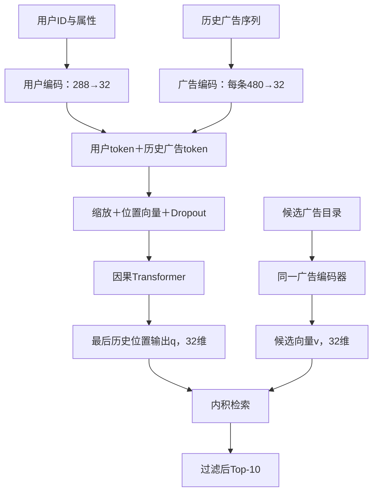

# 搜广推实习面试：项目深挖、参考回答与证据

> 适用于当前主分支的广告序列召回与 DCN V2 列表排序，也收录早期零点击长尾辅助通道的对照。
>
> 这份文档围绕“为什么做、怎么实现、如何验证、失败后怎么决定”准备回答。参考表达必须建立在自己能够解释和操作的范围内；涉及官方模型、已有代码、后续设想时，分别说明来源。所有数字都有实验范围，不能把不同实验的最好结果拼成一个版本。

## 阅读方式

第一遍只看每题的“回答要点”，建立主线；第二遍遮住答案，口述，再用追问检查漏洞；第三遍打开代码、JSON 和一个实际输出，练习现场定位证据。

建议每道题按以下顺序组织：

```text
观察到什么 → 为什么怀疑这个原因 → 改了什么
           → 用什么对照验证 → 结果与代价 → 最后采用还是停止
```

“遇到过的问题”包括实际运行失败、实验没有通过，以及实现中明确防范的风险。三者不要混称：例如原内积 HNSW 未过门槛有失败记录；分块计算是内存控制设计，不能据此虚构一次 OOM。

目录：

1. [项目定位与贡献边界](#scope)
2. [数据规模、编号与特征](#data)
3. [切分、目录与信息泄漏](#protocol)
4. [模型与张量流](#model)
5. [监督、负采样与训练](#training)
6. [对照设计与结果解释](#experiments)
7. [精确评估与指标](#evaluation)
8. [Faiss 与检索工程](#retrieval)
9. [冷启动、长尾与辅助通道](#tail)
10. [可以讲清楚的实际问题故事](#stories)
11. [生产追问与项目局限](#production)
12. [演练清单、数字速查与证据索引](#practice)
13. [当前双通道与 DCN V2 排序追问](#current-ranking)

<a id="scope"></a>

## 01. 项目定位与贡献边界

### Q01｜你做的项目到底预测什么？是 CTR 预估吗？

**回答要点：** 给定一个用户当时可见的属性和历史，将序列编码为查询向量，从固定百万级广告目录中检索 Top-10。离线目标是该用户之后的一次、在保留窗口历史中首次出现的广告点击。这是本地构造的序列召回任务。

模型输出原始内积分数，InfoNCE 训练的是正广告相对采样候选的区分能力。分数没有经过 CTR 概率校准，HR@10 也不是线上 CTR。没有竞价、预算分配或转化价值建模。

**继续追问：** “下一次点击”是不是跳过中间曝光直接训练？回答：留出目标选择合格点击；训练却是相邻事件预测，只在下一事件为点击的位置监督。这两个环节要区分。

**证据：** [README](../README.md)、[clean_and_split](../taac_retrieval/prepare.py)、[训练循环](../taac_retrieval/train.py)。

### Q02｜官方基线已经有 Transformer，你自己的工作在哪里？

**回答要点：** 上游已有 SASRec 风格注意力和 FFN，本项目继续复用这些模块。工作可以围绕三条可核查主线讲：

1. 将公开数据、编号、特征连接、逐用户留出和 OOV 处理组织成明确且可审计的协议。
2. 对监督方式、损失和负样本预算做对照，依据验证选方案，再做扩大规模的三种子确认。
3. 实现精确评估、向量导出、持久化检索与身份核验；处理原内积 HNSW 未过门槛的问题，后续继续诊断冷尾并评估辅助候选取舍。

不要把复用的注意力实现、公开预训练文本向量或标准 HNSW 算法说成原创。项目的价值要落到具体决策与证据。

**继续追问：** “如果模型结构基本没变，为什么不只是换 loss？”可以用监督与负例控制实验、数据协议、索引失败处理和辅助研究的停止决策回答。

**证据：** [主模型](../taac_retrieval/model.py)、[上游模块](../model.py)、[原始研究报告](../reports/objective_study/README.md)。

### Q03｜为什么主项目只有一层？是不是太简单？

**回答要点：** 一层因果自注意力就能读取全部可见历史，加层增强组合交互能力。有没有必要加深需要实验。项目做了 1/2/4 层对照，四层最佳验证均值略高，但区间跨零、长尾覆盖没改善，尚无独立测试确认，所以默认仍是一层。

主模型约 1.296 亿参数，大部分是 Embedding。这个参数量不能用来证明序列建模很强，也不能仅凭一层就认定模型没有容量。

**继续追问：** 一层和四层预算是否公平？五轮、数据与超参数相同，但 FLOPs 不相同；相同形状参数共享初值，普通 Dropout 的后续随机轨迹也不保证相同。

**证据：** [完整报告第14章](PROJECT_FULL_REPORT.md)。原始结果：`research/depth:reports/depth_study/README.md`。

### Q04｜用两分钟介绍项目，你会怎么说？

**参考表达：**

> 我基于 TencentGR-1M 和官方 SASRec 风格基线，做了一个广告序列召回与向量检索项目。先明确逐用户时间留出的本地任务，处理广告编号、文本向量连接、训练词表和历史过滤的一致性。
>
> 原目标把曝光和点击都作为下一事件正目标，我围绕它与点击召回任务是否对齐做了监督、损失及负样本对照。依据验证选出点击 InfoNCE-64，在约28.1万用户、270.8万候选上，用三个种子确认，测试 HR@10 从2.11%提高到2.97%。
>
> 检索部分，原内积 HNSW 没有达到预设重合率门槛。我采用保持精确内积排序的 MIPS→L2 转换，再验证选参数。在指定离线负载下，检索加过滤的 p95 从40.20ms降到4.14ms，测试前十重合率98.81%。
>
> 后续把长尾按点击支持拆分，保留主模型增加零点击长尾辅助候选。它只补回少量目标，并有整体覆盖代价，所以保留为研究原型。整个项目是公开静态目录下的离线实验，尚无线上收益结论。

**继续追问：** 每说一个数字，都要能说明对应哪份模型、哪个队列、什么测量范围。先讲主线，细节留给追问。

<a id="data"></a>

## 02. 数据规模、编号与特征

本节代码入口：[prepare.py](../taac_retrieval/prepare.py)。规模与审计：[scale_data_audit.json](../reports/objective_study/scale_data_audit.json)。

### Q05｜数据从哪里来？你真的训练了128GB数据吗？

**回答要点：** 来源是公开的 [TAAC2025/TencentGR-1M](https://huggingface.co/datasets/TAAC2025/TencentGR-1M)。公开序列表约100.2万用户，广告属性表约478.3万广告；还有用户属性、官方候选、编号映射及多种预计算向量。

本地完整下载目录约128GiB，大头包含本项目没有使用的82～86等向量。当前预处理相关 Parquet 与 indexer 约2.006GiB，实际训练又采用了用户采样和数组缓存。因此不能说“在128GB原始数据上做了全量多模态训练”。

**继续追问：** 81是什么？它是官方向量家族编号，维度是32；项目使用现成文本表示，训练投影与推荐模型，没有训练 BERT，也没有在主模型中使用82～86。

**证据：** [完整报告的数据来源与体积](PROJECT_FULL_REPORT.md)、`prepare.py` 中扫描路径与 `mm_projection`。

### Q06｜为什么抽30万用户，最后只有280,985？

**回答要点：** 均匀抽取30万用户后，还要求在最多100个事件的窗口内，存在两个满足严格时间和首次出现条件的留出点击，且历史足够。19,015人被排除，最终保留280,985人。

这是协议选择造成的用户筛选，不是随机丢数据。它也带来偏差：评估人群至少有一定历史和合格点击，不能代表所有新用户、极低活跃用户。

**继续追问：** 为什么不是全量100万、为什么窗口100、最少历史5？这些是当前项目的固定规模和协议设置，没有完成系统性的规模、窗口或阈值寻优，不能声称它们最优。

### Q07｜OID、RID、local ID、Embedding 行号和 Faiss 行号是什么关系？

**回答要点：**

```text
原始 OID ←→ 公共数据 RID ←→ 当前目录 local ID
                               ├→ item_id_lookup → ID Embedding行号
                               └→ 主索引行号 = local ID - 1
```

OID用于原始身份与内容表关联；RID出现在公开序列和属性表；local ID将当前目录压缩成连续下标。Embedding只给训练可见广告分配独立行，冷广告映射0。主Faiss索引省略padding，因此有行号偏移。

**手算：**

```text
catalog_rids   = [0, 2, 6, 9]
train_counts   = [0, 3, 0, 7]
item_id_lookup = [0, 1, 0, 2]

RID6 → local2 → ID行0
RID9 → local3 → ID行2
```

这里的1、2来自训练可见广告的连续编号，与频次3、7的大小无关。

**继续追问：** 辅助索引也能加1吗？不行。辅助子集local ID不连续，必须用显式映射。

### Q08｜训练未见广告的ID都变成0，它们岂不是一样？

**回答要点：** 一样的是显式ID分量，整条广告表示还包含13个属性与81向量。不同冷广告仍可能有不同表示。

此外，ID冷启动与属性OOV是两个概念：新广告可能使用训练见过的属性类别，从而共享对应Embedding；如果属性值也没见过，该字段才映射OOV行0。

**继续追问：** 为什么不用给冷广告随机分配独立ID向量？没有行为训练支撑时，随机参数并不会自动提供偏好信息。当前用零ID让它依靠共享特征，但效果仍必须看分桶指标。

### Q09｜广告属性与用户属性都重新编码了吗？

**回答要点：** 广告13个字段的词表只在训练可见广告上拟合，再映射整个目录。比如训练值为4、9、4，词表加缺失值后是[0,4,9]，对应行号0、1、2；未见值12映射0。

用户4个单值和4个多值字段沿用官方类别编码，没有按同样规则重拟合。用户多值列表去空值、按字段最大长度补0，模型对该字段的向量求和。

**继续追问：** 为什么求和不用均值？代码采用求和；均值会减少列表长度对幅度的影响。这是可对照的设计，当前没有完成两者效果消融。不能编造用户字段具体业务语义。

### Q10｜内容向量连接可能出现什么问题？怎么确认读对了？

**回答要点：** 序列、属性和内容表的键不在同一编号空间，内容表 `anonymous_cid` 还是字符串OID。直接拿RID连接，或把字符串与整数比较，都可能导致内容未命中。

当前实现先通过indexer得到local→OID，将内容键用Arrow转为int64，再查找对应local行；检查向量长度32、有限数值、缺失补零和padding为零。主目录81覆盖率约95.20%。

**继续追问：** 覆盖率95%就证明文本有效吗？只能证明成功接入可用向量。要证明推荐增益，需要在相同协议下做有无内容的模型对照；不能用读取正确替代效果验证。

**证据：** `prepare.py` 的 `batch_oids / mm_present`，以及35项数据审计中的内容检查。

<a id="protocol"></a>

## 03. 切分、目录与信息泄漏

### Q11｜clean_and_split到底做了什么，为什么这样切？

**回答要点：** 清理无效事件，按时间稳定排序，保留最后100个事件。在该保留窗口内寻找：点击、广告此前没有出现、严格更早历史至少5条。最后一个合格点击作test，更早时间的最后一个合格点击作val。

训练前缀在val目标之前结束。训练和val使用同一截止点，test可使用更晚但仍严格早于test目标的历史。没有足够目标的用户排除。

**继续追问：** “首次出现”是整个终生历史吗？代码先截断窗口再判断，因此准确口径是保留窗口内首次出现，不能扩大成用户终生第一次点击该广告。

**证据：** [clean_and_split](../taac_retrieval/prepare.py)。

### Q12｜为什么留出“首次出现点击”，不直接留最后一次点击？

**回答要点：** 检索会过滤用户历史中的广告。如果一个目标先曝光、后点击，曝光已经在历史中，目标就会被过滤掉。直接留这种点击，会让任务目标与过滤规则冲突。

数据没有足够的曝光—点击归因ID来可靠合并，因此本项目采用保守规则：目标广告此前在保留窗口中完全没出现。

**继续追问：** 这会改变任务吗？会。它强调新广告发现，排除了重复广告点击，降低了与真实广告投放重复曝光机制的一致性。这是公开日志上的代理任务，不是完整生产任务。

### Q13｜时间戳相同的事件怎么处理？

**回答要点：** 稳定排序只能保留原顺序，不能证明同时间戳事件的真实先后。使用 `searchsorted(times, target_time, side='left')`，只取严格早于目标时间的历史。同时间戳的其他事件不进入目标历史。

**继续追问：** 稳定排序为什么还不够？因为一个时间戳可能包含多条事件，原记录顺序未必代表推荐时可观察的因果顺序。

**证据：** `clean_and_split` 的 `cut` 与 `earlier` 判断。

### Q14｜测试历史包含验证点击，算泄漏吗？

**回答要点：** 测试发生在验证目标之后；如果那次验证点击已经真实发生，就可以作为后续预测的输入上下文。参数仍只用val之前的训练前缀更新。

必须区分“用已发生行为作为下一次预测的输入”和“把测试目标拿去更新参数”。模型和超参数选择还必须遵守验证、测试分工。

**继续追问：** 测试前是否重新训练？当前流程没有使用验证点击重新训练；只是构造test输入时允许它进入可见历史。

### Q15｜候选目录包含后来点击的广告ID，是不是泄漏？

**回答要点：** 当前目录由保留用户公开序列中的广告并集构成，不根据点击标签筛选；实验假设目录及静态内容预先已知。广告ID独立行、广告属性词表、热门计数和负样本池都只由训练前缀决定。

但这仍然是 `transductive public static catalog` 假设。它没有保证现实中这些广告和内容在过去时刻已经上线，也没有所有用户共享的全局时间截止点。

**继续追问：** 能否回答“完全无泄漏”？不应笼统保证。应说清哪些行为未进入训练、哪些静态信息被假设提前可见，以及哪些生产时间偏差尚未排除。

### Q16｜为什么不用官方66万候选，而是270万目录？

**回答要点：** 官方候选用于官方任务，但不覆盖本地留出目标全集。对全部保留用户审计，官方候选覆盖约73.35%的val目标、81.01%的test目标。若直接使用，一部分目标从入口就无解。

因此固定公开序列广告并集，得到2,708,122条候选，所有方案使用相同目录。没有为某个模型临时只补它漏掉的目标。

**继续追问：** 目录覆盖100%是否就是Recall100%？不是。前者只表示答案有资格参加检索，后者要求答案真正进入前K。

**证据：** [目录覆盖审计](../reports/objective_study/scale_data_audit.json)。

### Q17｜为什么另选评估用户？他们是训练未见新用户吗？

**回答要点：** 早期开发已经查看过2,000人的测试结果，扩大确认时按原用户RID排除这批用户，再固定10,000人的评估队列，避免继续把已看过的测试行为当新确认。

这些用户的训练前缀仍参与模型训练，因此新的是未用于先前评估决策的留出行为，不是训练未见的新用户。后续辅助确认排除此前已知的31,574个评估RID，也遵循同样区分。

**继续追问：** 为什么按RID排除，不按缓存行号？不同采样缓存的内部行号会变化，RID才对应同一个公开用户。

**证据：** [cohorts.py](../taac_retrieval/cohorts.py)、[辅助runner快照](tutorial_parts/tail_recall_snapshot/scripts/run_supplemental_tail.py)。

<a id="model"></a>

## 04. 模型与张量流

本节源码：[model.py](../taac_retrieval/model.py)、[data.py](../taac_retrieval/data.py)。下列A/B/C只是便于手算的教学广告，不赋予匿名ID具体语义。



### Q18｜广告编码器输入、输出分别是什么？

**回答要点：** 显式ID32维、13个属性各32维、81经过线性投影得到32维，共480维，经过Linear和ReLU得到32维广告向量。

```text
[ID32 ; 属性13×32 ; 81投影32] → 480 → Linear → ReLU → 32
```

这里是特征维拼接，原始81已提供32维，投影仍然是可学习的。候选打分使用融合后输出，不是直接拿原始81做匹配。

**继续追问：** 缺失81填0是否使投影输出也一定为0？不一定，Linear有可学习bias；padding广告则在融合后又乘 `ids != 0`，确保整个padding输出为零。

### Q19｜用户编码为什么是288维？多值属性如何处理？

**回答要点：** 用户ID32维，4个单值字段共128维，4个多值字段各自求和得到4个32维，共128维，总计288维，再Linear+ReLU变成32维。

它先形成用户token，还没有融合历史。用户内部行号来自保留用户的排序与映射，不等于原始RID直接查表。

**继续追问：** 多值列表长度变化为什么能固定维度？先在字段内对多条Embedding求和，结果始终是32维，补齐0行不贡献向量。

### Q20｜用户向量怎么和历史广告一起进入Transformer？

**回答要点：** 沿序列维放置一个用户token，再放历史广告token：

```text
[u, eA, eB, eC] → [1, 4, 32]
```

实际最大长度101：一个用户token加最多100条历史，历史不足时左补padding。`kinds` 标记0padding、1广告、2用户，分别决定填入广告还是用户编码。

```python
hidden = encode_items(items) * item_mask[..., None]
hidden += encode_users(users)[:, None, :] * user_mask[..., None]
```

**继续追问：** 是把用户向量加到每条广告上吗？用户向量只填在用户token位置，随后通过注意力影响后续状态。也不是把所有token拼成一个128维向量，每个位置始终32维。

### Q21｜为什么要因果mask？只取最后状态还需要吗？

**回答要点：** 训练时同一序列多个位置都预测各自的下一事件。如果允许看到右边，较早位置就可能直接读到答案。因果mask使每个位置只能读取自身及左侧有效位置。

即使推断只取最后状态，训练过程仍需因果约束。padding key被屏蔽；补齐查询位置保留自注意位置，避免全屏蔽softmax产生非有限值，后续再将padding输出清零。

**继续追问：** 用户token能看到后面的历史吗？不能。它在最前有效位置，因此输出只读到自己。

### Q22｜为什么取最后广告位置，而不取用户token输出？

**回答要点：** 最后历史位置能看到用户token和全部可见历史；前面的用户token受因果mask限制，不能聚合右侧历史。因此 `predict()` 取 `[:, -1]`，作为查询q。

```text
hU：只看到用户
hA：看到用户、A
hB：看到用户、A、B
hC：看到用户、A、B、C → q
```

**继续追问：** 最后一位会不会是padding？采用左padding，保留最后真实事件，符合资格的用户有非空历史，所以最后一位是有效历史位置。

### Q23｜历史广告和候选广告是否共用模型？候选也进Transformer吗？

**回答要点：** 历史与候选共用 `encode_items` 参数。历史广告编码后进入Transformer，帮助生成q；候选广告编码后直接得到v，与q做内积。

因此物品向量可以提前导出，用户查询按当前历史计算。这是可分离的向量检索结构，用户侧使用序列Transformer，不需要为每个候选重新跑一次历史。

**继续追问：** vA和历史位置输出hA一样吗？不一样。vA只编码A自身，hA还结合用户和左侧历史。

### Q24｜位置、行为与向量维度分别怎样设置，为什么？

**回答要点：** 主模型hidden32、1层、1头。输入先乘√32，加位置Embedding，再Dropout。主模型不启用历史行为Embedding；actions对照才将32维行为向量加到历史广告token上。两者行为类型仍用于监督筛选。

32维沿用当前实验预算，没有做32/64/128维系统寻优。加宽维度、扩张FFN与加深层数是不同变量，应分别对照，不能把固定设置说成理论最优。

**继续追问：** 为什么代码里主模型也有action_emb？两个变体都分配它以保持共享参数的随机初始化一致，主模型前向未使用它。

<a id="training"></a>

## 05. 监督、负采样与训练

本节源码：[Dataset和负采样](../taac_retrieval/data.py)、[训练循环](../taac_retrieval/train.py)、[损失](../taac_retrieval/objectives.py)。

### Q25｜一个用户究竟产生几条训练监督？输入和目标怎么错位？

**回答要点：** 整个训练前缀在一次序列前向中产生多个位置监督。假设前缀为A、B、C、D：

```text
输入token：用户u    A    B    C
目标广告：   A     B    C    D
```

当前主模型只选目标为点击且非padding的位置。若B和D是点击，参与损失的是“u+A状态预测B”和“u+A+B+C状态预测D”。A自身是曝光还是点击，不决定预测B的位置是否监督。

**继续追问：** 训练是不是直接跳到下一个点击？不是，目标仍是紧邻的下一事件；下一事件不是点击，该位置不参与主损失。

### Q26｜曝光为什么没有直接当负样本？未知行为怎么处理？

**回答要点：** 曝光表示被展示或出现过，未必能可靠代表拒绝，且这里没有完整的归因和观察条件。当前将曝光保留在上下文，是否监督由实验配置决定；随机抽取广告作为对比负候选。

原始action为0曝光、1点击、null可能未知；内部变成1曝光、2点击、3未知，0用于padding和用户位置。未知保留上下文，但所有已有目标方案都排除未知监督。

**继续追问：** 能否把空动作填成曝光？会人为制造监督，当前没有这种假设。

### Q27｜64个负样本到底怎么采？是不是batch内其他正样本？

**回答要点：** 负样本池为 `train_counts > 0` 的广告，每个ID在池中一行。每个有效监督位置均匀、有放回采64次；遇到该用户整个训练前缀中出现过的广告就重抽。

它不是batch内负采样，也没有模型打分挖掘困难负例。假设一个batch共有M个有效位置，负ID为[M,64]、负向量为[M,64,32]。

**继续追问：** 热门更容易被抽到吗？当前按ID均匀，不按事件频次加权。64个一定互异吗？不是，允许重复；不同位置也可抽到同一广告。

### Q28｜为什么排除整个训练前缀？未来的验证点击也排除吗？

**回答要点：** `seen` 是该用户整个训练前缀，包括当前正目标和该训练窗口内更靠后的事件。因此所有正目标都不会被同一用户采成负例，曝光和未知历史也排除。

验证、测试留出目标不被采样函数读取。如果某留出广告在其他用户训练中可见，仍有可能被当前用户采到。这是未观测反馈下可能存在的假负例，不能利用未来答案去消除。

**继续追问：** 对较早训练位置，排除前缀后面的事件是否引入信息？它确实使用了整个训练前缀的排除集合，和“只按当前位置左侧排除”不同；属于当前采样协议，应明确，不能说逐位置只依赖左侧历史。

### Q29｜为什么是64，不是16或128？

**回答要点：** 原主实验先将64作为固定预算，早期的BCE-1/BCE-64/InfoNCE-64没有完成InfoNCE不同K的寻优。后续已补充16/64/128、三个种子的五轮验证对照，见[负样本数量补充实验](negative_count_study.md)。

K16/64/128的验证HR为2.2733%/2.9733%/3.0900%，NDCG为0.011949/0.015775/0.016455。16明显较弱；128虽按主指标成为验证候选，但相对64的HR和NDCG区间跨0，且整体Recall@500从23.0600%降到18.7467%。因此没有自动替换默认64，不能把它说成理论最优或显存限制强制只能64。

**继续追问：** 为什么前十略好，前500却更差？两个K衡量不同排名范围；本轮128的候选冷广告比例显著增加，但正确目标覆盖没有同步提升。该组成诊断不能当成唯一根因。当前是复用验证集的补充研究，没有独立测试确认。

### Q30｜写出InfoNCE，并解释代码中的标签0。

$$
L=-\frac1M\sum_{m=1}^{M}
\log\frac{\exp(s_m^+/\tau)}
{\exp(s_m^+/\tau)+\sum_{j=1}^{64}\exp(s_{mj}^-/\tau)}.
$$

**回答要点：** 内积得到一个正分数和64个负分数，正分数固定放第0列，温度τ=1，交叉熵标签全部设0。

```python
logits = torch.cat([positive[:, None], negative], dim=-1) / temperature
loss = F.cross_entropy(logits, torch.zeros(M, dtype=torch.long, device=device))
```

标签0表示“正确类别是第0列”，不表示广告ID为0，也不表示负样本。分数竞争在65个采样项中发生。

**继续追问：** 这65项softmax概率是CTR吗？不是；也不是对270万目录计算的精确全量softmax概率。

### Q31｜BCE与InfoNCE有何不同？BCE-64怎样避免负项简单放大？

**回答要点：** BCE分别推动正分数为正、负分数为负；InfoNCE让正目标在一组候选中胜出，是相对竞争的多分类目标。不能说两者梯度完全相同。

多负样本BCE对64个负损失先求均值，再与正损失相加，避免仅因数量变多就把负项权重乘64。原一负例基线保留其原计算路径。

**继续追问：** InfoNCE一定更好吗？不是；当前相同点击监督和64负例的实验里它更好，不是所有数据或目标上的定理。

### Q32｜训练过程、随机性和内存控制有什么具体实现？

**回答要点：** Adam学习率0.001、betas=(0.9,0.98)，batch128、5轮，普通Dropout0.2，梯度范数裁剪5。先产生全部序列状态，再只对有效监督位置编码正负候选，避免无效位置的64负例计算。非有限loss或梯度会报错。

DataLoader打乱使用seed，负采样使用独立Generator(seed+17)，按batch动态重采，不是固定负样本缓存。数据缓存是NumPy数组，支持按需映射读取。

**继续追问：** 梯度裁剪证明解决过梯度爆炸吗？不能。它是当前训练保护措施；没有对应实际失败日志时，不应虚构一次爆炸事故。共享工作站的运行时间也不能直接当硬件极限。

<a id="experiments"></a>

## 06. 对照设计与结果解释

证据入口：[六组开发与主确认](../reports/objective_study/README.md)、[选择锁定记录](../reports/objective_study/model_selection.json)、[方案定义](../taac_retrieval/study.py)。

### Q33｜你比较了哪些方案？每一组回答什么问题？

| 方案 | 监督 | 损失 | 每位置负例 | 目的 |
|---|---|---|---:|---|
| baseline | 曝光＋点击 | BCE | 1 | 原目标控制组 |
| weighted_bce | 点击1、曝光0.1 | BCE | 1 | 降低曝光监督权重 |
| click_bce | 仅点击 | BCE | 1 | 改监督对象 |
| click_bce64 | 仅点击 | BCE | 64 | 同BCE下改变负例预算 |
| click_infonce64 | 仅点击 | InfoNCE | 64 | 与BCE-64比较损失 |
| click_infonce64_actions | 仅点击 | InfoNCE | 64 | 加历史行为Embedding |

**回答要点：** 开发使用约9.36万保留用户、153.87万候选、2,000评估用户和两个种子，比较六组；基线两次复用，新增十次训练。先按平均验证NDCG@10选方案，再扩大规模确认，不能将开发小样本指标当最终测试。

**继续追问：** 曝光降权系数0.1是寻优结果吗？不是，当前固定对照没有完成权重扫描。

### Q34｜怎么证明收益不只是因为负样本从1变成64？

**回答要点：** 不能把原BCE-1到最终InfoNCE-64称为纯loss单因素实验，因为监督对象、损失、负例预算都变化。加入点击BCE-64后，在相同点击监督、负例数与采样规则下，才更直接比较损失。

开发两种子验证均值：

| 配置 | NDCG@10 | HR@10 |
|---|---:|---:|
| 点击BCE-1 | 0.004434 | 0.9250% |
| 点击BCE-64 | 0.005126 | 0.9500% |
| 点击InfoNCE-64 | 0.011616 | 2.1750% |

这组结果不支持“多采负例就解释了全部提升”。同时，原始曝光＋点击BCE开发NDCG=0.008415，比点击BCE-1更好，说明只删曝光监督本身也并不必然改善。

**继续追问：** 三种子最终确认是否训练了所有六组？没有，确认比较原目标基线与开发选定方案。不能把所有单因素结论扩大成三种子独立确认结论。

### Q35｜只点击一定比全部事件监督更好吗？

**回答要点：** 原始开发选出点击InfoNCE-64，但后续还做了“全部曝光＋点击InfoNCE-64”与“仅点击InfoNCE-64”的补充对照。旧验证中，点击NDCG=0.015775、全部事件=0.015133，差异区间跨0。

对已经看过的旧测试重检，全部事件NDCG约0.015703、点击约0.015391，方向反过来，也不是新的独立确认。不能因此把“仅点击一定更好”当定论，更不能把后续观察倒推成原始选型依据。

**继续追问：** 两组计算量相同吗？每监督位置都是64负例，但全部事件监督位置更多，五轮不等于相同FLOPs。

**证据：** [完整报告第14.2节](PROJECT_FULL_REPORT.md)。原始补充研究：`research/supervision:reports/infonce_supervision/README.md`。

### Q36｜actions对照做了什么，为什么没有采用？

**回答要点：** 历史广告token上逐元素加行为Embedding：曝光1、点击2、未知3，维度仍32。候选结构和点击InfoNCE-64设置不变，输入只包含已发生的行为，目标行为只用于监督。

开发两种子中，actions的HR为2.2250%，略高于无actions的2.1750%；但NDCG为0.009726，低于0.011616。预定选型优先NDCG，因此未选它。

**继续追问：** 为什么HR高而NDCG低？命中数量与位置折扣的总体结果不同，不能据此断言所有共同命中的目标都排名下降。没有额外诊断时，也不能编造是过拟合或未知行为噪声造成。

### Q37｜多层消融结果怎样？为什么最后还是一层？

固定数据、hidden32、单头、点击InfoNCE-64和五轮；各模型取最佳验证轮，三种子均值：

| 层数 | NDCG@10 | HR@10 | 整体R@500 | 冷R@500 | 尾R@500 |
|---:|---:|---:|---:|---:|---:|
| 1 | 0.015775 | 2.9733% | 23.0600% | 8.3966% | 0.7290% |
| 2 | 0.016316 | 3.1067% | 22.5367% | 9.3576% | 0.6787% |
| 4 | 0.016498 | 3.1467% | 22.9733% | 9.1553% | 0.6787% |

**回答要点：** 四层按验证规则领先，但NDCG差值95%配对区间[-0.000866,+0.002225]跨0，长尾覆盖没有提高。统一看第5轮时，四层NDCG=0.015141，低于一层0.015244，没有独立测试确认，因此保留原主模型。

每增加一层仅增加6,464个参数，大部分参数仍在Embedding。共享工作站上四层训练部分耗时记录约增加9.6%，只能描述当次成本，不是严格速度结论。

**继续追问：** 为什么不继续调深模型学习率？可以作为新实验，但当前结果只支持在既定设置下的结论，不能宣称深网络普遍无用。也不能为得到正结果一直查看同一确认目标反复调参。

**证据：** `git show research/depth:reports/depth_study/README.md`；[完整报告](PROJECT_FULL_REPORT.md)。

### Q38｜最终提升多少？多种子和置信区间究竟说明什么？

主确认使用280,985训练用户、2,708,122候选、10,000评估用户、2026/2027/2028三个种子：

| 模型 | 测试HR@10 | 测试NDCG@10 |
|---|---:|---:|
| 训练频次热门 | 0.7600% | 0.004230 |
| 原目标BCE | 2.1133% | 0.010528 |
| 点击InfoNCE-64 | 2.9733% | 0.015391 |

HR绝对增加0.8600个百分点，相对增加约40.69%；不能说增加40.69个百分点。用户与种子配对bootstrap的HR差值区间约[+0.5566,+1.1667]个百分点，支持当前离线条件下的正向差异。

**回答要点：** 多种子减轻只挑一次初始化的偶然性；配对比较保留同用户、同seed的差异。三个种子仍很少，不能保证所有随机种子、未来时间或线上环境都有效。统计区间也不能消除已用验证集调参的选择偏差。

默认展示和ANN固定用seed2026，其测试HR为2.8400%，不是三种子均值2.9733%。它不是模型集成。

**继续追问：** 数据多次重采时独立性如何？不同模型用了同一批用户，应配对看差异，不能把三模型当三份独立用户样本。

<a id="evaluation"></a>

## 07. 精确评估与指标

### Q39｜HR、Recall、NDCG分别表示什么？指标是不是自己写的？

**回答要点：** 指标公式是标准的，项目在代码中自行实现并测试。每人一个留出目标：

$$
HR@K=\frac1U\sum_u \mathbb 1[r_u\le K],
\qquad
NDCG@K=\frac1U\sum_u
\frac{\mathbb 1[r_u\le K]}{\log_2(r_u+1)}.
$$

同一个K下，单目标Recall@K等于HR@K。目标第3名时HR@10=1、NDCG@10=0.5；第11名时两者都为0。但Recall@500与HR@10的K不同，不能互换。

**继续追问：** 一个用户多个相关目标怎么办？Recall分母、理想DCG等都会变化，不能直接沿用当前单目标简化公式。

**证据：** [metrics.py](../taac_retrieval/metrics.py)、[指标与覆盖测试](../tests/test_coverage.py)。

### Q40｜为什么不在一个正例加100个负例里评估？

**回答要点：** 训练用采样负例控制成本，评估则在固定完整目录上检索，避免用一个过于容易或分布不同的采样候选集代表真实目录竞争。

当前指标对应270万级目录、历史过滤和单目标点击。HR约3%不能直接与其他候选数、其他切分或线上CTR比较。

**继续追问：** 最低限度怎么判断模型有用？在相同协议下与热门和原目标基线比较，同时检查分桶与逐用户增减，而不是只看绝对数值是否“好看”。

### Q41｜270万广告如何精确评估？会不会一次生成巨大分数矩阵？

**回答要点：** 分块遍历候选，每块最多32,768条，计算[B,chunk]内积，屏蔽历史后取块Top-K，再与当前Top-K合并。遍历所有块后得到全目录精确Top-K。

例如B=256，一次保存256×270万的float32分数约2.58GiB；分块分数约32MiB。这里只是分数矩阵的数量级，不包含模型、候选向量和其他中间量，也不代表曾实际触发OOM。

**继续追问：** 分块会不会变近似？不会，所有候选均计算，每块只丢弃不可能进入全局Top-K的更低分项。相同分数的边界候选可能有实现相关的取舍。

**证据：** [exact_topk](../taac_retrieval/metrics.py)。

### Q42｜历史过滤到底过滤什么？精确与ANN怎么保证一致？

**回答要点：** 按当前可见历史的广告ID过滤，不区分曝光、点击和未知。精确检索直接把历史位置分数设为负无穷；ANN先多取候选，再删除历史、无效项和重复项，补足十个。

主Faiss每次多取 `K + batch内最大非零历史长度`，并受目录大小限制。对完整无重复索引，这能为历史过滤预留数量；返回不足时报错，不悄悄补随机广告。

**继续追问：** 真实业务一定要过滤历史曝光吗？不是，广告有频控和重复触达需求。当前是配合首次出现目标的项目约定，生产需根据业务改变。

**证据：** [精确过滤](../taac_retrieval/metrics.py)、[search_filtered与filter_results](../taac_retrieval/ann.py)。

### Q43｜ANN Recall@10和真实点击HR@10有什么区别？

**回答要点：**

```text
ANN Recall@10：近似结果与精确前10有多少ID重合
HR@10：结果中是否包含真实留出点击
```

即使ANN重合率100%，模型仍可能没把真实目标放前十。索引只忠实逼近同一模型的排序，不会自动修复模型兴趣表示。

**继续追问：** ANN重合率稍低，点击HR有没有可能更高？个别查询可能因近似扰动偶然把目标带进前十，但不能据此把搜索误差当作可靠建模收益。

<a id="retrieval"></a>

## 08. Faiss与检索工程

代码入口：[向量导出](../taac_retrieval/export.py)、[ANN基准](../taac_retrieval/benchmark_ann.py)、[检索适配](../taac_retrieval/ann.py)、[单用户推荐](../taac_retrieval/recommend.py)。

### Q44｜为什么能提前导出广告向量？模型更新后索引还能用吗？

**回答要点：** 广告向量只依赖广告特征和当前模型参数，不依赖请求用户，所以可离线批量计算。查询q依赖用户及历史，推荐时计算。

模型更新会改变候选空间，查询和索引必须匹配。当前导出记录checkpoint SHA、缓存签名、目录数、维度和评估队列身份；加载时核对模型、导出与索引，避免相同32维却来自不同模型的向量混用。

**继续追问：** 只检查维度足够吗？不够。两份不同模型都是32维，但坐标空间可能完全不兼容。

### Q45｜为什么Faiss行号要加1？怎么保证返回原始广告ID？

**回答要点：** 主候选向量文件含local0 padding，但索引从local1开始添加，保持目录原顺序。因此Faiss row0对应local1，先加1，再用 `catalog_oids[local]` 还原OID。

先检查Faiss返回行号是否有效，历史过滤使用local ID集合。把OID、RID或Embedding行号直接当Faiss行号，程序可能不报错但结果完全错位。

**继续追问：** 如果以后过滤候选或建立子索引？连续偏移约定可能失效，需要显式行号→local ID映射。当前辅助子集已经这样做。

### Q46｜为什么选HNSW？M、efConstruction、efSearch是什么？

**回答要点：** FlatIP作为精确参考，遍历全部候选；HNSW构建分层近邻图，在查询时只搜索部分节点，换取更低延迟，同时有近似损失、额外索引空间和构建成本。

| 参数 | 含义 | 当前设置 |
|---|---|---:|
| M | 图连接规模参数 | 32 |
| efConstruction | 建图时搜索候选范围 | 100 |
| efSearch | 查询时搜索候选范围 | 最终2048 |

M与efConstruction固定，验证扫描efSearch；要求ANN重合率至少98%，通过后选较小p95，再固定到测试。

**继续追问：** 为什么不用IVF/PQ？它们是可能的内存与速度方案，但本项目没有相同条件下的系统对照。不能说HNSW已证明是全部索引中最优。

### Q47｜原内积HNSW哪里出了问题？你怎么定位和处理？

**回答要点：** 原raw-IP图在efSearch=1024时验证重合率仅84.84%，未达98%门槛。继续扩大搜索的诊断仍出现明显差距，记录中也检查了分数并列不能解释主要差距。

没有直接降低门槛或用归一化改掉模型评分，而是登记保持精确IP排序的MIPS→L2变换，重新建图并在验证上扫参数。同样ef=1024约97.09%；ef=2048约98.20%达到门槛，然后锁定测试。

**继续追问：** 已经证明根因就是向量长度分布吗？没有。改变搜索几何有效是实测结论；不能把尚未隔离验证的单一几何原因说成已证明根因。

**证据：** [原始失败](../reports/objective_study/ann_initial_failure.json)、[变更登记](../reports/objective_study/ann_amendment.json)、[验证扫描](../reports/objective_study/README.md)。

### Q48｜推导MIPS→L2，为什么不直接做余弦归一化？

令统一R不小于库中所有广告向量长度：

$$
v'=[v,\sqrt{R^2-\|v\|^2}],\qquad q'=[q,0].
$$

则：

$$
\|q'-v'\|^2=\|q\|^2+R^2-2q^\top v.
$$

**回答要点：** 对固定q，前两项都是常数，所以新空间距离越小，原始内积越大。广告和查询32→33维，原分量保留，转换无需训练。Faiss返回距离平方D²，再按 `(||q||²+R²-D²)/2` 转回原内积。

直接将向量归一化会引入长度除法，变成余弦排序，可能改变原模型目标。MIPS→L2只保证精确排序等价，HNSW仍是近似，不能保证100%找回。

**手算：** q=(1,1)，A=(3,0)，B=(1,1)。原内积A=3、B=2；原距离平方A=5、B=0。取R=3后，A'=(3,0,0)，B'=(1,1,√7)，q'=(1,1,0)，距离平方变成A=5、B=7，恢复选择A。

**继续追问：** `radius_squared` 是R还是R²？是R²。若新入库向量长度超过既有R，需要重新处理这个约束，不能直接对负数开根号。

### Q49｜40.2ms降到4.14ms是什么范围？p95怎么测？

**回答要点：** 固定seed2026模型，在512测试查询上，单CPU线程、预热后，重复3轮打乱查询顺序，得到1536次单查询调用耗时，再取95%分位。

测量包括CPU索引检索和Python历史过滤，L2适配也在检索调用中；用户向量预先计算，不含Transformer编码、网络、启动或模型与索引加载。p95约4.14ms意味着当前样本中约95%调用不超过它，不是平均值或最大值。

**继续追问：** 单用户CLI刚输出一次4ms，能当p95吗？不能，单次请求与分位统计不同。8线程批量QPS也是另一个负载，不能拿1/p95换算或拼接。

### Q50｜速度提高付出了什么代价？98.81%到底来自哪里？

| 指标 | FlatIP | MIPS-L2 HNSW |
|---|---:|---:|
| 相对精确Top-10重合率 | 100% | 98.8086% |
| 单线程检索＋过滤p95 | 40.1965ms | 4.1443ms |
| 持久化索引体积 | 330.6MiB | 1043.8MiB |
| 当次构建耗时 | 约0.47s | 约36.28s |

**回答要点：** p95约加速9.70倍，但索引更大、建图更贵，还有近似损失。98.81%来自锁定参数后的512测试查询，与主模型10,000用户三种子HR不是同一个统计。

持久化文件体积不等于运行峰值RSS。共享机器和多线程建图也意味着耗时、图结构不一定逐位重现；应记录环境与结果，不承诺生产SLA。

**继续追问：** 主模型训练后还要全部重建吗？当前冻结向量工作流是重新导出和建索引；增量更新、删除和无中断切换尚未实现。

<a id="tail"></a>

## 09. 冷启动、长尾与辅助通道

代码与证据使用主目录固定快照，便于不切分支阅读：

- [辅助模块](tutorial_parts/tail_recall_snapshot/taac_retrieval/tail_channel.py)
- [实验配置](tutorial_parts/tail_recall_snapshot/configs/supplemental_tail.json)
- [完整指标](tutorial_parts/tail_recall_snapshot/reports/supplemental_tail_study/metrics.json)
- [真实案例](tutorial_parts/tail_recall_snapshot/reports/supplemental_tail_study/examples.json)
- [来源清单](tutorial_parts/tail_recall_snapshot/manifest.json)

### Q51｜怎么发现整体提升掩盖了冷尾问题？

**回答要点：** 按全部用户训练前缀中的事件次数分桶：cold=0、tail=1～5、mid=6～50、head>50，计数包含曝光、点击和未知。

原主确认测试三种子平均HR@10：冷约0.0425%、长尾0%、中频约0.1787%、头部约6.0537%。总体改善集中在头部。目录长尾约193万，其中约158万、82%没有训练点击，于是进一步按点击支持拆分。

**继续追问：** 零点击是不是广告质量差？不能直接判断。它可能曝光不足、匹配机会少，也可能确实不受欢迎，需要更多上下文和曝光证据。

### Q52｜为什么ID置零可能补回长尾？实验证明了什么？

**回答要点：** 零点击长尾没有自身作为点击正目标的直接监督，独立ID可能通过负候选或历史上下文学习，未必可靠；共享属性和文本参数能从其他广告迁移信息。

辅助编码把显式ID的32维输入设零，其余属性、81投影与融合层保持原参数，再得到32维候选。不是整条广告向量归零，也不是主向量直接减一个ID向量。属性还有高基数字段，不能称纯文本或完全去身份模型。

旧固定q消融曾使961个零点击长尾目标从0命中到25，但整体损失更大。它支持部分候选互补的假设，不能证明普遍改善。

**继续追问：** 最终收益全部来自置零吗？不能确定。专用池和配额也改变了机会，尚缺相同池与配额下保留ID的完整因子对照。

### Q53｜辅助通道有没有训练新模型？与主通道什么关系？

**回答要点：** 本轮没有训练新模型。对三个原checkpoint各自复用自己的q，冻结全部参数；辅助只编码训练事件1～5且点击0的候选。真正cold=0和有点击长尾不在该专用池。

它是“同一个用户查询、另一种候选视图”，不是三个新双塔，也没有把三个模型线上集成。参数前后哈希一致。

**继续追问：** 用不同seed的q和v混合行不行？不行，它们对应不同向量空间。历史广告编码也不置零，只有辅助候选侧显式ID清零。

### Q54｜辅助检索与融合具体怎么走？为什么先排主500？

**回答要点：** 在资格子集内，先屏蔽可见历史与全部主Top-500，再精确找Top-25新提议。否则提议会被已有广告占用，不能提供增量覆盖。当前用GPU分块精确检索，未建立持久化辅助Faiss索引。

融合保护主前10的身份顺序，以及主500中全部训练频次≤5的候选。从列表末尾倒序删除最多5个未保护的中频或头部，再追加同数量新辅助项；少于5个可用时少补，最终仍500且无重复。

**继续追问：** 两通道分数如何校准？本轮不相加分数、不混排，保留主相对顺序再追加，因此是配额规则融合。它也使辅助项只进入末尾。

### Q55｜真实补回案例与最终效果是什么？为什么不默认启用？

真实案例：用户内部行253247，目标local1326725、RID2343178；训练只有1事件、0点击。seed2026主通道Top-500没有它，辅助新候选排第2，保留495个主候选后进入第497名。对该用户Recall@500从0到1，HR@10仍为0。

新确认10,000人、三模型均值：

| 分组 | 主通道R@500 | 融合R@500 |
|---|---:|---:|
| 整体 | 23.0833% | 22.9700% |
| 全部长尾 | 0.5939% | 0.7230% |
| 零点击长尾 | 0% | 0.1883% |
| 冷启动 | 8.8071% | 8.8071% |
| 有点击长尾 | 1.8883% | 1.8883% |

885个零点击长尾目标中，三个模型新增1/3/1次命中，只涉及3个不同用户；每模型平均新增1.67个、丢失13个其他目标。整体下降0.1133个百分点。

**回答要点：** 它是带代价的微小覆盖补充。保护Top-10使HR/NDCG不变，冷与已有长尾保留是结构约束，不能作为学习改善。当前保留研究原型，没有自动接入主项目默认链路。

### Q56｜怎么防止辅助实验挑结果？点估计通过为什么不等于有效？

**回答要点：** 开发只比较raw IP/cosine与quota1/5四种组合，按既定规则选raw IP+5，再锁定模型、队列与配置做一次新留出行为确认。原整体覆盖至少保留99%是自定容忍门槛；实际约99.509%，通过并不意味着整体提升。

零点击长尾差值95%区间[0,+0.5650]个百分点，下界为0且新增用户少；整体区间[-0.1800,-0.0500]个百分点，当前抽样下损失明确。确认后没有因结果不好再换方案。

**继续追问：** 保护长尾不降，区间还会触0吗？会。结构保证不负不等于有稳定正增益，重采样可能抽不到那几个新增用户。已经看过的确认目标也不能再次称为未查看数据。

<a id="stories"></a>

## 10. 可以讲清楚的实际问题故事

这四个故事可以覆盖“遇到什么问题、怎么定位、怎么解决”。每个按一分钟基础版讲，再根据追问打开证据。把防范设计和真实失败说清楚，避免虚构调试日志、线上事故或人工观察。

### Q57｜讲一个数据问题：目标被历史过滤，或者目录不覆盖答案。

**一分钟参考表达：**

> 我在构造本地留出任务时，需要让评估目标与检索规则一致。一个风险是先曝光后点击的广告，如果把点击直接留作答案，前面的曝光使它进入历史过滤集合，答案就不可能被推荐。另一个实际审计结果是官方66万候选只覆盖部分本地目标。
>
> 处理上，我将目标限定为保留窗口内首次出现的合格点击，并要求历史严格早于目标时间；目录则固定为公开序列广告并集。之后用审计检查目标不在历史、确实是点击、时间严格更早和目标在目录。代价是任务变成新广告发现，并沿用公开静态目录假设，不能称生产全时间回放。

**继续追问：** 为什么不用放宽过滤保留重复广告？可以，但那是另一套任务定义和评估，需要重新比较，不能只为让当前答案可达而临时改某一组。

**现场证据：** [35项审计](../reports/objective_study/scale_data_audit.json)、`clean_and_split` 与 `exact_topk`。

### Q58｜讲一个检索失败：原IP-HNSW没过门槛。

**一分钟参考表达：**

> 精确检索提供同模型前十参考，我先固定向量、查询和历史过滤，再验证HNSW能找回多少。原始IP图在ef1024只有约84.84%，没有达到预设98%。
>
> 我保存失败记录，扩大搜索诊断仍有明显差距，也没有用改余弦评分掩盖问题。随后登记MIPS→L2转换，证明精确排序等价、核验还原分数和ID，再在验证上扫ef。ef2048通过后锁参数，测试重合率98.81%，检索过滤p95约4.14ms。
>
> 这个处理带来更大索引和构建成本，HNSW仍有近似损失，因此报告速度、精度和空间三者。

**继续追问：** 你能现场推导公式、说明R²取法、解释测试查询为何没用于调参吗？参见Q48～Q50。

**现场证据：** [失败JSON](../reports/objective_study/ann_initial_failure.json)、[变更登记](../reports/objective_study/ann_amendment.json)、[基准代码](../taac_retrieval/benchmark_ann.py)。

### Q59｜讲一个方法失败：加深或训练ID遮蔽没有达到目标。

**一分钟参考表达：**

> 我没有把加模块当成必然改进。深度对照里四层最佳验证均值略高，但差值区间跨零、长尾覆盖没提高。训练候选ID遮蔽的试验虽提高部分长尾指标，却使冷启动明显下降，因此都没有直接替换主模型。
>
> 这些失败帮助我收窄问题：长尾中大量广告没有点击正例，扩大网络容量未必提供缺失的信号；改变共享参数还会影响不同广告之间的竞争。因此后续改为冻结主模型，在专用子群上研究候选互补，允许最终结论是微小补充且有代价。

**继续追问：** 遮蔽试验细节是什么？候选p=0.5，同广告在正负候选共享掩码，历史不遮蔽，推断关闭遮蔽；单seed两轮，未通过门槛就停，未完成其余种子或新确认。第二轮冷R@500从8.4977%降至3.4901%，尾从0.5279%升至1.5083%。

**现场证据：** [候选遮蔽报告快照](tutorial_parts/tail_recall_snapshot/reports/candidate_regularization/README.md)、`research/depth` 分支报告。不要将这些旧验证数字与辅助新确认混用。

### Q60｜讲一个实现细节：为什么需要参数摘要、映射和独立核验？

**回答要点：** 指标正确依赖同一用户、同一目标、同一模型空间和正确ID映射。代码能运行，不代表连接正确。项目用配置/缓存签名、checkpoint SHA、候选映射和逐用户预测重建来核对。

辅助预检确实修复过直接将GPU参数转NumPy计算摘要的设备接口问题，正确路径是 `detach().cpu().numpy()`。这类修复保证核验能运行，不应夸成模型效果创新。

辅助独立核验记录检查13份源码、3个checkpoint、6份候选产物和15份融合重建，并验证前十与保护候选保留。正式记录还含56项CPU测试与GPU预检。

**继续追问：** SHA一致就能证明算法正确吗？不能，只能证明身份或内容一致；还要用独立重建、边界测试和指标交叉核对。

**现场证据：** [核验结果](tutorial_parts/tail_recall_snapshot/reports/supplemental_tail_study/verification.json)、[独立核验脚本](tutorial_parts/tail_recall_snapshot/scripts/verify_supplemental_tail.py)。

<a id="production"></a>

## 11. 生产追问与项目局限

### Q61｜为什么先诊断覆盖再训练排序？

**回答要点：** 先看召回候选是否包含目标。正确目标不在前500，排序无法将它凭空补回；若在500但排不到前十，才有明确重排空间。

当前实现冻结主召回器，把分组补充后的 500 条当训练列表，学习真实点击的相对顺序。实际列表里的其他广告作为竞争项，日志曝光二分类仍由原内容 MLP 学习。

**继续追问：** 只加通道是否提升了最终前十？保持冻结融合分时，两种子的 Top-10 均相同。完整提升来自同候选换用列表排序。

### Q62｜现实冷启动和长尾，还有哪些可用方案？

**回答要点：** 区分新用户、新物品、有点击长尾和零点击长尾。新用户可用上下文、主动兴趣与会话行为；新物品可用共享属性/内容、向量初始化、相似物品迁移；有点击长尾可研究正例平衡，零点击则更依赖跨物品迁移和新反馈。

召回侧可加专用通道，排序侧检查分组校准和预算；在线还可以用受控探索获取反馈。它们是可选方向，不是本项目已经实现的生产能力。

**继续追问：** 辅助通道等于探索吗？进入候选不保证获得展示，更不保证产生新反馈。真正探索需要选择展示、记录反馈和评估收益。离线已有点击不能充分验证新的探索策略。

### Q63｜如果把项目部署成服务，还差哪些工程？

**回答要点：** 当前是本地推荐CLI，不是常驻API。生产至少需要请求输入与用户特征获取、模型及索引常驻加载、并发与超时、特征和目录更新、索引版本发布、监控与回滚等。是否需要GPU取决于吞吐与延迟实测，不能用索引4.14ms直接决定。

新增广告还要完成编码、入索引和属性OOV处理；模型变化时维护查询与候选的一致性。主目录没有实现完整在线更新或无中断切换。

**继续追问：** 哪些检查已经有？模型—导出—索引身份、维度与目录数量检查已有；线上监控、增量服务与A/B没有。先给出本地实测边界再讨论方案。

### Q64｜评估最重要的局限是什么？下一步优先做什么？

**回答要点：** 这是每用户时间留出、公开静态目录已知的离线研究，没有全局时间截断。用户筛选偏向有足够合格点击的人群；字段和预计算内容的生产时点可用性未完整回放；不是官方私榜，也没有线上CTR/CVR或业务收益。

如果以可信度为下一步目标，优先建立全局时间回放、按广告上架时间控制候选及特征快照，重新验证主结论。如果继续方法研究，应使用新的开发与确认安排，避免在已看过的目标上无限试验。

**继续追问：** 为什么不先加生成式召回？增加架构不是自动修复数据与评估限制。当前先验证清楚一个问题，比堆更多模块更容易形成可解释的证据链。

<a id="practice"></a>

## 12. 演练清单、数字速查与证据索引

### 12.1 六个最能体现实际参与的动作

1. **拿一个用户手算切分。** 从`clean_and_split`解释train/val/test截止点，同时间戳为什么排除，目标为什么不在历史。
2. **画出输入与目标。** 对A/B/C/D标明用户token、事件位置、目标action与click mask；讲清选择的是目标动作。
3. **沿一个广告追踪编号。** OID→RID→local→Embedding行，再从Faiss row还原OID；单独讲辅助子集为何不能加1。
4. **拿出一个控制实验。** 用点击BCE-64对InfoNCE-64回答“是不是只因负样本更多”；指出整体主对比还改变了其他因素。
5. **展示一次失败和停止。** 原IP-HNSW失败可以讲修复；四层、门控或遮蔽可以讲为什么未采用；不要求每个故事最后都提升。
6. **打开一个真实辅助案例。** 讲训练次数、原主排名、辅助排名与最终第497名，并解释为什么只改善R@500。

如果暂时不能完成某个动作，优先补读对应代码和产物，不用增加新算法。

### 12.2 二十分钟自测顺序

| 时间 | 核心任务 | 面试官最可能往哪里追 |
|---|---|---|
| 0～2分钟 | Q04项目介绍 | 原始基线、个人工作、指标范围 |
| 2～6分钟 | Q07、Q11～Q16 | ID错位、历史过滤、静态目录假设 |
| 6～10分钟 | Q20～Q31 | 用户token、因果mask、点击mask、64负采样 |
| 10～13分钟 | Q33～Q38 | 变量控制、为什么选方案、失败结果 |
| 13～16分钟 | Q43～Q50 | ANN与HR、MIPS→L2、p95边界 |
| 16～19分钟 | Q51～Q56 | 零点击长尾、配额取舍、微小收益 |
| 19～20分钟 | Q61～Q64 | 排序依据、生产差距、下一步 |

自评每项0～2分：事实准确、设计理由、代码证据、对照与取舍。只背结论但说不出输入输出或比较对象，应记为待补。

### 12.3 必须记清的数字及其归属

| 数字 | 范围 | 不能混成什么 |
|---|---|---|
| 完整下载约128GiB | 本地含多种预计算向量的目录 | 全部都用于当前训练 |
| 280,985用户、2,708,122候选 | 扩大规模主实验 | 全量100万用户实验 |
| 19,361,659训练事件、2,050,483点击事件 | 所有保留用户的训练前缀 | 所有事件都参与点击主损失 |
| HR 2.1133%→2.9733% | 三种子主确认测试均值 | 单seed展示成绩或线上CTR |
| NDCG 0.010528→0.015391 | 同上，四舍五入 | 四层验证或辅助指标 |
| seed2026 HR 2.8400% | 单模型原测试 | 三模型集成 |
| ANN重合98.8086% | seed2026、512测试查询 | 命中真实点击的HR |
| p95 40.1965→4.1443ms | 预热、单线程、CPU检索与过滤 | 端到端在线请求延迟 |
| 四层验证NDCG 0.016498 | 复用验证队列、三种子最佳轮 | 独立测试确认收益 |
| 零点击尾R@500 0→0.1883% | 辅助新确认、885个该组目标 | 稳定显著改善或Top-10改善 |
| 整体R@500 23.0833%→22.9700% | 同一次辅助确认 | 无损补尾 |
| 1/3/1新增、3个不同用户 | 三个原模型对同一用户队列 | 5个独立新增用户 |

### 12.4 十二句容易被问穿的说法

| 容易失真的表述 | 准确表达 |
|---|---|
| “我复现了整篇生成式推荐论文” | 当前是SASRec风格向量召回，没有语义ID自回归生成 |
| “我训练了BERT和全部多模态” | 使用公开81向量，训练投影与推荐模型 |
| “只改loss就提升40%” | 整体对比改变多个因素，相对HR约+40.69%，有相同64负例损失对照 |
| “64是最优负样本数” | 后续16/64/128验证对照显示取舍；128前十略高但区间跨0、R@500退化，不能宣称普遍最优 |
| “曝光都是负样本” | 曝光保留上下文，负候选随机采样，监督由配置决定 |
| “所有用户共享一个时间截断” | 每用户留出，公共静态目录假设 |
| “测试用户完全没训练过” | 训练前缀参与训练，留出行为未用来更新参数 |
| “四层已经证明更好” | 验证均值略高但区间跨0，无独立测试确认 |
| “HNSW保持精确排序所以不会漏” | 变换保持精确评分顺序，HNSW搜索仍近似 |
| “4.14ms就是线上延迟” | 预热CPU检索和过滤p95，编码与网络不包含 |
| “辅助解决了冷启动和长尾” | 补回极少零点击长尾，冷不变来自保护，整体覆盖下降 |
| “提高R@500就是提高HR@10” | 候选与最终前十不同，当前前十按规则不变 |

### 12.5 可执行的代码与产物检查

以下是面试前自己核对的命令，不代表本次编写文档重新训练或重新测得指标。从仓库根目录执行；使用已装好的项目环境。

```bash
# 看主流程将执行哪些阶段，不训练、不读取全量数据
.project_venv/bin/python scripts/run_main.py --stage all --dry-run

# 定位主要函数
rg -n "def clean_and_split|id_lookup|vocabulary|batch_oids" taac_retrieval/prepare.py
rg -n "def make_input|class SequenceDataset|def sample_negatives" taac_retrieval/data.py
rg -n "def encode_items|def encode_users|def encode_history|def predict" taac_retrieval/model.py
rg -n "mask =|sample_negatives|sampled_info_nce" taac_retrieval/train.py
rg -n "def exact_topk|def recommendation_metrics" taac_retrieval/metrics.py
rg -n "def lift_database|class InnerProductFromL2|def search_filtered" taac_retrieval/ann.py

# 看研究分支报告，不切换当前工作目录
git show research/depth:reports/depth_study/README.md
git show research/supervision:reports/infonce_supervision/README.md
git show research/tail-recall:reports/supplemental_tail_study/README.md
```

若本地历史大产物仍存在，可以演示已训练主模型：

```bash
.project_venv/bin/python -m taac_retrieval.recommend \
  --checkpoint artifacts/objective_study/confirmation/selected_seed2026/best.pt \
  --cache artifacts/objective_study/scale_data \
  --export-dir artifacts/objective_study/export \
  --index-dir artifacts/objective_study/ann \
  --device cuda:0 --split val --index 0
```

这里的`--index 0`是固定评估队列中的第0个用户，不是原始用户ID。输出的`offline_target_oid`用于本地对照；检索输入来自该用户可见历史，不使用目标作查询。

没有相应数据、模型或索引时先核对路径，不把本地大文件可用性当作Git仓库自带内容。单次演示时间也不是重新获得的p95。

### 12.6 主要证据索引

| 内容 | 入口 |
|---|---|
| 主流程、配置检查、产物复用 | [run_main.py](../scripts/run_main.py)、[main.json](../configs/main.json) |
| 切分、编号、词表、81连接 | [prepare.py](../taac_retrieval/prepare.py) |
| 35项数据协议审计 | [scale_data_audit.json](../reports/objective_study/scale_data_audit.json) |
| 用户队列排除和固定 | [cohorts.py](../taac_retrieval/cohorts.py) |
| 序列样本和负采样 | [data.py](../taac_retrieval/data.py) |
| 主模型、输入与因果注意力 | [model.py](../taac_retrieval/model.py)、[复用的上游模块](../model.py) |
| 监督策略、BCE和InfoNCE | [objectives.py](../taac_retrieval/objectives.py) |
| 训练循环、随机流与checkpoint | [train.py](../taac_retrieval/train.py) |
| 开发方案、锁定与复核 | [study.py](../taac_retrieval/study.py)、[model_selection.json](../reports/objective_study/model_selection.json) |
| 主实验结果与原始指标 | [README](../reports/objective_study/README.md)、[metrics.json](../reports/objective_study/metrics.json) |
| 历史工作流验收 | [verification.json](../reports/objective_study/verification.json) |
| 精确Top-K和指标 | [metrics.py](../taac_retrieval/metrics.py)、[coverage.py](../taac_retrieval/coverage.py) |
| 导出、索引、计时与推荐 | [export.py](../taac_retrieval/export.py)、[benchmark_ann.py](../taac_retrieval/benchmark_ann.py)、[ann.py](../taac_retrieval/ann.py)、[recommend.py](../taac_retrieval/recommend.py) |
| 原IP失败与后续登记 | [ann_initial_failure.json](../reports/objective_study/ann_initial_failure.json)、[ann_amendment.json](../reports/objective_study/ann_amendment.json) |
| 辅助代码、配置和结果 | [固定研究快照](tutorial_parts/tail_recall_snapshot/manifest.json) |
| 各类实验与完整背景 | [项目完整报告](PROJECT_FULL_REPORT.md)、[离线HTML讲义](project_masterclass.html) |
| 主分支与研究分支的边界 | [版本说明](release.md)、[分支说明](branches.md) |

主分支历史验收记录30项单元测试与完整工作流完成；辅助的56项CPU测试属于另一阶段。它们是已有记录，不是本次写文档重新跑出的结果。测试数会随代码阶段变化，面试应优先解释测试覆盖的具体错误类型。

### 12.7 面试前最后一遍口述检查

- 能否不用术语堆叠，先说清输入、候选集合、目标与过滤规则？
- 能否画出用户token和历史token，说明最后状态为什么代表当前兴趣？
- 能否解释一个对照排除了什么，又没有排除什么？
- 能否讲一个真实失败，并说出停止或替代方案的依据？
- 能否指出一个指标对应的模型、数据、K、阶段和计时范围？
- 能否坦诚说明未做的寻优、未确认的收益和生产差距？

这些问题能讲清楚，比背更多模型名称更能支撑项目讨论。


<a id="current-ranking"></a>

## 13. 当前双通道与 DCN V2 排序追问

### Q65｜原内容 MLP 也能排序，为什么还要做列表训练？

原 MLP 从真实日志曝光和点击中学习单条广告的点击分数。新 DCN V2 的训练样本是一位用户的 500 个实际召回候选。目标是把留出点击排到同一列表其他广告前面。真实目标未进候选时，这名用户无法贡献排序正例，但仍进入评估分母。追问时拿出辅助广告从第 492 升到第 6 的实际案例说明。

### Q66｜怎么区分候选覆盖与排序的贡献？

做两个对照。先保留冻结融合分和 500 总预算，比较是否加入辅助候选，观察覆盖和最终 Top-10。再固定合并后的同一批候选，比较旧融合分与 DCN V2。第一步在确认集上改变了冷尾覆盖、Top-10 一致。第二步 HR@10 由 2.233% 到 2.917%，95% 配对区间 +0.383～+0.992 个百分点。

### Q67｜为什么用 DCN V2，换 DeepFM 能不能做？

使用相同 15 个连续特征比较通道 MLP 和通道 DCN V2。DCN V2 显式学习候选来源 × 点击相似度等交互。开发集 HR@10 从通道 MLP 的 2.430% 到 DCN V2 的 2.610%。确认集只复核锁定的完整方案。DeepFM 的二阶因子分解也可表达交互，本轮对照选 DCN V2。

### Q68｜长尾和冷启动到底改善多少？

历史查组使冷启动 Recall@500 从 8.735% 到 9.835%。真正由辅助通道补回并进前十的长尾目标有两名不同用户。排序净增 82 次命中，有 76 次来自头部。整体候选覆盖下降 0.108 个百分点。面试时可以复现 RID 134009，讲清主召回漏掉、通道补入、再从第 492 被重排到第 6 三个步骤。

### Q69｜试过生成式方案吗？为什么当前选历史查组？

试过生成两级属性路径，再在组内选候选。相同 500 条预算的复核中，生成查组的冷启动 Recall@500 为 8.22%，历史查组为 8.73%，HR@10 同为 1.84%。生成器能够找到部分历史未出现的正确组，组内筛选与最终榜尾排名限制了收益。

[当前排序流程](ranking_extension.md) · [结果与追溯](../reports/channel_rank/README.md) · [生成式对照](generative_retrieval.md)
