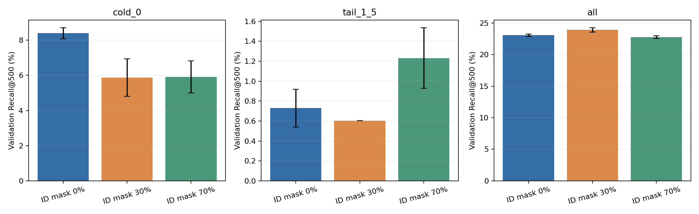
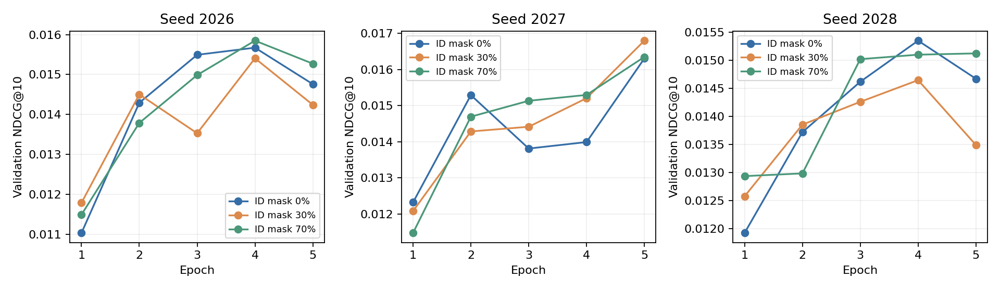

# 冷启动与长尾：候选覆盖诊断、ID 遮蔽与内容召回

ID 遮蔽选择结果：`click`。选择只依据重复使用的验证队列，是开发结果，尚无新测试确认。

## 问题与评估口径

固定 280,985 个训练用户、2,708,122 个候选广告与 10,000 名验证用户。每人只有一个目标，Recall@K 与单目标 HR@K 相同。

频次为所有用户训练前缀里的广告事件数，包含曝光、点击和未知行为；不是点击数。cold=0、tail=1–5、mid=6–50、head>50。所有搜索过滤当前已见广告，精确内积搜索整个固定目录。
原先测试分桶人数不能直接搬来使用：本报告验证分桶为 cold 659、tail 1326、mid 2966、head 5049。

## 先诊断原模型：Top-10 与 Top-500 是不同问题

| 目标分组 | 验证用户 | Recall@10 | Recall@100 | Recall@500 |
|---|---:|---:|---:|---:|
| all | 10000 | 2.9733% | 11.9467% | 23.0600% |
| cold_0 | 659 | 0.1012% | 1.4669% | 8.3966% |
| tail_1_5 | 1326 | 0.0000% | 0.0503% | 0.7290% |
| mid_6_50 | 2966 | 0.1911% | 2.2140% | 6.8555% |
| head_gt50 | 5049 | 5.7635% | 22.1562% | 40.3578% |

原模型冷启动和长尾中仍有大量目标在前 500 之外。对这些用户，重排同一批候选无法找回根本没有被召回的答案。全体进入 Top-500 的目标比例也只是候选覆盖上限，不是一个已实现排序模型的效果。

## 训练点击信号与内容特征诊断

目录中 1,931,099 个长尾广告里，82.00% 没有训练点击；验证长尾目标用户中，这一比例为 72.47%。两个分母不同，不能把“约 82%”写成所有验证用户的比例。

点击 InfoNCE 的这些广告缺少自身点击正目标；它们仍可能作为历史上下文或负例影响梯度。属性与 81 号文本向量虽然能提供表示，不代表已经学到足够的冷/尾召回能力。

完整特征覆盖、向量范数和高基数字段检查见 `frequency_audit.json`。

## 控制实验：训练时随机遮蔽广告 ID

比较 0%、30%、70% ID 遮蔽；每个 optimizer batch 为训练可见广告抽一次独立掩码，在历史、正样本和负样本间共享。只把被遮广告的 ID 查表索引改成 OOV=0，属性和文本保留；不做倒置缩放，验证时关闭遮蔽。独立随机生成器避免消耗普通 dropout、打乱和负采样的随机流。
同数据、监督位置、每目标 64 个负例、初值、模型大小、学习率、batch size 与 5 轮预算。每种遮蔽率使用三个种子；每个 checkpoint 仍按整体验证 NDCG@10 选取。

| 方案 | 全体 NDCG@10 | 全体 Recall@500 | 冷启动 Recall@500 | 长尾 Recall@500 |
|---|---:|---:|---:|---:|
| click | 0.015775 | 23.0600% | 8.3966% | 0.7290% |
| id_mask_30 | 0.015616 | 23.9067% | 5.8675% | 0.6033% |
| id_mask_70 | 0.015772 | 22.7667% | 5.9181% | 1.2318% |





### 按训练前约定的规则选择

整体 NDCG@10 至少保留对照的 95%；冷启动和长尾 Recall@500 各自都不得下降；通过后最大化两组 Recall@500 的等权均值，并要求严格改善，相同则选更小遮蔽率。没有合格改善就保留 0% 对照。

| 方案 | 合格 | 冷/尾宏平均 Recall@500 | 未通过原因 |
|---|---|---:|---|
| click | 是 | 4.5628% | 无 |
| id_mask_30 | 否 | 3.2354% | cold_recall500_decreased, tail_recall500_decreased |
| id_mask_70 | 否 | 3.5749% | cold_recall500_decreased |

### 配对不确定性

以下为相对 0% 对照的差值。用户和三个训练种子一起配对 bootstrap；仅三个种子不能代表所有初始化。候选选择按预先给定的均值与门槛执行，区间用于解释证据强弱。

| 方案 | 分组/指标 | 平均差值 | 95% 用户与种子配对区间 |
|---|---|---:|---|
| id_mask_30 | all/NDCG@10 | -0.000159 | [-0.001407, +0.001175] |
| id_mask_30 | cold_0/Recall@500 | -0.025291 | [-0.045524, -0.003035] |
| id_mask_30 | tail_1_5/Recall@500 | -0.001257 | [-0.005530, +0.002765] |
| id_mask_70 | all/NDCG@10 | -0.000003 | [-0.001171, +0.001324] |
| id_mask_70 | cold_0/Recall@500 | -0.024785 | [-0.045524, -0.002529] |
| id_mask_70 | tail_1_5/Recall@500 | +0.005028 | [-0.000754, +0.011312] |

## 内容召回与固定候选预算融合

固定候选预算是 500，验证选出的额外内容通道配额为 0。保留原 Top-10，替换较低名次候选；没有训练独立排序器，也没有据此声称 Top-10 改善。

| 内容配额 | 全体 Recall@500 | 冷启动 Recall@500 | 长尾 Recall@500 |
|---:|---:|---:|---:|
| 0 | 23.0600% | 8.3966% | 0.7290% |
| 50 | 22.2567% | 7.5873% | 0.7793% |
| 100 | 21.3767% | 6.9297% | 0.9050% |
| 250 | 18.1200% | 4.7041% | 0.9301% |

另有 learned Top-500 与 content Top-500 的未排序并集诊断，其候选数最多为 1000。该并集命中必须称为至多 1000 个候选的覆盖率，不能作为固定 500 融合的 Recall@500。详细结果见[融合报告](fusion.md)与 `fusion_metrics.json`。

原始固定配额融合没有通过门槛，保留配额 0。此时与对照的差值区间 [0,0] 是同一结果与自身相比，不代表统计确定的改进。

### 基于失败诊断的探索修正：保护已召回的稀有候选

这是查看前一版验证失败后单独登记的 follow-up，不能包装成最初预注册成功或独立确认。原失败结果保持原样。
保护 learned Top-10 和其中所有训练频次不超过 5 的候选，只从原列表尾部移除非稀有广告，再加入内容通道提供、且不在原 Top-500 的新稀有广告；始终维持 500 个候选。

验证选择的额外通道配额为 0。

| 内容配额 | 全体 Recall@500 | 冷启动 Recall@500 | 长尾 Recall@500 |
|---:|---:|---:|---:|
| 0 | 23.0600% | 8.3966% | 0.7290% |
| 50 | 21.4700% | 8.7506% | 0.8044% |
| 100 | 19.8467% | 8.8518% | 1.1061% |
| 250 | 13.1800% | 9.1553% | 1.5334% |

这条候选构造规则保持原始前十，因此当前 Top-10 没有提升；覆盖改善只表示给未来排序增加了候选空间。完整门槛、配对区间与保护不变量见[探索修正报告](fusion_protected.md)及 `fusion_protected_metrics.json`。
本次修正也未选择额外候选，继续保留原通道。

### 基于 ID 遮蔽取舍的探索：把 mask70 作为互补通道

该实验是在看到 mask70 提高长尾覆盖但降低冷启动覆盖后另行登记的验证驱动 follow-up，不属于最初预注册，也没有独立测试确认。
每个基线种子只与相同种子的 mask70 模型配对。保护基线 Top-10 及原 Top-500 中所有频次不超过 5 的候选，只用 mask70 提供的新稀有广告替换尾部非稀有广告，候选总数保持 500。

验证选择的互补候选配额为 25；该选择没有把 mask70 替换为主模型，也没有更新原索引。

| mask70 配额 | 全体 Recall@500 | 冷启动 Recall@500 | 长尾 Recall@500 |
|---:|---:|---:|---:|
| 0 | 23.0600% | 8.3966% | 0.7290% |
| 10 | 22.7867% | 8.8518% | 0.8296% |
| 25 | 22.4167% | 9.2564% | 0.9301% |
| 50 | 21.7000% | 9.5599% | 1.2569% |

候选池在验证选择规则下有所取舍，仍需结合配对区间判断不确定性。原 Top-10 按规则保持不变，当前不能声称最终推荐命中改善。

| 相对基线的选定方案 | Recall@500 差值 | 95% 用户与种子配对区间 |
|---|---:|---|
| all | -0.006433 | [-0.008300, -0.004500] |
| cold_0 | +0.008599 | [+0.003035, +0.016186] |
| tail_1_5 | +0.002011 | [+0.000503, +0.004022] |

详细来源摘要、seed 配对和保护不变量见[互补通道报告](fusion_masked.md)、`fusion_masked_metrics.json` 与登记的 `masked_fusion_plan.json`。

## 是否现在接独立排序

不把 MLP 排序作为本轮默认下一步。冷启动、长尾仍有大量答案未进入候选，排序只能处理已入选广告；先以固定预算的候选覆盖改善为主。若后续覆盖足够，再固定候选和时间协议训练轻量排序，并评估条件命中与端到端收益。
当前内容通道与 ID 遮蔽都是验证开发实验。不能把验证选出的收益当成独立测试确认，也不自动替换现有主模型、广告向量或持久化 HNSW 索引。

## 成本与可复现证据

| 方案 | 种子 | 最佳 epoch | 训练秒数 | 峰值显存 MiB |
|---|---:|---:|---:|---:|
| click | 2026 | 4 | 774.1 | 3470.1 |
| click | 2027 | 5 | 774.4 | 3469.5 |
| click | 2028 | 4 | 768.6 | 3470.2 |
| id_mask_30 | 2026 | 4 | 764.8 | 3472.7 |
| id_mask_30 | 2027 | 5 | 756.2 | 3472.7 |
| id_mask_30 | 2028 | 4 | 770.4 | 3472.7 |
| id_mask_70 | 2026 | 4 | 783.8 | 3472.7 |
| id_mask_70 | 2027 | 5 | 772.9 | 3472.7 |
| id_mask_70 | 2028 | 5 | 753.4 | 3472.7 |

训练秒数为各 epoch 训练部分之和，不含验证。参考模型来自此前运行，共享机器的负载不同，这不是严格性能基准。完整逐种子数据与曲线保存在 `metrics.json`。

- [协议配置](../../configs/cold_start.json)、[编排脚本](../../scripts/run_cold_start.py)、[ID 遮蔽模型](../../taac_retrieval/model.py)。
- [覆盖诊断](diagnostics.md)、[覆盖实现](../../taac_retrieval/coverage.py)、[频次审计](../../scripts/audit_cold_start_features.py)。
- `model_selection.json`：预定门槛、全部候选及保留对照的原因。
- `verification.json`：初值、checkpoint、队列、已见历史和逐用户指标的核对。

```bash
.project_venv/bin/python scripts/run_cold_start_pipeline.py \
  --root artifacts/cold_start_reproduction \
  --report-dir reports/cold_start_reproduction --gpus 0,2,3,4,5,6
```

该完整入口会补齐参考诊断、特征审计、内容通道与融合，再运行 ID 遮蔽实验。新实验用新 root；已完成训练的目录在相同 wrapper 命令后追加 `--stage finish` 继续诊断与报告，`--prerequisites-only` 只复核前置证据而不训练。当前研究只以验证目标评估与选参，未构造测试 Dataset；数组缓存本身仍包含完整公开序列及测试位置元数据。
