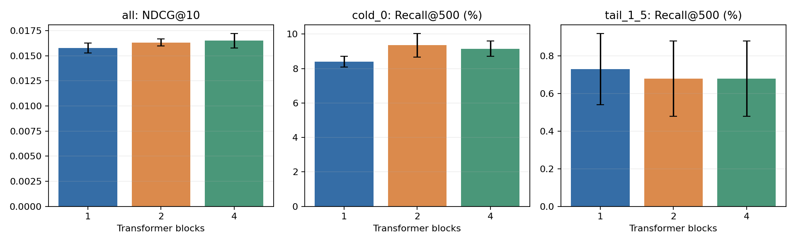
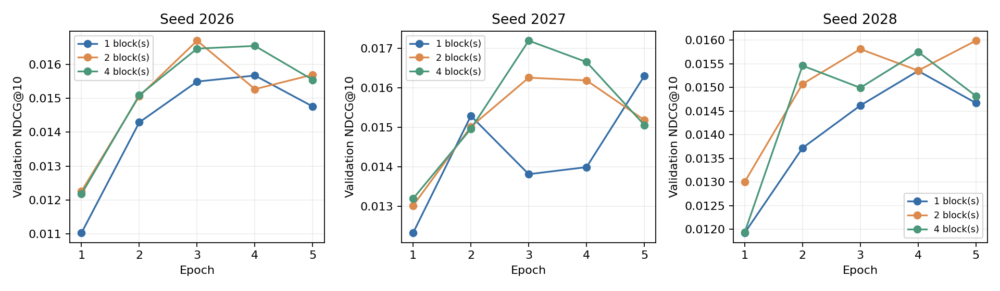

# Transformer 深度对照：1／2／4 层

依据三种子平均最佳验证 NDCG@10，选中 **4 层**；这是复用验证集的开发选择，尚无独立测试确认。

相对一层，所选 4 层的 NDCG@10 差值配对 95% 区间为 [-0.000866, +0.002225]。区间跨过 0，不能把验证均值领先表述成已确认的稳定收益。
所选深度的长尾 Recall@500 没有改善。
本机记录的训练部分耗时相对一层变化 +9.6%；这是共享机器上的描述性成本，不是严格性能结论。

## 固定了什么

同一 280,985 名训练用户、2,708,122 个候选和 10,000 名验证用户。隐藏维度 32、单头、FFN 32→32→32、点击 InfoNCE-64、batch size 128、学习率与五轮预算保持一致，只改变 Transformer 层数。
每个 checkpoint 按整体验证 NDCG@10、再按 HR@10 选 epoch，完全相同保留较早 epoch；深度方案按三个种子的均值选择，平分时优先更少层。冷启动、长尾指标报告但未被临时用作换选准则。

### 共享初值不只靠相同 seed

复用形状相同的编码器、第一层及最终归一化等参数的同一份初始权重；2 层与 4 层模型还共享第二层初值。逐参数 SHA 已核对。新增层独立初始化，没有使用已训练 checkpoint 给深模型热启动。不同层数完整参数集合不同，不要求 whole-model 初始化 SHA 相同。

数据打乱和负采样随机流保持原设置。更深模型执行更多普通 dropout，因此后续 dropout 随机流不保证逐位置相同；也不把相同 epoch 称为等 FLOPs。

## 主指标与候选覆盖：三种子均值

| 层数 | NDCG@10 | HR@10 | 全体 Recall@500 | 冷启动 Recall@500 | 长尾 Recall@500 |
|---:|---:|---:|---:|---:|---:|
| 1 | 0.015775 | 2.9733% | 23.0600% | 8.3966% | 0.7290% |
| 2 | 0.016316 | 3.1067% | 22.5367% | 9.3576% | 0.6787% |
| 4 | 0.016498 | 3.1467% | 22.9733% | 9.1553% | 0.6787% |



图中误差线是三个训练种子的样本标准差，下面表格中的区间才是用户与种子联合配对 bootstrap。



## 每个种子的最佳验证 checkpoint

| 层数 | 种子 | 最佳 epoch | 验证 NDCG@10 | 验证 HR@10 |
|---:|---:|---:|---:|---:|
| 1 | 2026 | 4 | 0.015672 | 3.0400% |
| 1 | 2027 | 5 | 0.016306 | 3.0500% |
| 1 | 2028 | 4 | 0.015348 | 2.8300% |
| 2 | 2026 | 3 | 0.016700 | 3.1900% |
| 2 | 2027 | 3 | 0.016260 | 3.0800% |
| 2 | 2028 | 5 | 0.015987 | 3.0500% |
| 4 | 2026 | 4 | 0.016544 | 3.1800% |
| 4 | 2027 | 3 | 0.017199 | 3.1300% |
| 4 | 2028 | 4 | 0.015751 | 3.1300% |

## 固定第 5 轮验证：不按最佳 epoch 取值

下面每个模型都使用第 5 轮指标，再对三个种子取均值；与上面的“各自最佳验证 checkpoint”是不同统计口径。

| 层数 | 第 5 轮平均 NDCG@10 | 第 5 轮平均 HR@10 |
|---:|---:|---:|
| 1 | 0.015244 | 2.9467% |
| 2 | 0.015623 | 3.0267% |
| 4 | 0.015141 | 2.9233% |

所选 4 层的最佳 checkpoint 均值较高，但固定第 5 轮的平均 NDCG@10 低于一层。当前优势依赖验证集选择较早的 epoch，不能概括为“网络越深越好”，也不代表训练到相同最后一轮仍有收益。

## 相对一层的配对差值

同一个种子、同一个用户成对比较；只有三个训练种子，不能由 bootstrap 推出所有初始化和所有时间段都有效。参数选择已使用本验证集，区间只用于解释开发证据。

| 方案 | 分组与指标 | 平均差值 | 95% 用户与种子配对区间 |
|---|---|---:|---|
| depth_2 | all/NDCG@10 | +0.000541 | [-0.000954, +0.002003] |
| depth_2 | all/Recall@10 | +0.001333 | [-0.001500, +0.003867] |
| depth_2 | cold_0/Recall@500 | +0.009611 | [-0.008093, +0.028832] |
| depth_2 | tail_1_5/Recall@500 | -0.000503 | [-0.005279, +0.003777] |
| depth_4 | all/NDCG@10 | +0.000723 | [-0.000866, +0.002225] |
| depth_4 | all/Recall@10 | +0.001733 | [-0.001300, +0.004600] |
| depth_4 | cold_0/Recall@500 | +0.007587 | [-0.010622, +0.027314] |
| depth_4 | tail_1_5/Recall@500 | -0.000503 | [-0.005279, +0.004525] |

## 参数与成本

| 层数 | 总参数 | Embedding 参数 | 非 Embedding 参数 | 平均五轮训练秒数 | 平均峰值显存 MiB |
|---:|---:|---:|---:|---:|---:|
| 1 | 129,569,344 | 129,537,120 | 32,224 | 772.3 | 3469.9 |
| 2 | 129,575,808 | 129,537,120 | 38,688 | 818.1 | 3469.6 |
| 4 | 129,588,736 | 129,537,120 | 51,616 | 846.3 | 3469.8 |

训练秒数为每轮训练部分之和，不含验证。参考一层模型来自此前运行，机器共享负载不同，所以这些时间是描述性成本，不是严格速度基准。加层不改变 32 维检索向量和 Embedding 表；每层新增 6,464 个参数。

## 应怎样解读

这组实验直接回答固定训练设置下，序列网络深度是否值得增加。即使深模型更好，也不能因此说冷启动与长尾已解决；需同时查看分桶和候选覆盖。即使更深没有变好，也只说明当前学习率、五轮与该初始化协议下未观察到收益，不能证明深网络普遍无用。
一层注意力已经可以读取全部可见历史；增加层数增加组合交互能力。当前对照还没有改变 FFN 扩张宽度或 hidden 维度，下一步应据结果决定是否单独比较它们。

## 证据与复现

- `metrics.json`：完整分桶 Recall@10/100/500、全部种子、配对区间及固定第 5 轮的验证结果。
- `model_selection.json`：只按验证集选择的层数、所有候选及输入 checkpoint SHA。
- `verification.json`：训练完成、初值逐参数、checkpoint、目录和逐用户指标检查。
- [配置](../../configs/depth_study.json)、[运行入口](../../scripts/run_depth_study.py)。

```bash
.project_venv/bin/python scripts/run_depth_study.py \
  --root artifacts/depth_study_reproduction \
  --report-dir reports/depth_study_reproduction --gpus 0,2,3,4,5,6
```

已有训练结果可追加 `--stage finish` 继续覆盖诊断和报告。新配置使用新目录；原始 checkpoint、主模型和 Faiss 索引没有因此被覆盖。本轮仅构造验证 Dataset；缓存虽含测试位置元数据，未用它们访问测试目标或选模型。
