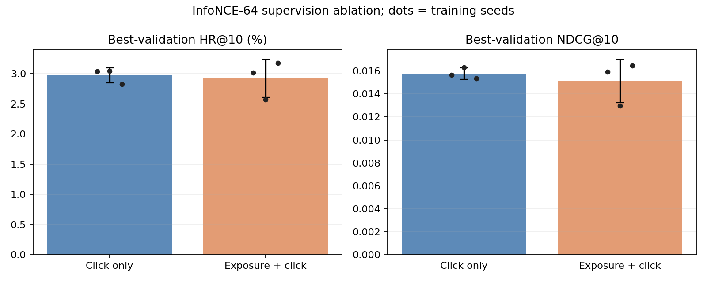
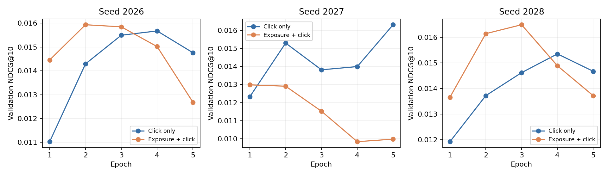

# 补充消融：全部事件 vs 仅点击，固定 InfoNCE-64

仅点击监督的三种子平均最佳验证 NDCG@10 更高。用户与种子联合配对区间跨过 0，当前三种子结果不足以确认稳定优劣。

## 实验问题与控制

在相同 InfoNCE 损失和每个监督位置 64 个负样本下，曝光事件是否应当提供下一事件正样本监督？

- `click_infonce`：只监督下一事件为点击的位置；曝光仍保留在输入历史。
- `all_infonce`：下一事件为曝光或点击均监督，每个位置等权。
- 未知行为与填充位置在两组中均不提供监督；曝光不是负样本。
- 同一缓存、固定队列、候选库、网络、学习率、初值、batch size 128、5 个 epoch、温度 1。
- 沿用 seed 2026/2027/2028 的已有点击版，新增三次全部事件版训练；共同初值 SHA 已逐个核对。
- 负样本池、分布与排除策略相同；mask 改变会改变随机数消耗，实际负例不保证逐位置相同。
- 监督位置数和负例总量不同，不是等算力或等训练时长的实验。

数据：280,985 用户，2,708,122 候选，10,000 名固定评估用户。

## 主比较：最佳验证 checkpoint

每个模型均只按验证 NDCG@10、再按 HR@10 选择 epoch；完全相同则保留较早 epoch。

| 方案 | 种子 | 最佳 epoch | 验证 HR@10 | 验证 NDCG@10 |
|---|---:|---:|---:|---:|
| 仅点击 | 2026 | 4 | 3.0400% | 0.015672 |
| 仅点击 | 2027 | 5 | 3.0500% | 0.016306 |
| 仅点击 | 2028 | 4 | 2.8300% | 0.015348 |
| 全部事件 | 2026 | 2 | 3.0200% | 0.015932 |
| 全部事件 | 2027 | 1 | 2.5700% | 0.012982 |
| 全部事件 | 2028 | 3 | 3.1800% | 0.016485 |

| 验证均值 | HR@10 | NDCG@10 |
|---|---:|---:|
| 仅点击 | 2.9733% | 0.015775 |
| 全部事件 | 2.9233% | 0.015133 |





以下差值统一定义为“全部事件 − 仅点击”；负值支持仅点击更好。区间对用户与三个训练种子联合配对 bootstrap。

| 验证差值 | 平均差值 | 95% 区间 |
|---|---:|---|
| HR@10 | -0.000500 | [-0.005100, +0.004300] |
| NDCG@10 | -0.000642 | [-0.003304, +0.001934] |

只有三个训练种子，bootstrap 不等于证明所有初始化都有效。固定第 5 轮的验证结果也保存在 `metrics.json`，便于检查最佳 epoch 选择的影响。

这组对照回答的是“固定 InfoNCE-64 时，增加曝光正目标是否有帮助”。监督范围的变化同时带来更多监督位置和负例总量，不能解读为等算力条件下的纯标签质量比较。也不能用它把旧基线到 InfoNCE 的全部收益归到某一个因素上。

## 补充测试结果

**这批用户的原测试结果此前已被查看。本次是用户提出后的补充消融，不是新的独立确认实验。**
三个新 checkpoint 全部按验证固定后才计算其测试指标；没有重新挑选原模型或修改已有索引。测试是辅助证据，主比较仍是上面的验证结果。

| 方案 | 种子 | 测试 HR@10 | 测试 NDCG@10 |
|---|---:|---:|---:|
| 仅点击 | 2026 | 2.8400% | 0.014665 |
| 仅点击 | 2027 | 2.9800% | 0.014908 |
| 仅点击 | 2028 | 3.1000% | 0.016602 |
| 仅点击均值 | — | 2.9733% | 0.015391 |
| 全部事件 | 2026 | 2.9300% | 0.016274 |
| 全部事件 | 2027 | 2.8300% | 0.013960 |
| 全部事件 | 2028 | 3.1700% | 0.016875 |
| 全部事件均值 | — | 2.9767% | 0.015703 |

| 测试差值：全部事件 − 仅点击 | 平均差值 | 95% 用户与种子配对区间 |
|---|---:|---|
| HR@10 | +0.000033 | [-0.003167, +0.003234] |
| NDCG@10 | +0.000312 | [-0.001782, +0.002384] |

验证与测试的平均 NDCG 差值方向不同，应结合配对区间与种子分布判断，不能仅挑更有利的一张表。原模型选择继续保留，不依据本次已查看测试队列的微小差异更换主模型。

## 监督预算与实测成本

| 方案 | 每轮监督位置 | 平均 5 轮训练秒数 | 平均训练过程峰值显存 MiB |
|---|---:|---:|---:|
| 仅点击 | 2,050,483 | 772.3 | 3469.9 |
| 全部事件 | 19,199,815 | 1163.8 | 4646.3 |

训练秒数为各 epoch 的训练部分之和；参考组是此前运行，实验组是本次运行，机器共享负载不同，因此时间是实测描述，不是严格性能基准。显存为 Torch 记录的 allocated 峰值，不等于 nvidia-smi 的 reserved/进程总量。

## 目标广告频次分组：测试 HR@10

| 分组 | 用户数 | 仅点击 | 全部事件 |
|---|---:|---:|---:|
| cold_0 | 785 | 0.0425% | 0.0849% |
| tail_1_5 | 1413 | 0.0000% | 0.0000% |
| mid_6_50 | 2984 | 0.1787% | 0.1005% |
| head_gt50 | 4818 | 6.0537% | 6.1021% |

## 证据与复现

- [配置](../../configs/infonce_supervision.json)、[编排入口](../../scripts/run_infonce_supervision.py)。
- [监督策略与损失](../../taac_retrieval/objectives.py)、[训练分支](../../taac_retrieval/train.py)。
- `metrics.json`：逐种子验证/测试、固定第 5 轮、配对区间、分桶与预算。
- `plan.json`：训练前固定的协议、参考产物 SHA 和源码 SHA；原件及源码快照在实验目录中。
- `verification.json`：配对检查与文件身份核对。

```bash
.project_venv/bin/python scripts/run_infonce_supervision.py \
  --root artifacts/infonce_supervision_reproduction \
  --report-dir reports/infonce_supervision_reproduction --gpus 0,2,4
```

完成训练的目录可用 `--stage finish` 继续评估和报告。已有点击版作为固定参考复用，原实验报告、模型选择和 Faiss 索引不会被覆盖。
