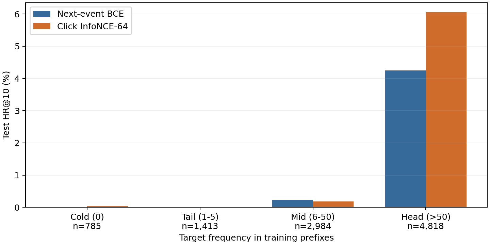
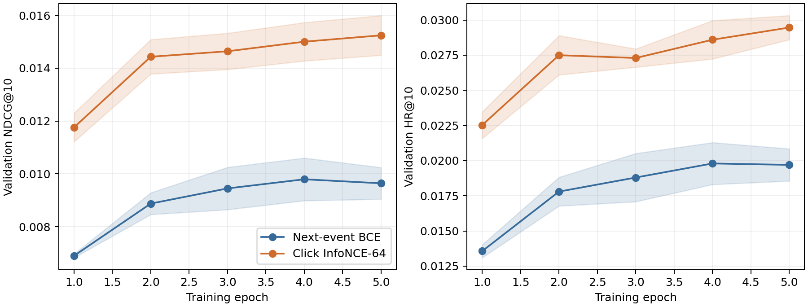
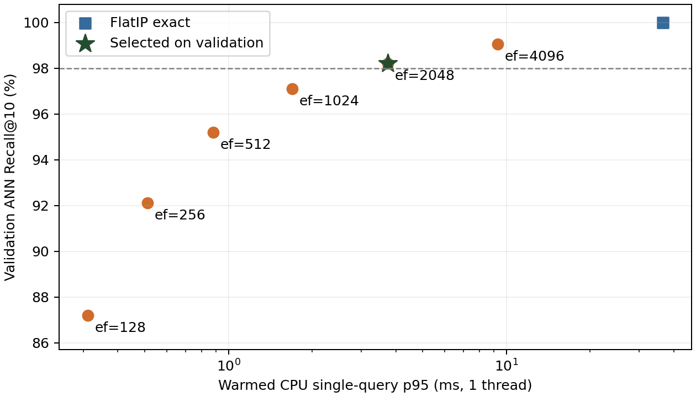

# 第 4–7 天：完整项目结果

扩大实验：280,985 名有效用户、2,708,122 个固定候选广告；
验证、测试各 10,000 名用户，排除之前查看过测试结果的用户；种子 [2026, 2027, 2028]。

## 第四天：训练目标消融（只看验证集）

| 配置 | 验证 NDCG@10（两种子均值） | 验证 HR@10 |
|---|---:|---:|
| click_infonce64 | 0.011616 | 2.1750% |
| click_infonce64_actions | 0.009726 | 2.2250% |
| baseline | 0.008415 | 1.6750% |
| weighted_bce | 0.008266 | 1.8000% |
| click_bce64 | 0.005126 | 0.9500% |
| click_bce | 0.004434 | 0.9250% |

依据预先约定的平均验证 NDCG@10 选择 `click_infonce64`。
点击 BCE-64 是负样本数量对照；它与 InfoNCE-64 使用相同点击监督、负样本数和采样策略。
所有配置保留；开发阶段没有评估新模型的测试集。选择记录见 `model_selection.json`。

## 第五天：扩大规模、三个种子复核

| 模型 | 测试 HR@10 | 测试 NDCG@10 |
|---|---:|---:|
| 热门广告 | 0.7600% | 0.004230 |
| 原目标 BCE 基线 | 2.1133% | 0.010528 |
| 验证选定方案 | 2.9733% | 0.015391 |

| 种子 | 模型 | 最优 epoch | 测试 HR@10 | 测试 NDCG@10 |
|---|---|---:|---:|---:|
| 2026 | baseline | 3 | 1.9000% | 0.009279 |
| 2027 | baseline | 5 | 2.1700% | 0.011120 |
| 2028 | baseline | 4 | 2.2700% | 0.011185 |
| 2026 | selected | 4 | 2.8400% | 0.014665 |
| 2027 | selected | 5 | 2.9800% | 0.014908 |
| 2028 | selected | 4 | 3.1000% | 0.016602 |

两个模型在同一种子下共享初始化、用户、词表、候选、网络和学习率，均训练 5 轮；
点击监督位置数和负样本数不同，所以这不是等 FLOPs 对照。epoch 只由验证集选择。

- HR@10：绝对差 +0.008600，相对差 +40.69%；种子+用户配对 bootstrap 95% 区间 [+0.005566, +0.011667]。本次复核观察到一致的正向差异。
- NDCG@10：绝对差 +0.004863，相对差 +46.19%；种子+用户配对 bootstrap 95% 区间 [+0.002961, +0.006804]。本次复核观察到一致的正向差异。

三个种子仍然有限；区间与结论只针对本次训练和本地评估协议，不代表线上 A/B 或官方成绩。

### 分桶及失败案例

| 目标训练频次 | 用户数 | 基线 HR@10 | 选定方案 HR@10 |
|---|---:|---:|---:|
| cold_0 | 785 | 0.0000% | 0.0425% |
| tail_1_5 | 1,413 | 0.0000% | 0.0000% |
| mid_6_50 | 2,984 | 0.2234% | 0.1787% |
| head_gt50 | 4,818 | 4.2480% | 6.0537% |

本次总体收益主要来自高频目标；1–5 次训练频次桶仍未命中，中频桶也没有同步改善。冷启动桶仅有极少命中，不能据此声称解决了冷启动或长尾问题。

失败分析还覆盖历史长短和内容是否缺失，见 `metrics.json`。`failure_cases.json` 按固定顺序各取最多 5 个改善、退化、冷启动未命中和共同未命中样例。
匿名数据只有 ID 和向量；这些样例支持频次/覆盖率分析，不支持凭空解释广告主题或用户偏好。

## 第六天：Faiss 精度—延迟—索引体积

同一 seed=2026 选定模型、同一候选向量、同一历史过滤；原始内积，没有改成余弦。
原始内积 HNSW 未达到验证召回门槛，失败配置与结果保留在 `ann_initial_failure.json`。
后续仅根据验证查询改用等价的 MIPS→L2 升维构图：广告变成 `(v, sqrt(R²-||v||²))`，查询变成 `(q, 0)`；
`R²` 为广告最大平方范数，距离满足 `D²=||q||²+R²-2q·v`，因此精确排序仍是原始内积。
返回的距离转换回内积分数。它与直接归一化成余弦不同；相关单元测试、独立打分和原 Torch 精确结果交叉检查均保留。
索引参数仅根据验证查询的 ANNRecall@10 门槛和 p95 延迟选取，然后固定到测试查询。

| 验证 efSearch | ANN Recall@10 | 单查询 p95 (ms) |
|---:|---:|---:|
| 128 | 87.2070% | 0.3113 |
| 256 | 92.1094% | 0.5108 |
| 512 | 95.1953% | 0.8802 |
| 1024 | 97.0898% | 1.6954 |
| 2048 | 98.2031% | 3.7401 |
| 4096 | 99.0430% | 9.2948 |

固定 efSearch=2048 后，在 512 个测试查询上：

- ANN Recall@10：98.8086%（相对精确检索的 ID 重合率）。
- 单线程 warmed p95：FlatIP 40.1965 ms，HNSW 4.1443 ms，约 9.70 倍。
- 8 线程批量吞吐：FlatIP 188.8 QPS，HNSW 2521.2 QPS。
- 持久化索引体积：FlatIP 330.6 MiB，HNSW 1043.8 MiB。

计时包含 CPU 检索和 Python 历史过滤，不含编码器、网络、进程启动与模型/索引加载。
单查询使用 1 个 CPU 线程并预热；批量吞吐是另一个 8 线程负载。持久化体积不是峰值 RSS。机器是共享工作站，不代表生产 SLA。
ANN Recall 与真实点击 HR 是两个指标；测试查询子集的点击指标也保存在原始 benchmark JSON 中，不与全体 10,000 用户的模型指标混用。

## 第七天：复现和面试材料

- [项目说明与运行命令](../../WEEK_PROJECT.md)
- [面试讲稿与简历写法](INTERVIEW.md)
- `metrics.json`：所有种子、配对差值、分桶指标。
- `failure_cases.json`：公开匿名 ID 的成功/失败案例。
- `environment.json`、`code_manifest.json`：实际环境、源文件摘要。

### 范围与限制

- 本地逐用户首次出现广告点击留出，排除重复广告点击，不等价于官方私有测试标签。
- 用户/广告静态特征来自公开快照，不保证跨用户的全局时间隔离。
- 仅使用预提取的 81 号文本向量；未实现文图融合或语义 ID 自回归生成。
- 冷启动是否有效以分桶为准；内容存在不等于冷启动问题已解决。
- 不声称参与比赛获奖、线上 CTR/CVR 提升、生产流量验证。
